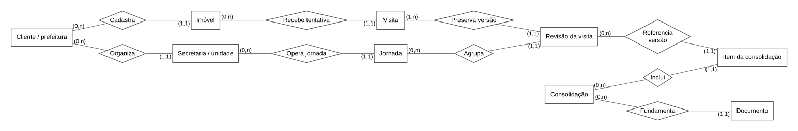

# Esboço do modelo entidade-relacionamento — Denguinhos

**Data:** 27/10/2026. **Nível:** esboço entidade-relacionamento em notação de Chen (mínimo–máximo), derivado do [documento de requisitos v2.2](../../../documento_de_requisitos.md). Não é migração, schema Prisma ou implementação do banco. Os requisitos continuam centralizados no documento principal; este diretório apenas propõe sua tradução em entidades, atributos e relacionamentos.

A proposta assume PostgreSQL/PostGIS para dados operacionais e geometrias, com arquivos/modelos em object storage referenciados por chave. Essa escolha orienta os tipos indicados, mas nomes físicos, índices e detalhes de implantação ainda serão refinados. Não houve acesso a banco externo ou alteração de dados.

**Modelo unificado:** [todas as entidades, atributos e relacionamentos](../modelo_completo.puml) · [SVG completo](../modelo_completo.svg) · [Visualizador com busca e zoom](../modelo_completo.html). Estes arquivos por domínio continuam como recortes de consulta do esboço.

## Cliente, prefeitura, secretaria e município

- **Cliente (`cliente_id`)**: fronteira de isolamento e provisionamento do sistema. No escopo atual, o cliente é a prefeitura.
- **Prefeitura (`prefeitura`)**: perfil institucional do cliente, relacionado ao município geográfico. Não é uma secretaria.
- **Unidade organizacional (`unidade_organizacional`)**: secretaria de Saúde, Educação, Assistência Social, departamento ou setor, pertencente à prefeitura. Hierarquia e vigência são explícitas.
- **Município (`municipio_id`)**: referência geográfica/código IBGE; não identifica credencial, contrato ou tenant.

Exemplo: prefeitura A possui Saúde e Educação; prefeitura B possui sua própria Saúde. As três unidades têm IDs distintos. Participar de A não autoriza consultar B, e estar em Educação de A não autoriza consultar Saúde de A. Cadastro geográfico igual não junta clientes. Compartilhamento entre unidades de A exige finalidade, recursos/campos, aprovador e vigência; não permite compartilhar automaticamente com B.

[Ver organização multiclientes em SVG](07_clientes_organizacao.svg) · [Editar fonte Chen](07_clientes_organizacao.puml)

## Visão reduzida para começar



[Ampliar SVG](00_visao_resumida.svg) · [Editar fonte PlantUML Chen](00_visao_resumida.puml)

O desenho reduzido apresenta as entidades e seus relacionamentos. Os sete diagramas de domínio abaixo detalham os domínios; os atributos técnicos estão no [dicionário de entidades](dicionario_entidades.md). Use o domínio 02 como ponto de partida para o fluxo do ACE.

## Diagramas editáveis por domínio

Cada `.puml` contém um único diagrama Chen (`@startchen`/`@endchen`), independente dos demais para prévia. Cada SVG é uma exportação dos relacionamentos da respectiva fonte. As entidades com `[ref]` são referências à mesma tabela de outro domínio, não tabelas duplicadas. Abrir um arquivo por vez evita enviar todo o modelo em uma única URL ao renderizador.

| Arquivo | Leitura principal | Requisitos relacionados |
| :--- | :--- | :--- |
| [01 — Acesso e território](01_acesso_territorio.puml) · [SVG](01_acesso_territorio.svg) | Cliente, município geográfico, usuários, papéis/permissões, unidade de escopo e cadastro territorial | RNF-002/008/019; RF-002/018/031 |
| [02 — Planejamento e visitas](02_planejamento_visitas.puml) · [SVG](02_planejamento_visitas.svg) | Ciclo, modalidade, planejamento, sequência do percurso, jornada, tentativa, revisão, recuperação e recepção técnica | RF-012/013/018..022/024; RNF-004/016 |
| [03 — Depósitos, tratamento e laboratório](03_depositos_tratamento_laboratorio.puml) · [SVG](03_depositos_tratamento_laboratorio.svg) | Categorias, observações, controle mecânico, alvos, produto/carga/aplicação, amostra, tubito e resultado por espécie/fase | RF-021/023/024/030 |
| [04 — Gestão e documentos](04_gestao_documentos_ocorrencias.puml) · [SVG](04_gestao_documentos_ocorrencias.svg) | Consolidação, composição dos totais, conferência, documento/envio, decisão, tarefas, ocorrências, tratativas e anexos | RF-017/025..029/034/036..040 |
| [05 — Integração e ML](05_integracao_pessoas_ml.puml) · [SVG](05_integracao_pessoas_ml.svg) | Fonte/lote, códigos externos, pessoa/moradia, registros de saúde, datasets, modelos, execução, previsão e simulação | RF-001/003..007/010/011/015/016/032; RNF-006 |
| [06 — Entregas e comunicação](06_predicoes_comunicacao.puml) · [SVG](06_predicoes_comunicacao.svg) | Política de visibilidade, agenda, horários/destinatários, entrega e comunicação de orientação | RF-033; RNF-008/019 |
| [07 — Clientes e organização](07_clientes_organizacao.puml) · [SVG](07_clientes_organizacao.svg) | Prefeitura, unidades, lotações, módulos e compartilhamento autorizado | RF-041; RNF-002/008/019 |

**Notação da imagem:** retângulo = entidade; losango com verbo = relacionamento; `(0,1)`, `(1,1)`, `(0,n)` ou `(1,n)` = limites de participação da entidade naquela associação. As linhas não possuem setas nem pé de galinha. `N` nas fontes Chen e `n` nos SVGs significam muitos. `[ref]` marca a mesma entidade de outro domínio.

**Como ler:** `Imóvel — (0,n) — Recebe tentativa — (1,1) — Visita` significa que um imóvel pode participar de nenhuma ou muitas visitas e que cada visita se refere a exatamente um imóvel. A posição do min–máx exprime a participação da entidade junto àquela linha, por isso a tradução da notação anterior não consiste apenas em trocar o símbolo pelo texto no mesmo extremo.

**Atributos:** PK, FK, tipos e propostas de colunas foram preservados no [dicionário de entidades](dicionario_entidades.md). Entidades associativas do esboço anterior foram mantidas para conservar a correspondência com o banco proposto; a mudança é de notação, não de escopo. Nos autorrelacionamentos, o primeiro papel é origem e o segundo é destino, explicitados nos comentários da fonte.

## Decisões centrais de modelagem

1. **Usuário não é papel.** A pessoa autentica em `usuario`, participa de um cliente por `vinculo_usuario`, atua em unidades por `lotacao` e recebe papéis/escopos em `concessao_papel`. Papel pertence ao cliente; permissão e módulo podem ser catálogos globais. Não criar tabelas duplicadas de usuários ACE, gestores e digitadores. Escopo de dados combina cliente, unidade, território, módulo, finalidade e vigência. Hierarquia ou lotação não concedem acesso automaticamente.
2. **Território não é uma árvore única de bairros.** `territorio` e `territorio_versao` identificam áreas com códigos/geometrias históricos. `vinculo_territorial` suporta sobreposição e composição conforme seu tipo. Bairro e distrito podem se cruzar; relações de composição precisam validar ciclos e coerência territorial, sem impedir sobreposição legítima. Lado/quarteirão/localidade dependem do cadastro real.
3. **Imóvel conserva identidade.** `imovel.id` permanece estável; `imovel_versao` preserva endereço, tipo, situação e vigência. Correspondências territoriais referenciam versões. Endereço ou sequência do percurso não são chave; imóveis sem número e várias unidades no mesmo endereço são válidos.
4. **Visita é tentativa; revisão é correção.** `visita` identifica o evento e eventual retorno à tentativa anterior. `visita_revisao` congela conteúdo e contexto histórico. Retorno cria outro `visita.id`; corrigir registro cria nova revisão; reenviar usa o mesmo evento e a mesma operação idempotente. Imóvel fechado não gera automaticamente uma inspeção ou imóvel vago.
5. **Jornada não é relatório.** `jornada` agrupa o trabalho do ACE; `consolidacao` fixa escopo e corte de uma versão diária, semanal, mensal ou por ciclo. `item_consolidacao` aponta exatamente uma revisão de cada visita elegível. Não somar resumos diários como se fossem novas visitas semanais.
6. **Recipiente, ação, produto e amostra são coisas distintas.** `observacao_deposito` descreve recipiente individual ou grupo homogêneo. `acao_controle` e `alvo_controle` registram eliminação/tratamento; `aplicacao_produto` registra consumo e sua unidade. `carga_produto` pode atender várias visitas. Amostra tem movimentos e resultados próprios, sem positividade automática pela observação visual.
7. **Famílias não são copiadas para a visita.** `pessoa`, `pessoa_fonte` e `vinculo_residencia` preservam origem, atualização, vigência e correspondência. Imóvel pode existir sem morador vinculado; pessoa pode ter vínculos históricos ou ambíguos. A integração APS permanece mock enquanto acesso e contrato reais não forem validados.
8. **Dados operacionais e analíticos têm finalidades diferentes.** Identificação pode existir na operação autorizada conforme RNF-006. `dataset_versao` referencia conjunto transformado/agregado e sua linhagem de lotes; modelos não recebem nomes/endereço individual como features por padrão. O modelo do banco não concede acesso irrestrito a prontuários.
9. **Previsão não é notificação.** Execução do modelo publica previsões; a agenda escolhe quando disponibilizá-las, sem obrigar novo treino a cada horário. `entrega_predicao` congela a referência entregue; `comunicacao_equipe` pode enviar somente orientação. Disponibilização, leitura, comunicação e execução da tarefa são eventos distintos.
10. **Ocorrência pública não exige imóvel.** `ocorrencia` tem referência territorial própria e pode se vincular à visita. Não é automaticamente depósito A1..E ou PE. Encaminhamento e resposta são rastreados sem presumir API externa disponível.

## Convenções e restrições para o refinamento físico

| Tema | Proposta de integridade |
| :--- | :--- |
| Tenant e unidades | Toda tabela operacional carrega `cliente_id NOT NULL`, inclusive vínculos e tabelas de itens; dados setoriais têm unidade responsável consistente com o agregado. FK composta `(cliente_id, imovel_id)` referencia `(cliente_id, id)`; FKs de unidade/ator/origem também garantem mesmo cliente. RLS aplica tenant + unidade/permissão e compartilhamento autorizado; não substitui integridade relacional. `usuario`, `municipio`, `permissao` e `modulo` são catálogos globais; `cliente` é a raiz; `prefeitura` usa sua PK. Papéis e pessoas pertencem ao cliente. |
| Compartilhamento interno | Unidades da mesma prefeitura são separadas por finalidade e autorização. Cadastro do cliente pode ser compartilhado, sem liberar visitas/prontuários associados. `compartilhamento_autorizado` especifica origem/destino do mesmo cliente, registros/campos, finalidade, aprovação e vigência; revogação bloqueia novos acessos. Administração técnica não equivale a permissão clínica. |
| Configuração e módulos | `cliente_modulo` habilita capacidade no tenant; `unidade_modulo` habilita na secretaria/setor sob essa concessão. `configuracao_versao` define escopo cliente ou unidade, sem nulos ambíguos: aplicar índices únicos separados para configuração global do cliente e de cada unidade. Unidade pai precisa pertencer ao mesmo cliente e não pode criar ciclo. |
| Identidade offline | UUID gerado no dispositivo para visita e operação; `UNIQUE(cliente_id, operation_uuid)` evita duplicar recepção. `device_id`, base da versão e resultado precisam ser preservados. Não fazer UNIQUE por imóvel/data, pois duas tentativas no mesmo dia podem ser legítimas. |
| Temporalidade | Guardar horário técnico em `timestamptz`, data da atividade local separada, fuso configurado do cliente/unidade e vigência. A revisão deve referenciar contexto compatível com a data. Validação entre jornada, autor, atribuição e território pode exigir transação/serviço ou trigger, não um CHECK que consulte outras tabelas. |
| Versões | UNIQUE por entidade/versão em imóvel, território, visita e catálogo. Revisão usada em documento aprovado não é atualizada nem excluída; nova correção cria versão e retificação. Referências antigas continuam resolúveis. |
| Composição de relatório | `item_consolidacao`: PK `(consolidacao_id, visita_id)` e FK que confirma que `visita_revisao_id` pertence àquela visita/tenant. Isso impede usar duas revisões da mesma tentativa no mesmo snapshot. Snapshot aprovado não aceita novos itens; chegada tardia exige nova versão. |
| Resultado laboratorial no relatório | Além das revisões de visita, congelar IDs/versões dos resultados laboratoriais e catálogos utilizados, no manifesto do snapshot ou em tabelas de itens próprias. A figura é preliminar e não torna consulta ao “último resultado” suficiente para reproduzir PDF antigo. |
| Contagens | Inteiros não negativos; distinguir zero, ausente e não aplicável. Não impor igualdade entre encontrados, inspecionados, positivos, tratados e eliminados sem confirmar método/universo. No modo individual, contagens respeitam o alvo; no modo agrupado, a granularidade necessária ao indicador deve ser homologada. |
| Produtos e cargas | Decimais com unidade explícita, quantidade não negativa, produto compatível entre aplicação e carga. Não somar preparo de carga em cada aplicação. Conversão/rateio exige regra versionada; não deduzir dose a partir do DER. Estoque completo não está modelado como se já fosse um fluxo aprovado. |
| Auto-relacionamentos | Retorno não aponta à própria visita nem forma ciclo; resolução de pendência deve ser evento elegível no mesmo imóvel/escopo. Resultado substituído e anexo original também não podem formar ciclos ou mudar de tenant. |
| Origens opcionais | Em `mapeamento_externo`, exatamente um alvo: imóvel ou território. Em `anexo`, exatamente uma origem principal: revisão de visita ou ocorrência. Vínculos específicos com ação/amostra exigem associação tipada na etapa física, sem `entidade_tipo + entidade_id` livre e sem FK. |
| Entrega agendada | UNIQUE por horário, ocorrência em UTC e destinatário. Entrega pode registrar ausência de previsão, mas status de entrega com resultado exige referência válida. Conferir permissões atuais mesmo quando houver política histórica ligada ao registro. |
| Exclusão | Sem cascata que apague evidência/produção/documento aprovado. Desativação/anulação tem autoria e motivo; eliminação por retenção deve respeitar obrigações e política definidas, sem “guardar tudo para sempre” por padrão. |
| Auditoria | Prever `evento_auditoria` com cliente, unidade, ator, ação, data, request/operation ID e referência estável. Alterações sensíveis exigem diferença e motivo com acesso restrito; logs de infraestrutura não recebem cópia irrestrita do payload nominativo. Tabela transversal não detalhada nos recortes. |
| Índices | B-tree por tenant/data/status/responsável e chaves externas mais consultadas; índices espaciais para geometrias quando usados. Particionamento e materialização dependem do volume real e plano de consultas, não de adição automática neste esboço. |

## Pontos deliberadamente abertos

- Códigos nacionais/municipais, modalidade, catálogo de produtos, unidades, fases/espécies e formulários precisam ser homologados; valores de exemplo não são enums definitivos.
- PE, agenda de inspeção/tratamento e campanha amostral utilizam modalidade/planejamento; se o protocolo exigir cadastro PE próprio, sorteio auditável, remessa laboratorial ou plano amostral detalhado, especializar essas entidades antes da migração. O booleano `selecionado_amostra` não reproduz sozinho metodologia LIRAa/LIA.
- Autoria, digitador, conferência de uma revisão e assinatura do documento precisam de atores e trilhas explícitos no schema físico. O evento de conferência ligado à consolidação representa a entrega/conferência da produção, não autenticação de identidade ou folha de ponto.
- O relacionamento amostra–recipiente foi deixado N:N para não inventar equivalência entre tubito e amostra. Confirmar se o protocolo deve restringi-lo; nenhum formulário deve solicitar essa associação adicional sem necessidade.
- Sintomas/contexto da visita, setores destinatários, dispositivo, regras de cálculo, modelos de relatório, vínculos de tarefa a imóveis, jobs/outbox e dispositivos e regras especializadas exigem refinamento físico; configuração versionada e organização multiclientes já estão esboçadas no domínio 07. O campo `tipo` ou JSON de contexto não transforma todo o produto em formulário genérico.
- Pessoas e registros de saúde importados precisam de correspondência autorizada e resolução de ambiguidade. Não assumir que schema ou chave do SINAN, APS ou SisPNCD é conhecido; `mapeamento_externo` não implica inserção automática em banco de terceiros.
- `recursos`, `qualidade`, `metricas`, `filtros` e manifestos são candidatos a JSONB com esquema versionado. Identidade, relações, quantidades operacionais e permissões continuam tipadas e relacionais.
- Cenários/simulações e datasets são referências a versões concretas. Se uma simulação usar mais de uma execução/snapshot, substituir a referência única por associação N:N, preservando os itens exatos.

## Ordem sugerida de construção

1. Cliente/perfil prefeitura, unidades, módulos, participação/lotação/papéis e cadastros geográficos/territoriais, mantendo identidades separadas.
2. Planejamento, jornada, visita/revisões, depósitos/intervenções e idempotência.
3. Consolidação/conferência, documentos e encaminhamento; isso já permite o ganho administrativo após o dia, inclusive com origem em papel.
4. Laboratório, fotos, ocorrências e tarefas conforme modalidade habilitada.
5. Conectores, moradores APS, dados analíticos, modelos, agendas e visibilidade das predições conforme acesso e validação.

O desenho é um esboço, não cobertura física final de todos os campos. A ordem respeita os requisitos e permite revisar o núcleo antes de produzir migrations.

## Exportação e verificação

As fontes usam a [sintaxe oficial de Chen do PlantUML](https://plantuml.com/er-diagram). Os SVGs foram exportados localmente com Graphviz/Viz a partir das entidades, losangos e participações declaradas nos `.puml`. A geometria pode diferir da prévia nativa PlantUML; entidades e cardinalidades são as mesmas.

O exportador `renderizar_svg.mjs` usa `@viz-js/viz`, resolvido como pacote disponível ou pelo caminho informado no primeiro argumento. Exemplo de execução com o renderizador em pasta temporária:

```bash
node docs/arquitetura/banco/renderizar_svg.mjs /private/tmp/denguinhos-der-render/node_modules/@viz-js/viz/dist/viz.js
```

Foram verificadas oito fontes, os dois extremos de cada relacionamento, a preservação das cardinalidades e a estrutura dos oito SVGs. A renderização nativa PlantUML continua dependente de Java Runtime; os SVGs já podem ser abertos diretamente no navegador.


## Contexto obrigatório em todos os caminhos de dados

Cache: cliente/unidade/escopo de acesso/filtros/versão; job: cliente/unidade/ator/contrato e credencial própria; storage: prefixos isolados e autorização também no download; sincronização: fila e banco local segregados por cliente/unidade/vínculo, sem limpar dados pendentes ao trocar de contexto. Não confiar em `cliente_id` ou `unidade_id` enviado livremente pelo navegador.

Relatórios e datasets devem registrar cliente, unidade, origem e políticas usadas. Integração com outra secretaria da mesma prefeitura exige acesso autorizado; com outra prefeitura é uma integração externa específica, e não uma consulta com RLS desabilitado. Operações privilegiadas da plataforma têm trilha própria e não expõem automaticamente conteúdo dos clientes.

**Passagem para schema físico:** revisar todos os índices/UNIQUE antes baseados apenas no município, criar chaves por cliente e escopo apropriado, classificar cadastros compartilhados versus dados de unidade e definir políticas transacionais de acesso. Este repositório ainda não contém schema operacional ou migrations para executar essa mudança; os desenhos são alvo de implementação.
