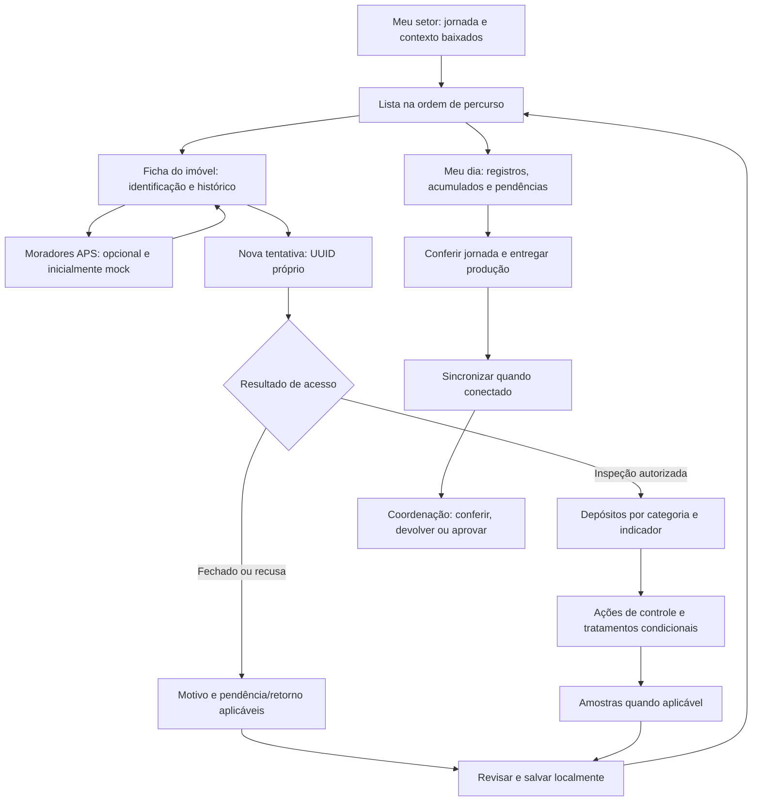
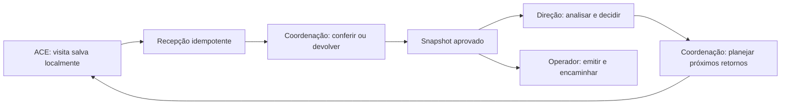

# Documento de Requisitos de Software — Plataforma Denguinhos

**Versão:** 2.2 — múltiplas prefeituras, unidades organizacionais e isolamento de dados

**Data:** 27 de outubro de 2026

**Estado:** backlog funcional consolidado; capacidades planejadas com ativação por fase e validações municipais explícitas, sem declaração de implementação ou homologação.

**Fontes:** [transcrição de Moura](transcricoes/transcricaoMoura.txt), requisitos anteriores e esclarecimentos do solicitante sobre consolidação, impressão, assinatura, sistema territorial atual e consulta de moradores da Atenção Básica (26/10/2026).

**Decisão multiclientes (27/10/2026):** tenant = cliente/prefeitura; secretarias são unidades organizacionais; município é referência geográfica. RNF-002 e RF-041 definem isolamento e administração. Os diagramas e o dicionário do banco seguem essa separação.

**Fonte única:** requisitos, campos, fluxos, entidades, regras, evidências, demonstrativos, critérios de aceite e backlog estão centralizados neste arquivo. Os arquivos anteriores de análise/especificação são apenas redirecionamentos. Fotos, entrevistas e publicações externas são fontes de evidência, não definições concorrentes de requisitos.

## Legenda e critérios

- ✅ **Implementado**: fluxo identificado no código. Não significa homologação integral em produção.
- 🏗 **Parcial**: há código ou protótipo, mas faltam integrações, comportamento ou abrangência para atender ao requisito completo. Não indica trabalho em andamento.
- ⏳ **Futuro**: comportamento ainda não entregue; depende de implementação e validação pelos critérios descritos neste documento.
- 🔎 **A verificar**: descrição ampla ou evidência insuficiente para atestar o atendimento completo.

Os IDs existentes foram preservados. Requisitos novos usam IDs posteriores aos já cadastrados. A existência de entidades, tabelas ou casos de uso isolados não equivale à entrega da funcionalidade.

**Como atualizar:** alterar somente o campo `Status` na definição do requisito, registrar sua evidência/lacuna e executar `npm run progress`. O script usa este arquivo, conta uma única definição por RF/RNF e ignora referências em tabelas, legendas e exemplos de código. Status são avaliados por revisão de código; o script apenas calcula os totais, sem inferir atendimento ou homologação automaticamente.

**Cálculo:** Implementados ÷ total de RF e RNF × 100, arredondado. Parcial não recebe crédito percentual; requisitos condicionais continuam no denominador. Cenários T-xx e campos C-xx não são requisitos adicionais. A barra representa a entrega dos requisitos completos conforme seu escopo, não a quantidade de telas prontas, esforço investido, cobertura de testes ou percentual de homologação.

**Revisão inicial:** 26/10/2026, leitura estática dos componentes, rotas e dados presentes no repositório. Protótipos usam dados demonstrativos; não foram identificados API de negócio, banco operacional, aplicativo offline ou motor ML. A classificação não substitui testes funcionais, medição de desempenho ou validação municipal. Nenhum requisito recebeu Implementado apenas por existir uma tela relacionada.

<!-- requirements-progress:start -->

**Progresso de implementação:** 0% (0 de 64 requisitos com status Implementado).

| Status | Quantidade |
| :--- | ---: |
| ✅ Implementado | 0 |
| 🏗 Parcial | 11 |
| ⏳ Futuro | 50 |
| 🔎 A verificar | 3 |
| **Total** | **64** |
<!-- requirements-progress:end -->

## Como consultar este documento

Os requisitos estão organizados pelo papel responsável pela tarefa e agrupados por funcionalidade. Cada RF/RNF possui uma única definição; quando atende a mais de um papel, os demais módulos fazem referência ao mesmo ID. A numeração dos IDs foi preservada e não determina ordem de implementação. Papéis delimitam acesso; módulos compartilhados concentram dados e regras comuns, sem duplicar cadastros ou serviços por perfil.

| Seção | Papel / módulo | Conteúdo principal |
| :--- | :--- | :--- |
| 2 | Todos os papéis | Responsabilidades, limites e acesso por tarefa. |
| 3 | ACE | Setor, imóvel, moradores, visita, retorno, PE e offline. |
| 4 | Coordenação/supervisão | Cadastro territorial, planejamento, produção e aprovação. |
| 5 | Digitador/operador | Papel, relatórios, impressão e encaminhamento. |
| 6 | Laboratório e equipe de levantamento | Plano amostral, amostras e resultados. |
| 7 | Direção/gestor | Mapa, recomendações, diagnóstico e simulação. |
| 8 | Epidemiologista | Modelos, séries, nowcasting, calibração e exportação. |
| 9 | Integrações / APS e destinos | Importação, fontes, vinculação, política de compartilhamento e tratativas intersetoriais. |
| 10 | Administração / plataforma | Papéis, configuração, auditoria e continuidade. |
| 11–15 | Compartilhado | Dados, fluxos, prioridades, evidências, validação e índice de requisitos. |

## 1. Visão geral do sistema

A **Plataforma Denguinhos** é uma solução Software as a Service (SaaS) voltada à gestão preditiva de surtos de arboviroses (dengue, zika e chikungunya). O sistema combina dados de notificação histórica/em tempo real, variáveis climáticas, dados da Atenção Primária em Saúde (APS) e indicadores territoriais para gerar previsões de risco em nível intramunicipal (bairros e distritos sanitários), apoiando decisões dos gestores e o trabalho operacional dos Agentes de Combate às Endemias (ACE). A plataforma também deve agregar a produção das visitas, reduzir somas e redigitação e gerar documentos para conferência, impressão e eventual assinatura. O ACE é usuário operacional prioritário; coordenação e direção de Vigilância Ambiental validam a produção e decidem sua utilização. O fluxo de ACS/APS é relacionado, mas distinto e não deve ser tratado como equivalente ao trabalho do ACE.

## 2. Papéis, responsabilidades e limites

| Papel | Responsabilidades | Limites |
| :--- | :--- | :--- |
| ACE | Consultar área atribuída; registrar produção; acompanhar pendências; solicitar correção e conferir sua produção. | Não aprova a própria consolidação final nem muda protocolo técnico. |
| Coordenador/supervisor | Planejar ciclos, atribuir áreas, conferir e devolver produção; aprovar consolidação e acompanhar pendências. | Mudanças em registros exigem motivo e histórico; não apagar produção silenciosamente. |
| Digitador/operador | Receber fichas em papel, lançar origem identificada, conferir demonstrativos e registrar envio ao destino. | Não compartilhar credencial do ACE; não presumir que geração de arquivo equivale a transmissão. |
| Direção de Vigilância Ambiental / gestor autorizado | Validar formulários, destinatários, assinaturas e fluxo pós-coleta; decidir prioridades e autorizar encaminhamento. | Decisão de adoção não é delegada ao agente de campo. |
| Laboratório/responsável habilitado | Receber amostras e registrar resultados quando módulo estiver habilitado. | Observação de larva em campo não equivale a confirmação laboratorial. |
| Epidemiologista | Validar indicadores, limitações e modelos e avaliar recomendações. | Modelo não substitui levantamento de campo ou procedimento oficial. |
| Responsável do setor destinatário | Receber, devolver ou responder ocorrências do seu setor, registrar atendimento e evidência de resolução (RF-038). | Acessa somente casos encaminhados/autorizados; não recebe acesso geral a visitas, prontuários ou outros setores. |
| Administrador municipal | Gerir usuários, permissões, catálogos e configuração municipal autorizada. | Administração técnica não concede aprovação sanitária automática. |

Coordenação, digitação e laboratório devem ter permissões próprias; não reaproveitar perfil ADMIN para todo acesso. Acúmulo de papéis é configurável e auditado conforme a equipe real.

### 2.1 Regra de acesso e composição dos módulos

O acesso combina cliente/prefeitura, unidade organizacional, papel, território atribuído, módulo habilitado, finalidade e vigência. Secretaria de Saúde é uma unidade da prefeitura; outra secretaria não herda acesso aos dados de saúde. Município/geografia não é a chave do cliente. A mesma pessoa pode acumular papéis autorizados; isso não elimina autoria nem validações de aprovação. A interface mostra ações permitidas e os serviços validam novamente a autorização. Os papéis descritos são a referência funcional; não pressupõem que todos já existam no protótipo.

A consulta de moradores pela Atenção Básica é consumida pelo ACE (RF-032); ingestão e vinculação pertencem ao módulo compartilhado de integrações. ACS/APS não herda permissões do ACE e seu fluxo assistencial não é ampliado por esta reorganização. Coordenação e digitador trabalham sobre a mesma produção; laboratório registra resultados relacionados às amostras, sem duplicar a visita.

## 3. ACE — território, imóvel e operação de campo

**Decisão de produto:** o ACE já usa uma ferramenta para saber quais casas pertencem ao seu setor, conforme esclarecimento do solicitante. A solução deve aproveitar essa referência de trabalho, e não exigir que o agente reaprenda seu território. A entrevista também descreve o e-Visita anteriormente utilizado; não há confirmação de que ele seja o sistema consultado atualmente. Demonstrar a ferramenta atual antes de definir equivalência visual. A adesão e recomendação espontânea entre agentes são resultados desejados de utilidade e familiaridade, não tarefas obrigatórias do trabalhador.

**Fluxo principal:** Meu setor → imóveis → ficha do imóvel → consulta opcional de moradores → registro de visita → conferência da própria produção. O planejamento vem da coordenação (RF-019); entrega e correções seguem RF-026. Levantamento/amostras são especificados no módulo 6 (RF-023).

### RF-012 — Atribuição de Rota Inteligente

**Status:** 🏗 **Parcial**

**Evidência e lacunas:** [components/overview-dashboard.tsx](../components/overview-dashboard.tsx). FieldPortal apresenta rota estática e alterna estado de início; faltam imóveis, planejamento aprovado, atribuição persistente e aplicativo de campo.

O aplicativo deve exibir a área e o planejamento aprovados para o ACE, incluindo quarteirões, lados, imóveis, pendências e retornos. Sugestões preditivas são auxiliares e não substituem a cobertura do ciclo, o planejamento amostral ou a decisão da coordenação. Reatribuição deve ser autorizada e rastreável.

### RF-031 — Meu setor, lista de imóveis e ficha do imóvel

**Status:** ⏳ **Futuro**

**Evidência e lacunas:** Não foi identificado fluxo operacional completo ou protótipo específico deste requisito nos arquivos app/, components/ e lib/ revisados; implementação e critérios de aceite permanecem pendentes.

**Entrada:** após autenticação, mostrar “Meu setor” com código/nome usado pelo município e contexto de ciclo. Se houver substituição ou mais de uma atribuição válida, permitir selecionar somente setores autorizados. Setor e área devem ter correspondência explícita na configuração municipal, sem presumir que sejam sempre a mesma divisão.

**Lista de imóveis:**

- Disponibilizar consulta por quarteirão e lado, com rua, número/complemento, tipo de imóvel e código conhecido. Manter ordenação territorial familiar, sem substituir a lista padrão por ranking de IA ou mapa obrigatório.
- Busca por código, rua, número/complemento e filtros por situação/pendência da visita e ciclo; distinguir situação cadastral de situação da última tentativa. Preservar filtros e posição ao retornar da ficha.
- Exibir última visita conhecida, data de atualização e disponibilidade offline. Não interpretar “sem visita recebida” como “ACE não trabalhou”; mostrar pendência de sincronização quando conhecida.
- Permitir imóveis sem número, endereços repetidos e várias unidades no mesmo endereço, diferenciados por código/complemento. Cadastro ausente pode gerar solicitação de inclusão ou identificação local provisória para conferência, sem duplicação automática.
- Mapas, novas priorizações e gráficos são auxiliares; a tarefa básica deve funcionar pela lista, inclusive sem coordenadas.

**Dentro do imóvel:**

| Área da ficha | Conteúdo e comportamento |
| :--- | :--- |
| Identificação sempre visível | Código, setor, quarteirão/lado, rua, número/complemento e tipo. Diferenciar claramente imóveis vizinhos e mostrar contexto antes de salvar. |
| Resumo operacional | Situação cadastral e atualização, última tentativa/visita, pendências e eventual retorno vinculado; dados não informados são explicitados. |
| Ação principal | “Registrar visita” reutiliza o imóvel e contexto atual; mantém sequência da ficha conhecida, aplica campos de modalidade e salva offline. Não exige acessar moradores primeiro. |
| Histórico | Linha temporal de tentativas, inspeções e tratamentos autorizados, com data, modalidade e resultado; preserva autoria, correções e origem papel/digital. Não mistura histórico clínico de pessoas com histórico do imóvel. |
| Moradores — Atenção Básica | Consulta opcional do RF-032, separada dos dados de visita. No protótipo, aviso persistente de dados fictícios e integração ainda não conectada. |
| Divergência cadastral | Solicitar correção do território ou sinalizar divergência da APS com motivo; não alterar silenciosamente a fonte externa. Separar observação do ACE de cadastro confirmado pela APS. |
| Navegação | Voltar à lista na mesma posição; imóvel anterior/próximo somente com identificação explícita e sem descartar rascunho. Ação de saída deve preservar rascunho ou solicitar decisão sobre alterações não salvas. |

**Aceite:** usando dados de teste e setor baixado, o ACE encontra um imóvel pela referência que utiliza hoje, confirma sua identificação, vê o histórico e conclui visita sem redigitar o endereço. Reabrir lista/ficha mantém contexto; selecionar imóvel homônimo não mistura registros. Setor sem imóveis, cadastro ausente e dispositivo offline têm orientação acionável. A validação deve incluir ACE habituados ao sistema atual, além da gestão.

**Detalhamento da revisão por imóvel:** Preservar sequência de percurso familiar sem usá-la como identidade permanente. Da lista, abrir imóvel → nova tentativa → acesso → blocos condicionais → revisão → salvar → retornar à mesma posição; “Meu dia” mostra acumulados e pendências derivados.

**Complemento da referência e-Visit@:** Preservar agrupamento territorial e imóveis por rua, com identificação no cabeçalho e atalhos de fechados/recusas. Contadores devem informar período/escopo e status com texto/ícone, sem depender somente de cor. Retomar último contexto sem exigir repetir seleção a cada visita; confirmar correspondência com a versão local do e-Visit@.

### RF-032 — Consulta de moradores da Atenção Básica com integração inicialmente simulada

**Status:** ⏳ **Futuro**

**Evidência e lacunas:** Não foi identificada ficha de imóvel com provedor mock de moradores, seus estados e vínculo; a tela agregada APS não entrega essa consulta.

**Objetivo:** representar a lacuna relatada de não conhecer, no cadastro do ACE, quem mora no imóvel. Prever a integração na ficha desde o desenho, usando exclusivamente pessoas e vínculos fictícios na demonstração. A fonte real, seu acesso e seu contrato ainda não estão confirmados; esta revisão autoriza a especificação do mock, não a importação de pessoas reais.

- Separar provedor de dados da interface: contrato de consulta por referência territorial local com implementações `mock` e `APS` futura. A troca de provedor não deve exigir refazer lista, ficha ou formulário de visita. O contrato abaixo é proposta interna, não API já existente na Atenção Básica.
- Resultado mínimo: `property_ref`, `link_status`, `residents[]`, `source`, `source_updated_at`, `fetched_at`, `is_mock` e `data_status`. Cada pessoa fictícia contém `source_person_ref`, `display_name` e situação de vínculo com o imóvel; outros campos dependem de necessidade e autorização validadas. CPF, Cartão SUS e histórico clínico não são requisitos de exibição.
- Estados de vínculo: confirmado, não vinculado e ambíguo. Correspondência apenas por texto de endereço não confirma vínculo automaticamente; apresentar divergência para conferência autorizada. Não permitir busca irrestrita de pessoas em outros setores.
- Distinguir lista vazia confirmada, ausência de vínculo, fonte indisponível, acesso negado e dados desatualizados. Falha de integração nunca é exibida como “não há moradores” ou como imóvel vago.
- Mostrar fonte e datas; não assumir que visita bimestral atualiza composição familiar em tempo real. Informação da APS e observação feita pelo ACE têm origem e status próprios.
- Prever consulta somente leitura. ACE pode sinalizar divergência com fluxo a definir com a APS; não editar a composição familiar oficial pelo aplicativo sem novo requisito autorizado.
- Mock deve ser determinístico, isolado de bases reais e cobrir imóveis com um/múltiplos moradores, sem vínculo, vínculo ambíguo, ausência de atualização, falha e falta de permissão. Aviso “Demonstração — moradores fictícios; Atenção Básica não conectada” deve permanecer visível na consulta.
- Dados simulados não entram em relatório oficial, produção, indicadores epidemiológicos ou treinamento de ML. Não misturar contagens fictícias com produção real em ambiente híbrido.
- Integração real seguirá RNF-006 e permissões por área/finalidade. Consulta identificável pode usar o ambiente operacional autorizado, local ou hospedado, com API autenticada e acesso por tarefa/território. Pessoas e vínculos não devem ser copiados indiscriminadamente para visões analíticas, terceiros ou modelos. Política de cache/offline, expiração, revogação e retenção deve ser definida antes de ativar dados reais; não pré-carregar moradores reais por padrão.
- Ausência de permissão para moradores não impede consultar os dados territoriais autorizados e registrar visita. Não condicionar o trabalho a CPF, CadÚnico, resposta da APS ou conexão.

**Aceite:** alternar cenários mock mantendo a mesma ficha e referência de imóvel; demonstrar aviso de simulação, origem e atualização. Cadastro sem vínculo ou APS indisponível permite seguir com a visita. Usuário sem permissão recebe estado de acesso negado sem nomes fictícios expostos. Não há transmissão à APS real nem dados simulados nos relatórios de produção. Ativação do conector real depende de V-08 e V-12.

### RF-014 — Alertas de Campo

**Status:** 🏗 **Parcial**

**Evidência e lacunas:** [components/overview-dashboard.tsx](../components/overview-dashboard.tsx). FieldPortal/ApsPortal apresentam alertas demonstrativos; faltam ingestão de eventos, entrega real, política de visibilidade e consulta offline.

Alertas que incluam predições seguem a programação e a política de visibilidade de RF-033; a equipe pode receber somente orientações operacionais quando o gestor restringir os resultados do modelo.

O sistema deve disponibilizar alertas territoriais autorizados e ações de campo para a área atribuída ao ACE, informando fonte, data e atualização. Novos alertas dependem de conexão; alertas já baixados permanecem consultáveis offline. Identificação e endereço só podem aparecer na consulta operacional autenticada quando necessários à tarefa e autorizados para o perfil/território; notificações de tela bloqueada não devem expor dados pessoais ou de saúde. Aplicar RNF-006 também no ambiente hospedado.

### RF-013 — Registro de Visita e Criadouro

**Status:** ⏳ **Futuro**

**Evidência e lacunas:** Não foi identificado fluxo operacional completo ou protótipo específico deste requisito nos arquivos app/, components/ e lib/ revisados; implementação e critérios de aceite permanecem pendentes.

O ACE deve registrar visitas a diferentes tipos de imóvel, resultados de acesso, depósitos inspecionados, tratamentos, orientações e, quando aplicável, amostras, conforme RF-018 a RF-029 e RF-031/032. Contagens são numéricas; suspeita visual e confirmação laboratorial são estados diferentes. O salvamento local deve funcionar sem conexão e sem exigir dados de moradores.

**Detalhamento da revisão por imóvel:** Cada tentativa é um evento individual vinculado ao imóvel, com histórico próprio; a ficha operacional é a origem dos resumos, não uma linha de total manual. Distinguir visita, inspeção, controle, amostra e consolidação.

**Complemento da referência e-Visit@:** Evidências fotográficas opcionais seguem RF-034, vinculadas à visita/observação/ação com legenda e acesso restrito. Captura ou envio de imagem não pode bloquear salvamento do formulário básico. Proibir uso de foto de morador como comprovação padrão de visita; necessidade, limites e retenção das mídias devem ser validados.

### RF-020 — Ficha diária digital do ACE

**Status:** ⏳ **Futuro**

**Evidência e lacunas:** Não foi identificado fluxo operacional completo ou protótipo específico deste requisito nos arquivos app/, components/ e lib/ revisados; implementação e critérios de aceite permanecem pendentes.

- Iniciar a jornada com agente e território previamente selecionados; reaproveitar contexto de quarteirão/lado/rua entre registros e permitir correção explícita.
- Registrar identificador da visita, autor, data da atividade, data do lançamento, modalidade, ciclo, imóvel local e resultado de acesso.
- Catálogo inicial de tipos: residência, comércio, terreno baldio e outros com descrição; PE tem fluxo próprio, não é confundido com residência.
- Admitir rascunho e conclusão; exigir somente campos pertinentes ao acesso e à modalidade. Abrir a ficha de visita a partir do imóvel selecionado (RF-031), sem redigitar endereço/códigos. A consulta opcional de moradores (RF-032) não bloqueia a visita nem exige CPF, nome de morador ou cadastro familiar.
- **Aceite:** fechar e reabrir aplicativo sem perder visita salva; impedir conclusão com contagem negativa ou campo obrigatório aplicável ausente.

**Detalhamento da revisão por imóvel:** A ficha diária contém tentativas individuais contextualizadas, com hora quando exigida, acesso, classificação normal/recuperação, ações, orientações e retorno pertinentes. Separar estado de conteúdo (rascunho/concluído), sincronização (pendente/aceita/rejeitada/conflito) e conferência (entregue/devolvida/aprovada); nenhum deles substitui os demais.

**Complemento da referência e-Visit@:** Etapas devem ser curtas e condicionais à atividade. Telas públicas de referência exibem responsável/sintomas/inspeção/tratamento/riscos, mas isso não torna levantamento clínico/social obrigatório no Denguinhos. A visita vetorial continua independente de moradores APS ou formulários de outra área.

### RF-021 — Depósitos, inspeção e tratamento

**Status:** ⏳ **Futuro**

**Evidência e lacunas:** Não foi identificado fluxo operacional completo ou protótipo específico deste requisito nos arquivos app/, components/ e lib/ revisados; implementação e critérios de aceite permanecem pendentes.

- Registrar quantidades por categoria homologada (códigos mencionados: A1, A2, B, C, D1, D2, E), distinguindo encontrados/inspecionados, positivos quando aplicável e tratados segundo o formulário aprovado.
- Catálogo deve conter descrição validada, versão e vigência. Falas sobre categorias, volumes e produtos têm ambiguidades; não converter a transcrição em dosagem ou prescrição.
- Para tratamento registrar tipo focal/perifocal, produto autorizado, quantidade, unidade, referência de depósito/área e lote quando exigido pelo fluxo homologado.
- Diferenciar capacidade do reservatório, volume de água tratado e quantidade de produto; campos/unidades não podem ser intercambiáveis. Zero é distinto de não informado e não se aplica.
- **Aceite:** registrar vários depósitos da mesma categoria em um imóvel, com contagens inteiras; rejeitar unidade incompatível e não exigir tratamento em toda inspeção.

**Detalhamento da revisão por imóvel:** Distinguir encontrados, inspecionados, positivos, eliminados e tratados por categoria. Registrar controle mecânico separado de aplicação de produto; representar observação individual ou contagem homogênea explicitamente. Não impor equivalência entre indicadores. Separar alvos, aplicações e cargas compartilhadas para não duplicar depósitos ou consumo; referência detalhada na matriz de campos e nas regras de dados deste documento (seções 3 e 11).

### RF-022 — Imóveis fechados, vazios e recuperação

**Status:** ⏳ **Futuro**

**Evidência e lacunas:** Não foi identificado fluxo operacional completo ou protótipo específico deste requisito nos arquivos app/, components/ e lib/ revisados; implementação e critérios de aceite permanecem pendentes.

- Separar resultado da tentativa (inspecionado, fechado, recusa ou outro motivo homologado) da situação cadastral (ocupado, vago ou desconhecido).
- Criar retorno vinculado à tentativa anterior, com data e resultado, preservando os dois eventos. Recuperação conta conforme regra oficial de competência, sem transformar retrospectivamente tentativa frustrada em inspeção.
- Exibir pendências e permitir justificar retorno não realizado. Não afirmar ausência de moradores apenas porque o imóvel estava fechado.
- **Aceite:** uma tentativa fechada seguida de retorno inspecionado gera duas tentativas, uma inspeção e histórico de recuperação; relatório aplica a regra homologada para imóveis únicos.

**Detalhamento da revisão por imóvel:** Recusa e inspeção parcial dependem de catálogo técnico homologado; retorno entre semanas preserva data e competência de cada evento. Nova tentativa tem UUID novo; reenvio técnico mantém o evento original.

### RF-024 — Pontos estratégicos (PE)

**Status:** ⏳ **Futuro**

**Evidência e lacunas:** Não foi identificado fluxo operacional completo ou protótipo específico deste requisito nos arquivos app/, components/ e lib/ revisados; implementação e critérios de aceite permanecem pendentes.

- Cadastro e ficha específicos, agenda de inspeção e agenda de tratamento distintas; histórico de inspeção, recipientes, amostras e intervenções quando aplicáveis.
- Configurar periodicidades por município e vigência; o relato quinzenal/bimestral é referência local sujeita a confirmação.
- **Aceite:** uma inspeção sem aplicação não gera consumo nem tratamento perifocal; ausência de tratamento fica justificada quando necessário.

### RF-034 — Evidências fotográficas e anexos de campo

**Status:** ⏳ **Futuro**

**Evidência e lacunas:** Não foi identificado fluxo operacional completo ou protótipo específico deste requisito nos arquivos app/, components/ e lib/ revisados; implementação e critérios de aceite permanecem pendentes.

**Escopo:** capacidade planejada; ativação por município/modalidade e permissões, após validar protocolo e destinatários. Não é dependência da visita vetorial básica ou do primeiro fechamento diário.

- Permitir ao ACE anexar foto pela câmera ou selecionar arquivo autorizado, vinculado à visita, observação, intervenção ou ocorrência, com descrição, autor e data. Seleção pela galeria deve informar origem; não presumir captura naquele local/data.
- Manter formulário e anexos com estados de transmissão distintos. Salvar e continuar a visita mesmo se foto não puder ser enviada; impedir anexos órfãos e duplicados por reenvio.
- Habilitar por modalidade/finalidade, com limites de tamanho/quantidade e retenção configurados e validados no piloto. Preservar evidência original e versão de anotação quando houver marcação; edição visual não pode modificar silenciosamente o original.
- Permitir consulta pelo supervisor para preparar retorno e recursos necessários, com acesso autenticado por escopo. Evitar exposição de rostos, documentos e imagens de moradores sem necessidade operacional; não exigir foto como comprovação padrão de produtividade.
- **Aceite:** formulário sincroniza uma vez com imagem pendente, anexo termina depois sem criar outra visita; usuário sem escopo não acessa arquivo, inclusive por URL; original e anotação permanecem distinguíveis.

### RF-035 — Contexto de moradores e sinais/sintomas em atividade autorizada

**Status:** ⏳ **Futuro**

**Evidência e lacunas:** Não foi identificado fluxo operacional completo ou protótipo específico deste requisito nos arquivos app/, components/ e lib/ revisados; implementação e critérios de aceite permanecem pendentes.

**Escopo:** capacidade planejada; ativação por município/modalidade e permissões, após validar protocolo e destinatários. Não é dependência da visita vetorial básica ou do primeiro fechamento diário.

- Disponibilizar bloco condicional, separado da inspeção vetorial, para contagem declarada de moradores, pessoas com sintomas e grupos relevantes previstos no protocolo municipal, incluindo gestação, idosos e crianças quando necessário. Campos e faixas etárias são versionados; exemplos do e-Visit@ não viram limite nacional fixo.
- Registrar sinais relatados/observados, como febre, dor articular e manchas, e procura por serviço de saúde apenas quando o procedimento determinar. Guardar data, origem e condição desconhecido/não informado; não gerar diagnóstico, confirmação laboratorial ou notificação oficial automaticamente.
- Separar observação da visita do cadastro recebido da APS (RF-032). Atualização de composição familiar oficial depende do responsável da fonte; divergência gera solicitação de conferência, não sobrescrita.
- Restringir consulta e encaminhamento conforme RNF-006/008; consolidar os sinais em visão autorizada para investigação pela equipe competente. Não coletar CPF ou histórico clínico completo como condição para finalizar a visita vetorial.
- **Aceite:** bloco desabilitado não aparece como pendência na rotina comum; habilitado, coleta apenas campos aplicáveis; dado desconhecido não vira ausência de sintomas; usuário sem permissão clínica continua executando a inspeção.

### RF-036 — Registro de ocorrências e riscos observados

**Status:** ⏳ **Futuro**

**Evidência e lacunas:** Não foi identificado fluxo operacional completo ou protótipo específico deste requisito nos arquivos app/, components/ e lib/ revisados; implementação e critérios de aceite permanecem pendentes.

**Escopo:** capacidade planejada; ativação por município/modalidade e permissões, após validar protocolo e destinatários. Não é dependência da visita vetorial básica ou do primeiro fechamento diário.

- Permitir ao ACE registrar ocorrência sanitária, vetorial, ambiental ou social observada, inclusive sem inspeção completa do imóvel, quando a modalidade e o treinamento municipal autorizarem. Registrar referência territorial, tipo, descrição factual, data, autor, evidências opcionais e necessidade de providência.
- Catálogos e linguagem devem ser aprovados pelos responsáveis de cada área; não classificar condição social ou violência como diagnóstico automático nem obrigar todo ACE a preencher avaliação de outra profissão.
- Manter ocorrência como entidade própria com possível vínculo à visita/imóvel/local público; identificação de risco não implica foco confirmado, tratamento executado ou nova visita na produção.
- Encaminhar para conferência/destinação conforme RF-038. Observação sensível fica restrita ao destinatário competente; não publicar texto livre no mapa geral.
- **Aceite:** ocorrência observada em imóvel fechado não cria inspeção fictícia; visita e ocorrência têm IDs e permissões próprios; encaminhamento mantém origem e autoria.

**Qualidade e restrições deste módulo:**

### RNF-004 — Funcionamento Offline do App Móvel

**Status:** ⏳ **Futuro**

**Evidência e lacunas:** Não foram identificados mecanismos e evidências verificáveis suficientes deste comportamento no repositório; a previsão documental não comprova implementação. Implementar e validar pelos critérios do requisito.

O módulo de campo deve permitir consultar o planejamento previamente baixado, registrar visitas e manter pendências inteiramente offline. A sincronização ocorre quando houver conexão e sessão válida, incluindo no retorno à base. Login inicial, novas atribuições, alertas novos e envio à secretaria dependem de conectividade. Mostrar claramente o que foi salvo localmente, enviado e aceito pelo servidor.

**Detalhamento da revisão por imóvel:** Conferência da jornada e prévia dos acumulados devem funcionar com os dados locais; indicar explicitamente o que ainda não foi recebido. Fechamento local não comprova aprovação municipal.

### RNF-005 — Design Responsivo e Ergonômico

**Status:** ⏳ **Futuro**

**Evidência e lacunas:** Há classes responsivas nas telas web; não foi identificado aplicativo de campo nem verificação ergonômica/contraste em Android de entrada.

A interface mobile deve ser otimizada para operação com uma única mão, alto contraste (para uso sob luz solar direta) e telas de tamanho variado em dispositivos Android de entrada.

### RNF-015 — Usabilidade operacional validada com ACE

**Status:** ⏳ **Futuro**

**Evidência e lacunas:** Não foram identificados mecanismos e evidências verificáveis suficientes deste comportamento no repositório; a previsão documental não comprova implementação. Implementar e validar pelos critérios do requisito.

testar as tarefas de visita comum, imóvel fechado, recuperação, vários depósitos e jornada offline com profissionais de campo e aparelhos reais. Alvo proposto: pelo menos 90% de conclusão sem ajuda nas tarefas essenciais, zero perda de registros salvos e nenhuma digitação obrigatória repetida de contexto territorial. Medir tempo de registro em comparação com a ficha; a melhoria pretendida é administrativa, sem prometer reduzir tempo técnico de inspeção. Meta final e amostra do teste serão pactuadas antes do piloto.

### RNF-016 — Sincronização sem perda ou duplicação

**Status:** ⏳ **Futuro**

**Evidência e lacunas:** Não foram identificados mecanismos e evidências verificáveis suficientes deste comportamento no repositório; a previsão documental não comprova implementação. Implementar e validar pelos critérios do requisito.

UUID idempotente por operação, confirmação por item, reenvio após falha, persistência após reinício e preservação de conflitos. Testar queda antes/depois do envio, resposta perdida, reconexão, sessão expirada e aparelho sem espaço. Não usar sobrescrita silenciosa; registro pendente deve permanecer visível.

**Detalhamento da revisão por imóvel:** Testar resposta perdida após aceite, nova tentativa legítima no mesmo imóvel/dia e conflitos de edição. UUID idempotente evita repetição técnica; apenas coincidência de endereço/data não autoriza eliminar visita.

**Complemento da referência e-Visit@:** Se mídias estiverem habilitadas, manter fila de envio/recibo própria, vinculada ao UUID de origem, com retry sem duplicar visita. Mostrar separadamente formulário aceito e anexo pendente; não apagar evidência local antes da confirmação e política de guarda.

### RNF-017 — Dispositivos pessoais e compartilhados

**Status:** ⏳ **Futuro**

**Evidência e lacunas:** Não foram identificados mecanismos e evidências verificáveis suficientes deste comportamento no repositório; a previsão documental não comprova implementação. Implementar e validar pelos critérios do requisito.

confirmar titularidade e disponibilidade antes da implantação. Suportar isolamento de contas e encerramento de sessão sem revelar dados de outro agente; acesso local protegido, retenção mínima, procedimento para perda/troca do aparelho e recuperação dos dados já sincronizados. Trabalho não sincronizado em aparelho perdido não tem recuperação garantida: orientar sincronização e contingência. Não exigir equipamento pessoal ou conectividade móvel contínua para adesão.

### RNF-023 — Familiaridade, implantação gradual e adesão do ACE

**Status:** ⏳ **Futuro**

**Evidência e lacunas:** Não foram identificados mecanismos e evidências verificáveis suficientes deste comportamento no repositório; a previsão documental não comprova implementação. Implementar e validar pelos critérios do requisito.

- Levantar com agentes os nomes dos campos, sequência da consulta, organização da lista e modelo de ficha utilizados atualmente; registrar correspondência entre fluxo atual e proposto antes de fechar as telas.
- Priorizar identificação do imóvel, formulário e retorno à lista; reduzir digitação repetida e introduzir recursos opcionais de forma gradual. Não exigir dados adicionais sem finalidade operacional e validação com usuários.
- Validar em demonstrações e piloto com ACE de diferentes níveis de familiaridade digital: localizar casa, conferir ficha, registrar inspeção/fechada/retorno e consultar mock de moradores. Observar erros de seleção de imóvel, perda de contexto e pedidos de ajuda, além do tempo.
- Comparar as tarefas com a ferramenta e ficha atuais; registrar dificuldades, correções e aceite dos agentes antes da expansão. RNF-015 permanece a referência de meta proposta, com parâmetros pactuados no piloto.
- Não presumir fidelidade visual sem acesso às telas atuais e não tornar treinamento extenso um pré-requisito para registrar uma visita comum. Disponibilizar orientação curta e apoio inicial conforme o piloto indicar.

**Detalhamento da revisão por imóvel:** Validar cenário representativo de aproximadamente 25–40 imóveis por jornada, fornecido no pedido de revisão, com campos condicionais e contexto reaproveitado. É volume de teste, não meta nacional ou obrigação individual; manter distinção da referência de 25–35 relatada na entrevista.

**Complemento da referência e-Visit@:** Usar referências visuais do e-Visit@ para validar equivalência por tarefa, com identidade própria e legenda explícita, sem presumir que captura histórica de MS seja idêntica ao sistema local. A alegação de menos passos/tempo exige comparação observada com ACE.

### 3.1 Campos da visita e do cadastro territorial

**Convenções:** H = herdar do cadastro/contexto, com confirmação e correção autorizada; O = obrigatório para identificar o registro concluído; C = condicional ao procedimento homologado; D = derivado, nunca redigitado para recalcular produção. Contagens são inteiras não negativas; quantidades físicas usam decimal e unidade. Valor ausente não vira zero. O mínimo de identificação exige imóvel estável e contexto municipal, não todos os campos opcionais de endereço. A matriz combina I1/I2, entrevista e pedido; a coluna de fonte e a conferência visual abaixo distinguem presença no papel de campos digitais ou propostos. Presença em foto não torna o campo obrigatório em todas as modalidades.

| Campo do papel / código | Significado operacional | Entidade de origem | Tipo de dado | Regra de preenchimento | Regra de consolidação | Fonte ou pendência |
| :--- | :--- | :--- | :--- | :--- | :--- | :--- |
| C-01 Município | Referência geográfica da produção, distinta da prefeitura/cliente | Município/território | Código IBGE/local + nome | H/O conforme leiaute; não define credencial/tenant | Agrupamento geográfico dentro do cliente/unidade autorizados | DOC/ACE; IMG-P |
| C-02 Código e nome da localidade | Divisão reconhecida pelo serviço | Localidade | Código + texto | H; C se usado no leiaute | Agrupar pelo código vigente no registro | PED; vínculo territorial a validar |
| C-03 Zona urbana/rural | Classificação territorial | Território | Enum versionado | H/C; desconhecida explícita | Separar zona conforme regra do destino | PED; COMP destaca zona rural; IMG-P |
| C-04 Área/setor | Atribuição territorial do trabalho | Área/atribuição | Referência | H/O; não presumir área=setor=distrito | Agrupar pelo contexto da atividade | ACE/DOC; equivalência local pendente |
| C-05 Quarteirão | Unidade do percurso | Quarteirão | Código | H/C conforme território | Distintos trabalhados; concluídos por regra separada | ACE; IMG-P |
| C-06 Lado | Face operacional | Lado | Código | H/C; admitir mais de quatro lados | Dimensão de detalhe, não multiplicador de imóveis | ACE; IMG-P |
| C-07 Sequência | Posição no percurso ou linha da ficha | Planejamento/lançamento | Ordem inteira ou código do leiaute | H/C; confirmar qual sentido no papel | Não contar como chave estável nem indicador | PED; significado exato pendente |
| C-08 Logradouro | Referência de localização | Imóvel/endereço | Texto/código | H/C; não redigitar na visita | Dimensão de consulta; histórico preservado | ACE; IMG-P |
| C-09 Número e complemento | Distinguir unidades | Imóvel/endereço | Texto + indicador sem número | H/C; aceitar s/n e unidades distintas | Imóveis únicos por ID, nunca só pelo número | ACE/PED; IMG-P |
| C-10 Tipo de imóvel | Classificação operacional | Imóvel + referência histórica da visita | Enum versionado | H/C; residência, comércio, terreno e outros; PE conforme catálogo | Contar por tipo válido na atividade | ACE/PED; PE e códigos oficiais a validar |
| C-11 Identificador local/código externo | Identidade persistente | Imóvel/mapeamento externo | UUID + código fonte | H/O; código externo opcional | Chave de distinção de imóveis, com tenant | DOC; não confundir com sequência |
| C-12 Situação cadastral/origem | Ocupado/vago/desconhecido e fonte | Histórico cadastral | Enum, fonte, data | H/C; fechado não implica vago | Exibir separadamente de acesso | ACE/DOC |
| C-13 ACE/responsável | Autoria da atividade | Usuário/atribuição | Referência | H/O; digitador tem campo próprio | Agrupar por autor real, não por quem transcreveu | ACE/DOC; identificação no papel IMG-P |
| C-14 Data da atividade/lançamento | Quando ocorreu e quando foi digitado | Visita | Data local + timestamp | O; manter fuso e distinguir datas | Competência pela atividade segundo regra aprovada | ACE/DOC |
| C-15 Ciclo, atividade/modalidade | Contexto planejado e tipo de ação | Planejamento/visita | Referência + catálogo | H/O para modalidade; ciclo C | Consolidar modalidades sem misturar amostra/rotina | ACE/PED; códigos pendentes |
| C-16 Hora da visita | Horário do evento em campo | Visita | Hora + fuso; precisão/origem | C se protocolo exigir; não usar hora de sync como visita | Ordenar; não transformar em ponto automaticamente | PED; obrigatoriedade IMG-P |
| C-17 Acesso: trabalhado/fechado/recusa/outro | Resultado da tentativa e execução | Visita + execução da inspeção | Catálogo + indicador de inspeção | O; “trabalhado” depende de definição local | Tentativas, trabalhados e inspeções distintos | ACE/PED; validar nomenclatura e inspeção parcial |
| C-18 Normal/recuperação/retorno | Classificação e relação entre tentativas | Visita/pendência | Enum + visita anterior | C conforme caso; novo evento com novo UUID | Recuperação não apaga nem duplica inspeção anterior | ACE; critério de recuperação a homologar |
| C-19 Pendência/necessidade de retorno | Providência não resolvida | Pendência | Motivo, estado, referência, data prevista C | C; resolver com vínculo e motivo | Quantidade aberta em data de corte, não soma irrestrita do histórico | ACE/PED; catálogo pendente |
| C-20 Inspeção e orientações/observações | Execução e informação pertinente | Visita/ação | Enum, itens e texto limitado | C ao acesso/modalidade; evitar dados clínicos livres | Não contar texto como intervenção; derivar por ações codificadas | DOC/PED; IMG-P |
| C-21 Encontrados A1/A2/B/C/D1/D2/E | Quantidade observada por categoria | Observação de depósito | Inteiro por indicador/categoria | C se exigido; não preencher por inferência | Somar indicador separado por categoria | ACE/PED/MS25; aplicabilidade local pendente |
| C-22 Inspecionados A1/A2/B/C/D1/D2/E | Depósitos em que ocorreu inspeção | Observação de depósito | Inteiro | C; zero explícito se avaliado e nenhum | Somar inspecionados, sem assumir positividade | ACE/PED/MS25; IMG-P |
| C-23 Positivos por categoria | Positividade segundo método aprovado | Observação/resultado laboratorial | Inteiro + método/status | C; suspeita visual separada de confirmação | Separar método e estado; pendente não é negativo | PED/DOC; regra técnica pendente |
| C-24 Eliminados/controle mecânico | Remoção ou manejo executado | Ação de controle | Tipo de ação + quantidade | C quando executado; relacionar depósito/categoria | Contar operação única; depósito distinto quando exigido | PED/MS25; detalhamento local pendente |
| C-25 Depósitos tratados | Recipientes com tratamento | Tratamento/alvos | Referências ou contagem por categoria | C quando executado | Alvos distintos no escopo; não igualar a doses/aplicações | ACE/PED; IMG-P |
| C-26 Imóveis tratados | Imóveis com intervenção válida | Visita/tratamento | Inteiro D | D; não pedir total manual | Distintos conforme modalidade/período e regra oficial | ACE/PED; definição pendente |
| C-27 Focal/perifocal/larvicida/adulticida | Natureza da ação e produto | Tratamento | Catálogos separados | C por modalidade; tipo de ação não é sinônimo de produto | Separar modalidades, produto e alvos | ACE/PED; adulticida só quando autorizado |
| C-28 Produto, lote, unidade, quantidade | Consumo aplicado | Aplicação de produto | Referência, decimal, unidade, lote C | C; validar catálogo/unidade; não calcular dose a partir da ficha | Somar por produto/unidade; conversão só homologada | ACE/PED; sem gestão de estoque implícita |
| C-29 Capacidade, volume tratado e cargas | Medidas físicas diferentes | Depósito/tratamento/preparo da carga | Decimal + unidade; nº cargas inteiro C | C; carga compartilhada tem identidade própria | Contar carga uma vez; não repetir por imóvel atendido | PED; definição/campos e rateio pendentes |
| C-30 Equipamento/proteção operacional | Informação exigida na atividade | Atividade/equipamento | Catálogo/checklist | C pelo protocolo; não exigir em toda visita | Consolidar apenas se houver quadro aprovado | PED; presença na ficha não confirmada |
| C-31 Amostra/tubito, data e coletor | Material remetido para análise | Amostra + recipiente de coleta | Código único, referências e datas | C quando coletado; depósito vinculado quando identificável | Distinguir quantidade de recipientes e de amostras | ACE/PED; equivalência tubito=amostra não confirmada |
| C-32 Recebimento e estado de análise | Percurso no laboratório | Amostra/movimentação | Enum, responsável, datas | C: coletada, recebida, em análise, resultado; outros a homologar | Pendências e concluídas separadas | PED/DOC; protocolo local pendente |
| C-33 Resultado, organismo e fase | Identificação laboratorial | Resultado de análise versionado | Enum/catálogo, contagem e método C | C por responsável habilitado; permitir inconclusivo | Agrupar categoria/imóvel/organismo/fase somente se solicitado | PED/DOC; não derivar de observação visual |
| C-34 Quarteirões trabalhados/concluídos | Cobertura e conclusão | Visitas + fechamento territorial | Inteiro D + decisão versionada | D; conclusão exige regra/plano e responsável | Distintos por escopo; não somar contagens diárias cegamente | ACE/PED; cobertura a homologar |
| C-35 Zona/atividade concluída | Encerramento de unidade/atividade | Fechamento territorial/atividade | Enum/data/responsável | C após regra validada; não confundir com urbana/rural | Estado na data de corte; não contador por visita | PED; rótulo e significado IMG-P |
| C-36 Identificação, totais e responsáveis do resumo | Identificar competência e versão | Consolidação/documento | Datas, referências, valores D, assinatura C | D; assinaturas conforme destino | Snapshot reproduzível com filtro/regra/versão | ACE/PED/DOC; formulário IMG-P |
| C-37 Estado do registro/envio/conferência | Progresso administrativo e técnico | Visita/operação/produção | Três estados independentes | Automático ou ação autorizada; ver seção 11.3 | Pendente não entra como aprovado; mostrar totais provisórios | DOC/PED; campo digital, presença no papel não presumida |
| C-38 Tipo de localidade: sede/outros | Classificação da localidade, distinta de zona urbana/rural | Localidade | Código versionado | H/C; I1 mostra 1–Sede e 2–Outros | Dimensão territorial se exigida | I1; códigos confirmados visualmente, aplicação municipal pendente |
| C-39 Zona concluída: S/N | Marcador de encerramento do cabeçalho | Fechamento territorial | Enum + responsável/data | C; I1 mostra S–Sim e N–Não, sem definir cobertura | Estado por escopo, não somatório das visitas | I1; significado operacional a validar com C-35 |
| C-40 Código de atividade | Código utilizado no formulário | Modalidade/planejamento | Catálogo versionado | H/C; I1: 1–LI, 2–LI+T, 3–PE, 4–T, 5–DF, 6–PVE | Agrupar código sem misturar universos | I1; ver conferência visual na seção 3.1, não impor código nacional |
| C-41 Nº de amostra inicial/final | Faixa de identificação das amostras | Amostra/identificação externa | Texto/código | C se houver coleta; preservar zeros/prefixos | Não inferir quantidade pela subtração entre códigos | I1; unidade de numeração a confirmar |
| C-42 Quantidade de tubitos | Recipientes utilizados na coleta | Recipiente de amostra | Inteiro | C se coletado; relação com amostras deve ser explicitada | Contar recipientes únicos; sem igualar automaticamente à quantidade de exemplares | I1; C-31 desdobra este campo |
| C-43 Imóveis com amostra coletada | Imóveis em que houve coleta elegível | Visita/amostra | Inteiro D | D das coletas válidas, não preenchimento paralelo | Contagem distinta de imóvel conforme escopo | I2; critério de elegibilidade pendente |
| C-44 Recuperados e pendentes no quadro de imóveis | Situações consolidadas do trabalho | Visita/pendência | Inteiros D | D segundo competência/catálogo aprovado | Separar recuperados e pendências na data de corte | I2; não confundir duas tentativas com dois imóveis únicos |
| C-45 Larvicida: tipo L1 | Identificação do produto do quadro focal | Produto/catálogo | Código | C ao tratamento; I1 indica tipo (L1), I2 mostra L1 | Agrupar por produto/versão/unidade | I1/I2; L1 não identifica sozinho composição ou protocolo vigente |
| C-46 Quantidade de larvicida | Consumo declarado | Aplicação | Decimal + unidade | C; I2 permite ler quantidade em gramas; subrótulo de I1 deve ser reconferido | Não converter cargas em gramas sem definição aprovada | I1/I2; preservar divergência de rótulos/unidade como pendência |
| C-47 Adulticida: tipo e quantidade/cargas | Produto do tratamento perifocal e medida aplicada | Aplicação/carga | Código, decimal/unidade e contagem C | C; I1 mostra tipo e quantidade de cargas; unidade exata do subcampo de I2 requer conferência | Separar carga, produto e alvos; manter unidade explícita | I1/I2; não automatizar diluição impressa |
| C-48 Nº/sequência de quarteirões trabalhados e concluídos | Identificar quais quarteirões compõem o resumo | Plano/visitas/fechamento | Lista de referências | D/C; não guardar só o total se a ficha exige os códigos | Contar distintos a partir da lista elegível e cobertura homologada | I2; códigos são identificadores, não frações |
| C-49 Quarteirões com Aedes aegypti / Aedes albopictus | Unidades territoriais com resultado da espécie | Amostra/resultado/território | Lista de referências D | C a resultado laboratorial válido | Distintos por espécie e escopo; pode haver sobreposição entre espécies | I2; não inferir por larva observada em campo |
| C-50 Depósitos com espécimes por tipo | Recipientes positivos para espécie no quadro laboratorial | Resultado/alvo de amostra | Contagens A1/A2/B/C/D1/D2/E + total D | C quando origem/método válidos | Contar depósito elegível sem duplicar por múltiplos espécimes/amostras | I2; definição de depósito positivo e total a homologar |
| C-51 Imóveis com espécimes por espécie e tipo | Quadro por Aedes aegypti, Aedes albopictus e outras espécies | Resultado + imóvel/tipo histórico | Contagens D por Res/Com/TB/PE/Out e total | C a resultado confirmado e catálogo | Distintos por célula; não somar espécies como imóveis distintos sem regra | I2; categorias de espécie visíveis, enum completo a validar |
| C-52 Nº de exemplares por fase | Material identificado em laboratório | Resultado/contagem de espécimes | Inteiros: larvas, pupas, exúvia de pupa e adultos | C pelo responsável de análise | Somar espécimes/fases, não imóveis/tubitos | I2; definição do número sob cada coluna a confirmar |
| C-53 Recebimento e conclusão do laboratório | Datas próprias do processamento | Movimento/resultado | Datas | C: data de entrada e data de conclusão | Competência laboratorial não substitui data da visita | I2; política de corte/retificação pendente |
| C-54 Assinaturas do agente, supervisor e laboratório | Responsabilização documental | Aprovação/documento | Referência de responsável/assinatura | C; I1 tem agente e supervisor, I2 tem laboratorista e assinatura | Não criar confirmação automática ao emitir | I1/I2; validade/fluxo de assinatura municipal pendente |
| C-55 Categoria da localidade | Classificação territorial impressa separadamente de tipo sede/outros | Localidade/catálogo | Código/texto | H/C; significado e catálogo ainda não confirmados | Agrupar apenas se regra do destino exigir | I1; não fundir com C-03/C-38 |
| C-56 Número de quarteirão no rodapé diário | Referência territorial no fechamento do papel | Jornada/fechamento/território | Código ou lista a confirmar | H/C; definir se identifica quarteirão da folha, quantidade ou encerramento | Não converter em total de concluídos sem regra | I1; rótulo visível, semântica pendente |
| C-57 Cliente/prefeitura | Proprietário organizacional dos dados | Cliente/perfil prefeitura | UUID + referência institucional | Herdado do contexto autorizado, obrigatório; não confiar no payload | Isolar todos os dados e documentos por cliente | RF-041/RNF-002; campo digital, não inferido do papel |
| C-58 Unidade responsável | Secretaria/departamento/setor que opera o registro | Unidade organizacional/lotação | UUID + tipo/nome | Herdado da atribuição, com autorização; manter unidade histórica | Consolidar/compartilhar somente no escopo aprovado | RF-041/RNF-008; não confundir com município/localidade |

#### Catálogo de depósitos

A1: armazenamento elevado; A2: armazenamento ao nível do solo; B: móveis; C: fixos; D1: pneus; D2: lixo; E: naturais. Essa síntese segue os agrupamentos da seção 5.2 das [Diretrizes MS 2025, p. 41](https://www.gov.br/saude/pt-br/centrais-de-conteudo/publicacoes/svsa/dengue/diretrizes-nacionais-para-prevencao-e-controle-das-arboviroses-urbanas-vigilancia-entomologica-e-controle-vetorial.pdf). Definições completas, exemplos limítrofes e catálogo municipal devem ser conferidos pelo responsável técnico. Uma categoria não determina automaticamente inspeção, coleta ou tratamento.

Não prescrever dose, diluição ou concentração nesta especificação. Não assumir que larvicida, perifocal e controle mecânico sejam a mesma dimensão de classificação.

#### Conferência visual e correspondência dos códigos

- **I1:** título “Resumo diário do serviço antivetorial”, identificação municipal, código/nome da localidade e categoria, número/nome da zona/localidade, tipo sede/outros, zona concluída, data, ciclo/ano e atividade. C-01/02/14/15/38..40 cobrem o cabeçalho; “categoria da localidade” e “tipo sede/outros” aparecem como campos separados e não devem ser fundidos sem validação.
- **I1 — percurso:** há sequência e lado antes do logradouro e outra coluna “Sequência” após “Nº”. Conservar as duas referências no mapeamento; o significado de cada sequência (percurso/quarteirão/imóvel/linha) permanece pendente. Não usar nenhuma delas como chave permanente do imóvel.
- **I1 — acesso:** tipo do imóvel, hora, visita normal/recuperação e pendência fechado/recusa. Os códigos visíveis N/R e F/R pertencem a catálogos diferentes: “R” não pode ter significado global no sistema. A coluna “Imóveis inspecionados (LI)” exige regra própria por atividade.
- **I1 — depósitos/coleta:** A1/A2/B/C/D1/D2/E, número inicial/final de amostra, quantidade de tubitos e depósitos eliminados. Há bloco focal com imóveis tratados, tipo de larvicida, quantidade e depósitos tratados; bloco perifocal com adulticida tipo/quantidade de cargas. Os pequenos subrótulos de medida devem ser reconferidos antes de fixar unidade.
- **I1 — rodapé:** referência ao número de quarteirão e assinaturas de agente e supervisor. Não está comprovado pela foto que essa referência seja o contador de quarteirões concluídos.
- **I2 — campo:** tipos Res/Com/TB/PE/Out e total; quadro de imóveis tratados focal/perifocal, depósitos eliminados, recuperados e pendentes; imóveis com amostra; pendência recusa/fechados; depósitos inspecionados por tipo; larvicida e adulticida; listas de quarteirões trabalhados/concluídos. Confirmar grafia dos subcampos de produto e unidades no original.
- **I2 — laboratório:** listas de quarteirões com Aedes aegypti/albopictus, depósitos com espécimes por categoria, imóveis com espécimes por espécie/tipo, número de exemplares por fase, datas de entrada/conclusão, laboratorista e assinatura. Os resultados vêm do laboratório, não dos totais preenchidos pelo ACE.
- A legenda de I1 lista LI (levantamento de índice), LI+T, PE, T, DF (delimitação de foco) e PVE (pesquisa vetorial especial); a leitura de cada expansão será confirmada no catálogo local. Não tornar coleta obrigatória em todas as seis atividades.
- As descrições impressas de depósitos em I2 e o agrupamento MS25 têm correspondência geral, mas exemplos de categoria não são catálogo técnico completo. O campo C e os demais não perdem seu código.
- I2 contém texto de preparo/diluição e aviso de proteção. Preservar como referência documental pendente de protocolo, sem reproduzir dose como prescrição ou gerar calculadora automática. A existência do aviso não comprova campo de checklist de EPI; C-30 é necessidade condicional do PED, não campo de preenchimento confirmado na foto.

**Fontes por campo:** I1 confirma presença territorial/de atividade de C-01/02/04..10/13..18, inspeção C-22, eliminação C-24, tratamento C-25..29 e coleta C-31/41/42, com ressalvas acima. I2 confirma quadros consolidados de C-10/17..19/22/24..29/31..36 e C-43..54. C-03 (urbana/rural), identificador interno estável, situação/origem cadastral, data de lançamento, observações/orientações, contagem específica de “encontrados”, retorno vinculado e estados digitais vêm de PED/DOC/ACE quando não visíveis; não apresentá-los como transcrição literal de I1/I2. Rótulo “zona/localidade” não comprova classificação urbana/rural. C-55 e C-56 cobrem explicitamente categoria da localidade e referência do rodapé, com semântica ainda pendente.

### 3.2 Fluxo de telas, jornada e estados visíveis

- Dados territoriais conhecidos são herdados; acesso vem antes dos blocos condicionais. Voltar à lista preserva posição e filtros. Visita sem depósitos positivos não deve abrir tratamento obrigatório.
- Nova tentativa é ação explícita; repetir envio nunca é nova tentativa. Retorno exibe a referência anterior e preserva ambos os eventos.
- Jornada offline permite fechamento local provisório, com indicação de itens ainda não aceitos pelo servidor. Não mostrar aprovação municipal enquanto não ocorrer conferência autorizada.
- Resumo “Meu dia” lista cada imóvel/tentativa e permite abrir os componentes de um total. Prévia é derivada; não há segunda ficha para digitar totais.
- Visibilidade de predições segue RF-033: fluxo de campo funciona mesmo sem acesso aos resultados do modelo.

#### Continuidade com o e-Visit@ e visão de fechamento

A referência pública na seção 13 detalha o percurso semelhante ao e-Visit@: atividade → área/quarteirão → imóveis por rua → ficha contextualizada → inspeção/intervenção aplicáveis. Atalhos de fechados/recusas, contadores com escopo e status textual preservam familiaridade. Não repetir perguntas clínicas/sociais de outra modalidade na visita básica.

Após salvar, “Meu dia” mostra produção e itens locais; “Meus envios” distingue formulário recebido, mídia pendente e falha. A coordenação recebe fila de conferência com motivo/responsável. A direção vê snapshot do dia com entregas, produção, cobertura/retornos, qualidade, laboratório, emissão/encaminhamento e decisões. Mapa observado não é previsão; restrição de RF-033 permanece em vigor.

Só exibir número de visitas ainda no dispositivo se o sistema de fato recebeu esse estado; sem comunicação, mostrar “sem atualização”. Comparações, total da lista, mapa e PDF usam os mesmos filtros/versão. Dados tardios geram revisão explícita e não alteram documento anterior.

**Evidências opcionais:** fotos e posição da visita, quando habilitadas, possuem finalidade, origem, estado de envio e acesso restrito; falta de foto/GPS não impede visita comum. Anexo não cria tentativa nova nem substitui resultado laboratorial. Depósito público/ocorrência intersetorial é extensão separada, não uma categoria adicional A1..E ou PE automática.

### 3.3 Navegação familiar ao ACE

**Início:** “Nova visita”, “Meu setor”, “Meu dia”, “Pendências” e “Meus envios”. Ao retomar jornada, oferecer último contexto e imóveis restantes; não exigir selecionar município/ciclo a cada visita.

**Percurso:** atividade planejada → setor/quarteirão → imóveis agrupados por rua → imóvel. Usar cartões ou lista conforme teste com ACE; nunca depender somente de cor. O cartão mostra código/número/complemento/tipo, última tentativa e status textual. Exibir escopo do contador e instante de atualização.

**Ficha:** identificação fixa → acesso → inspeção → intervenção/coleta aplicáveis → revisão/salvar. Moradores/contexto APS opcionais; sintomas/riscos só se módulo autorizado. Campos herdados não precisam ser confirmados por redigitação. Registro salvo localmente já permite seguir ao próximo imóvel; mídias pendentes permanecem visíveis.

**Meu dia:** visitas individuais, imóveis distintos, recuperações, pendências, ações e consumo, com origem de cada número. Controles de fechamento informam rascunhos, dados não enviados e inconsistências. Não transformar um botão “enviar dados” em aprovação ou registro de presença.

## 4. Coordenação/supervisão — território, planejamento e produção

**Fluxo principal:** manter território/atribuições → planejar ciclo/modalidade → acompanhar produção → conferir, devolver ou aprovar. A lista de campo do ACE consome esse cadastro (RF-031). Emissão e encaminhamento usam o mesmo fechamento no módulo 5; metas e decisões de intervenção são pactuadas, não impostas automaticamente pelo modelo.

### RF-002 — Geocodificação e Tratamento Territorial

**Status:** ⏳ **Futuro**

**Evidência e lacunas:** Não foi identificado fluxo operacional completo ou protótipo específico deste requisito nos arquivos app/, components/ e lib/ revisados; implementação e critérios de aceite permanecem pendentes.

O sistema deve mapear indicadores por bairro/distrito e suportar a hierarquia operacional município → área → quarteirão → lado → logradouro → imóvel. Geocodificação e vinculação podem ocorrer no ambiente operacional autorizado, local ou hospedado, com controle de acesso e finalidade conforme RNF-006; consultas a geocodificadores externos devem minimizar o endereço enviado e não incluir nome, diagnóstico ou composição familiar. Ausência de coordenadas não impede o registro territorial por código/endereço local.

**Complemento da referência e-Visit@:** Quando houver posição da visita, registrar origem, precisão e instante, distinguindo geocodificação cadastral de captura no campo. Falta de GPS não bloqueia referência territorial autorizada; correção manual tem justificativa. Não incluir rastreamento contínuo do agente por inferência do uso de mapas.

### RF-018 — Cadastro territorial e atribuição de área

**Status:** ⏳ **Futuro**

**Evidência e lacunas:** Não foi identificado fluxo operacional completo ou protótipo específico deste requisito nos arquivos app/, components/ e lib/ revisados; implementação e critérios de aceite permanecem pendentes.

- Manter códigos estáveis para área, quarteirão, lado e imóvel; código externo, tipo e situação cadastral, origem e data da atualização, quando disponíveis.
- Suportar quarteirão com mais de quatro lados, imóvel sem número, múltiplos imóveis em um endereço, área sem mapa e alterações cadastrais sem apagar visitas anteriores.
- Importar cadastro com prévia, validação, identificação de duplicatas e relatório de rejeições. Ausência de cadastro completo não bloqueia início assistido com identificadores locais.
- Registrar vigência da atribuição ACE/área e substituições; preservar autoria e território da produção passada.
- Preservar os códigos territoriais utilizados no sistema atual, a ordem de consulta e a referência do imóvel; mapear códigos externos sem obrigar recadastro manual de toda a área. Detalhes de navegação em RF-031.
- **Aceite:** reatribuir área não transfere autoria de visitas; tentativa de consultar outra área sem autorização é negada. Dados identificáveis seguem RNF-006.

**Detalhamento da revisão por imóvel:** Incluir, quando disponíveis, código/nome da localidade, zona urbana/rural e sequência do percurso. Sequência pode mudar e não substitui identificador estável. Modelar correspondências entre bairro, distrito, área e setor sem presumir equivalência ou hierarquia única.

### RF-019 — Planejamento por ciclo e modalidade

**Status:** ⏳ **Futuro**

**Evidência e lacunas:** Não foi identificado fluxo operacional completo ou protótipo específico deste requisito nos arquivos app/, components/ e lib/ revisados; implementação e critérios de aceite permanecem pendentes.

- Configurar ciclo, datas, área, responsável, dias úteis, exceções e metas pactuadas. Distinguir visita de rotina, retorno/recuperação, levantamento amostral, ponto estratégico e ação de bloqueio autorizada.
- Informar pendências por quarteirão e cobertura do ciclo; quarteirão trabalhado não é automaticamente concluído.
- Recomendações de risco devem mostrar justificativa, validade e decisão do supervisor; não reordenar silenciosamente trabalho baixado.
- **Aceite:** registrar produção cotidiana fora da semana amostral; inspeção de amostra não encerra automaticamente o ciclo da área.

**Detalhamento da revisão por imóvel:** Separar jornada, ciclo, modalidade e fechamento territorial. “Zona/atividade concluída” depende de significado e procedimento confirmados; encerrar o dia não encerra automaticamente quarteirão/atividade.

### RF-025 — Produção diária, semanal e por ciclo

**Status:** ⏳ **Futuro**

**Evidência e lacunas:** Não foi identificado fluxo operacional completo ou protótipo específico deste requisito nos arquivos app/, components/ e lib/ revisados; implementação e critérios de aceite permanecem pendentes.

- Consolidar automaticamente registros por ACE, área, período, modalidade e tipo de imóvel; expor tentativas, inspeções, tratamentos, depósitos, recuperações e quarteirões trabalhados/concluídos conforme regras homologadas.
- Distinguir quantidade de visitas, imóveis únicos, depósitos e tratamentos; não somar medidas de unidades diferentes nem contar reenvio como nova produção.
- Totais devem permitir reconciliação com os registros de origem no ambiente autorizado. Mostrar produção incompleta, rejeitada e ainda não recebida; ausência de sincronização não equivale a produção zero.
- Configurar corte semanal, calendário e competência; lançamento tardio não troca automaticamente a data da atividade pela data da digitação.
- **Aceite:** a mesma visita reenviada não aumenta total; soma por agente reconcilia com consolidado municipal da mesma versão e escopo.

**Detalhamento da revisão por imóvel:** Disponibilizar resumo diário “Meu dia” e demonstrativo semanal derivados dos registros individuais e fechamentos versionados, sem segunda digitação de totais. Cada célula deve permitir rastrear itens de origem. Recalcular contagens distintas no escopo semanal; não somar cegamente distintos diários. Detalhamento de campos e quadros na matriz de campos, rastreabilidade e demonstrativos deste documento (seções 3, 13 e 5).

**Complemento da referência e-Visit@:** Oferecer filtros de hoje/data, semana, ciclo, atividade, agente e território, com composição equivalente em lista e mapa. “Meu dia” do ACE e fechamento gerencial consomem o mesmo cálculo. Equipes sem entrega conhecida devem ser apresentadas como sem atualização, não como produção zero; o servidor não conhece registros ainda não comunicados pelo aparelho offline.

### RF-026 — Conferência, fechamento e correção

**Status:** ⏳ **Futuro**

**Evidência e lacunas:** Não foi identificado fluxo operacional completo ou protótipo específico deste requisito nos arquivos app/, components/ e lib/ revisados; implementação e critérios de aceite permanecem pendentes.

- Estados da produção: rascunho → entregue → em conferência → aprovada; devolvida retorna ao responsável com motivo. Documento emitido aponta versão aprovada.
- ACE confere produção; coordenação aprova ou devolve; digitador mantém a transcrição de papel identificada. Registro entregue tem correção controlada, nunca exclusão silenciosa.
- Correção após fechamento exige solicitação, motivo, aprovação e nova versão de consolidação/documento; preservar versões anteriores e destinatários afetados.
- **Aceite:** usuário sem permissão não aprova produção; alteração posterior permite identificar autor, data, motivo e diferença dos totais.

**Detalhamento da revisão por imóvel:** Fechamento offline é provisório; aprovação depende de recepção e conferência. Fixar versões de itens, regras, filtros e corte em cada consolidação. Correção laboratorial ou de visita posterior pode exigir retificação sem alterar documento já emitido.

**Complemento da referência e-Visit@:** Disponibilizar fila de conferência com origem, motivo e responsável por pendência; separar pendência de campo, inconsistência de dado e falha de transmissão. A aprovação publica snapshot consistente; dado tardio sinaliza nova revisão sem modificar documento anterior. Cada devolução deve orientar a correção necessária.

### RF-030 — Consumo de insumos e limite do estoque

**Status:** ⏳ **Futuro**

**Evidência e lacunas:** Não foi identificado fluxo operacional completo ou protótipo específico deste requisito nos arquivos app/, components/ e lib/ revisados; implementação e critérios de aceite permanecem pendentes.

- Consolidar consumo registrado em tratamentos por produto, unidade, modalidade e período. Registrar correções sem alterar retroativamente registros aprovados.
- Pedidos, entradas, saídas e saldo oficial pertencem ao sistema municipal/estadual citado, até confirmar seu nome e interface; módulo completo de estoque não faz parte do primeiro escopo.
- **Aceite:** somar gramas apenas com gramas, litros apenas com litros; consumo estimado não é apresentado como saldo de estoque ou solicitação já enviada.

### RF-037 — Cadastro e acompanhamento de depósitos públicos e problemas de saneamento

**Status:** ⏳ **Futuro**

**Evidência e lacunas:** Não foi identificado fluxo operacional completo ou protótipo específico deste requisito nos arquivos app/, components/ e lib/ revisados; implementação e critérios de aceite permanecem pendentes.

**Escopo:** capacidade planejada; ativação por município/modalidade e permissões, após validar protocolo e destinatários. Não é dependência da visita vetorial básica ou do primeiro fechamento diário.

- Manter cadastro de ocorrência/local público com tipo homologado, descrição, condição, endereço/referência, coordenadas quando disponíveis, origem da localização, responsável e anexos. Exemplos a configurar incluem vazamento em via pública, extravasamento de esgoto e bueiro danificado/obstruído.
- Permitir registrar estando no local ou selecionar referência em mapa com justificativa/origem, mantendo alternativa textual quando GPS/mapa não estiverem disponíveis. Suspeita de duplicidade é conferida por proximidade/contexto e histórico, sem fundir automaticamente ocorrências distintas.
- Distinguir depósito público/ocorrência ambiental de recipiente A1..E e de cadastro PE. Criar vínculo quando houver relação real, sem converter um registro no outro nem aumentar contagens de visitas.
- Oferecer lista/mapa por tipo, município, território, data e situação, detalhe e histórico de tratativas. Indicadores de economia/volume de água só poderão existir com metodologia e fonte aprovadas, sem copiar valores de apresentação.
- **Aceite:** local público sem imóvel cadastrado pode ser acompanhado; correção de posição preserva histórico; filtro de pendências abre a ocorrência e responsável, sem revelar dados de outros municípios.

### RF-040 — Tarefas, preparação de retornos e acompanhamento da ação

**Status:** ⏳ **Futuro**

**Evidência e lacunas:** Não foi identificado fluxo operacional completo ou protótipo específico deste requisito nos arquivos app/, components/ e lib/ revisados; implementação e critérios de aceite permanecem pendentes.

**Escopo:** capacidade planejada; ativação por município/modalidade e permissões, após validar protocolo e destinatários. Não é dependência da visita vetorial básica ou do primeiro fechamento diário.

- Converter pendência de visita, ocorrência ou decisão gerencial em tarefa aprovada, com responsável/equipe, território/alvo autorizado, modalidade, motivo, prioridade justificada, prazo pactuado e recursos necessários, preservando o planejamento do ciclo e da amostragem.
- Permitir ao supervisor registrar preparação específica, como necessidade de equipamento/acesso e apoio de outra equipe, sem calcular dosagem de produto por IA. Anexar referência à visita/evidência que fundamenta a tarefa, respeitando permissões.
- Disponibilizar instruções ao ACE no próximo sincronismo; registrar recebimento conhecido, execução relatada, impedimento e validação. Estados: planejada, atribuída, recebida, em execução, executada, validada ou cancelada com motivo; tarefa executada só gera produção por meio dos registros operacionais correspondentes.
- Decisão, notificação, tarefa recebida e visita realizada não são eventos equivalentes. Reatribuição é autorizada e preserva histórico; instrução enviada não libera resultados preditivos restritos por RF-033.
- **Aceite:** retorno programado aparece para a equipe autorizada, pode ser baixado para uso offline, admite impedimento e só é validado com evidência operacional exigida pelo fluxo, sem duplicar visita por confirmar recebimento.

**Qualidade e restrições deste módulo:**

**Detalhamento da revisão por imóvel:** Cargas, aplicações e consumo têm identidades e unidades próprias; uma carga usada em vários imóveis não é repetida por visita. Conversão/rateio depende de regra aprovada, sem inferir dose ou saldo de estoque.

### RNF-022 — Transparência da qualidade

**Status:** 🏗 **Parcial**

**Evidência e lacunas:** [components/ingestion-dashboard.tsx](../components/ingestion-dashboard.tsx). A importação apresenta avisos e linhas ignoradas; faltam estados completos de origem, sincronização, conferência e atualização dos dados operacionais.

diferenciar zero, desconhecido, não se aplica, não sincronizado e pendente de conferência. Exibir atualização por fonte; indisponibilidade de ML não bloqueia coleta nem relatório operacional de dados conferidos.

### 4.1 Recebimento e conferência pela coordenação

**Entrada padrão:** dia/município/equipe, com abas “Recebido”, “Em conferência”, “Devolvido”, “Aprovado” e “Aguardando entrega conhecida”. Filtrar área, modalidade e agente sem misturar datas da atividade com chegada do dado.

**Fila acionável:** cada problema mostra tipo, origem, motivo, responsável e próxima ação. Abrir comparação, devolver com justificativa ou aprovar conforme RF-026. Produção aprovada não é apagada em um ícone: correção/anulação gera histórico e retificação quando necessário.

**Cobertura:** acompanhar quarteirão trabalhado versus concluído e imóveis ainda previstos no ciclo; quantidade visitada no dia não equivale à cobertura total. Planejar recuperação e alocação preservando ciclo e amostra autorizados.

## 5. Digitador/operador — papel, documentos e encaminhamento

**Fluxo principal:** receber/transcrever ficha → resolver duplicatas → encaminhar à conferência → emitir versão aprovada → imprimir/colher assinatura quando exigida → registrar encaminhamento. O digitador não substitui a aprovação da coordenação (RF-026); direção valida leiautes/destinatários. RF-025 é a fonte única dos totais.

### RF-029 — Papel e operação assistida

**Status:** ⏳ **Futuro**

**Evidência e lacunas:** Não foi identificado fluxo operacional completo ou protótipo específico deste requisito nos arquivos app/, components/ e lib/ revisados; implementação e critérios de aceite permanecem pendentes.

- Permitir uso digital, transcrição de papel ou operação híbrida por equipe/período, com origem de cada lançamento e responsável pela digitação.
- Identificar ficha, agente, data de atividade e competência; confrontar importação/transcrição com registros digitais existentes. Duplicata suspeita exige conferência, não soma automática.
- Papel pode ser contingência e documento de assinatura; eliminar dupla escrituração como obrigação somente após validação municipal.
- **Aceite:** ficha digitada posteriormente preserva data de campo e digitador real; mesma ficha não pode entrar duas vezes sem alerta e resolução rastreável.

**Detalhamento da revisão por imóvel:** A referência da ficha, autor da atividade e digitador devem permanecer distintos. Comparar origem papel/digital antes de somar; suspeita de duplicata exige conferência e não pode apagar tentativas legítimas.

### RF-027 — Relatório de produção para impressão e assinatura

**Status:** ⏳ **Futuro**

**Evidência e lacunas:** window.print em diagnosis-dashboard.tsx imprime o diagnóstico; não implementa demonstrativo operacional de visitas aprovado, versionado e homologado.

- Gerar PDF a partir de versão consolidada, com prévia; oferecer diário individual, consolidado semanal e por ciclo/modalidade conforme modelos homologados.
- Cabeçalho mínimo: município/unidade, nome e código do relatório, competência, área, agente/equipe conforme necessidade, modalidade, status, versão e data de emissão. Corpo: colunas e totais validados; rodapé: páginas e responsáveis/campos de assinatura quando exigidos.
- Distinguir relatório preliminar de aprovado e reemissão de retificação. O documento deve ser legível em preto e branco, sem depender de cor, sem cortar tabelas e sem ocultar status em páginas seguintes.
- Papel/tamanho, orientação, campos, destinatários e assinantes dependem do formulário municipal real; A4 é proposta inicial, não comprovação de formato oficial.
- Permitir baixar e imprimir pela secretaria sem devolver fisicamente o celular pessoal do agente. Assinatura manuscrita após impressão é suficiente quando aceita; assinatura eletrônica não é obrigação desta versão.
- Guardar versão emitida e referência de encaminhamento; anexar cópia assinada somente se o fluxo validado exigir, com acesso e retenção definidos. Não marcar “assinado” automaticamente ao gerar PDF.
- **Aceite:** imprimir relatório com mais de uma página sem perda de linhas; totais iguais à consolidação aprovada; retificação identificada e original preservado. Só chamar o modelo de “oficial homologado” após aceite do destinatário.

**Detalhamento da revisão por imóvel:** Os demonstrativos diário/semanal seguem os quadros aplicáveis da matriz de campos (seção 3) e dos demonstrativos (seção 5), incluindo os campos legíveis de I1/I2. Subrótulos, unidades, vigência e periodicidade do resumo de campo/laboratório precisam de conferência do original e aceite do destino.

### RF-028 — Encaminhamento e sistemas legados

**Status:** ⏳ **Futuro**

**Evidência e lacunas:** Não foi identificado fluxo operacional completo ou protótipo específico deste requisito nos arquivos app/, components/ e lib/ revisados; implementação e critérios de aceite permanecem pendentes.

- Gerar espelho/arquivo no leiaute aceito pelo destinatário após validação. Registrar destino, competência, responsável, versão, data e situação: preparado, encaminhado, aceito ou rejeitado; protocolo quando fornecido.
- Sem API/importador homologado, entregar relatório para apoiar lançamento manual no sistema atual. Digitação remanescente deve ser explicitada na implantação.
- **Aceite:** PDF gerado não aparece como enviado; reenvio da mesma versão tem histórico e evita duplicar competência no controle interno. Falha externa não apaga produção.

### RF-039 — Consolidados mensais, por ciclo e semana epidemiológica

**Status:** ⏳ **Futuro**

**Evidência e lacunas:** Não foi identificado fluxo operacional completo ou protótipo específico deste requisito nos arquivos app/, components/ e lib/ revisados; implementação e critérios de aceite permanecem pendentes.

**Escopo:** capacidade planejada; ativação por município/modalidade e permissões, após validar protocolo e destinatários. Não é dependência da visita vetorial básica ou do primeiro fechamento diário.

- Estender o motor único de RF-025 para consulta e demonstrativos por mês, ciclo e semana epidemiológica, com calendário/regra de competência homologados. Não impor seis ciclos por ano nem equiparar semana de trabalho à semana epidemiológica.
- Gerar quadros de produção e laboratório aplicáveis ao período/modalidade, com contagens distintas recalculadas da origem e indicadores claramente definidos. Consolidação mensal não é soma cega de imóveis únicos ou quarteirões distintos semanais.
- Emitir versão preliminar/aprovada/retificada com leiaute e destino validados; disponibilizar exportação CSV/XLSX/JSON conforme permissão e contrato de campos, além do PDF previsto em RF-027. Exportar não comprova transmissão/aceite no sistema oficial.
- **Aceite:** atividade na transição de mês/semana/ciclo pertence à competência configurada; o mesmo imóvel em dois dias não duplica métrica de imóvel único do mês; correção tardia gera versão auditável.

**Qualidade e restrições deste módulo:**

### RNF-018 — Reprodutibilidade documental

**Status:** ⏳ **Futuro**

**Evidência e lacunas:** Não foram identificados mecanismos e evidências verificáveis suficientes deste comportamento no repositório; a previsão documental não comprova implementação. Implementar e validar pelos critérios do requisito.

relatório emitido referencia um snapshot e regras versionadas; gerar novamente a mesma versão deve manter os mesmos dados e totais. Mudança de catálogo/leiaute não altera documento anterior. Impressão com paginação, rótulos repetidos e totais reconciliados deve ser verificada com a secretaria.

### RNF-013 — Operação Sem Necessidade de TI Local (*No-Code Interface*)

**Status:** 🏗 **Parcial**

**Evidência e lacunas:** [components/ingestion-dashboard.tsx](../components/ingestion-dashboard.tsx). Há interface de importação assistida com prévia e avisos; autonomia do gestor e fluxo completo de operação ainda precisam de integração e validação com usuários.

A interface web de gestão e alimentação de dados por planilhas deve ser autoexplicativa e pronta para uso por gestores municipais, dispensando a necessidade de programadores ou técnicos de TI locais.

### RNF-009 — Arquitetura Sem Migração de Bases

**Status:** ⏳ **Futuro**

**Evidência e lacunas:** Não foram identificados mecanismos e evidências verificáveis suficientes deste comportamento no repositório; a previsão documental não comprova implementação. Implementar e validar pelos critérios do requisito.

A solução deve interoperar com as bases de dados municipais e federais existentes por meio de conectores/APIs sem exigir substituição dos sistemas legados. A captura digital e a agregação são mudanças assistidas de processo; manter saídas utilizáveis no fluxo atual e contingência em papel. Integração direta só será prometida após verificar documentação, acesso e homologação do destino.

### 5.1 Demonstrativos diário e semanal

#### D — resumo diário / Meu dia

- **Unidade:** agente, data de atividade e contexto territorial; separar modalidades/ciclos quando necessário. Fonte: visitas e ações, não uma tabela de totais digitados.
- **Identificação:** C-01..16 aplicáveis, data de atualização, versão e status. Lista de tentativas abre ficha e pendência correspondente.
- **Quadros:** acesso/pendências/inspeções/recuperações (C-17..20), depósitos por categoria e indicador (C-21..25), imóveis tratados e produtos (C-26..30), coleta/laboratório aplicável (C-31..33), cobertura (C-34..35), conferência (C-36..37).
- **Fechamento:** ACE revisa inconsistências; pode deixar rascunho explicitamente pendente. Não fechar quarteirão ou confirmar laboratório por encerrar a jornada. Mostrar o que está apenas local e o que foi recebido.
- **Saída:** consulta digital e prévia/PDF segundo RF-027, com rótulo preliminar quando não aprovado. Não exigir preenchimento manual do acumulado.

#### S — resumo semanal / demonstrativo de campo

- **Unidade:** município, semana/corte municipal, equipe/agente, território, modalidade e tipo de imóvel. Fechamentos diários referenciam as mesmas visitas; o motor não soma simultaneamente linhas individuais e totais diários.
- **Quadros visíveis em I2, sujeitos à regra de preenchimento e periodicidade:** imóveis trabalhados por tipo e acesso; pendências; depósitos por categoria/indicador; imóveis e depósitos tratados; controle mecânico; quarteirões trabalhados/concluídos; produtos/unidades/cargas; laboratório quando previsto, sem converter amostra pendente em resultado negativo.
- **Consistência:** contagens distintas são recalculadas sobre o conjunto semanal, e medidas aditivas são somadas sobre seus itens únicos. Toda célula registra métrica, filtros, fonte e versão da regra; zeros/ausências seguem o contrato de dados.
- **Conferência:** coordenador visualiza composição do total, devolve inconsistências e aprova versão; operador emite e registra destino. Mudança posterior gera retificação rastreável. Dados atrasados fora do corte não alteram silenciosamente o documento emitido.
- **Impressão:** RF-027 rege identificação, paginação, preto e branco, responsáveis, assinatura e reemissão. Os quadros visíveis foram mapeados em C-43..54; dimensões finais, subrótulos, ordem de impressão e competência semanal dependem de conferência do original e do destinatário.
- **Não aplicável:** quadro não exigido pela modalidade deve aparecer como não aplicável ou ser omitido conforme leiaute aprovado; não enviar zero fictício para fazê-lo parecer preenchido.

**Índices oficiais:** esta revisão não cria fórmulas de IIP, IB, ITR ou equivalência entre LIRAa e rotina. Implementação exige fonte técnica acessível, denominadores, elegibilidade e versão aprovados. Não comparar coberturas ou índices de universos distintos como se fossem a mesma medida.

## 6. Laboratório e levantamento — amostragem e resultados

**Responsáveis:** coordenação aprova o plano; ACE executa a coleta; laboratório/responsável habilitado recebe e registra resultados. Compartilham campanha, códigos de amostra e histórico; resultado laboratorial não altera silenciosamente a visita. PE é especificado em RF-024.

### RF-023 — Levantamento de índices e laboratório

**Status:** ⏳ **Futuro**

**Evidência e lacunas:** Não foi identificado fluxo operacional completo ou protótipo específico deste requisito nos arquivos app/, components/ e lib/ revisados; implementação e critérios de aceite permanecem pendentes.

- Manter campanha, estratos, plano amostral, quarteirões selecionados, imóveis elegíveis, seleção executada e responsável pelo plano.
- Aceitar plano gerado por ferramenta oficial externa; geração de sorteio própria depende de validação metodológica e não é requisito obrigatório do primeiro ciclo.
- Registrar amostra por código único local, origem territorial, coletor, data, remessa, recebimento e resultado pendente/positivo/negativo/inconclusivo, com método e responsável quando exigidos.
- Índices devem explicitar fórmula, numerador, denominador, período, modalidade e limitações; não calcular indicador oficial sem regra aprovada e dados suficientes.
- **Aceite:** resultado pendente não vira negativo; rotina sem coleta não exige amostra; resultado corrigido mantém a versão anterior.

**Detalhamento da revisão por imóvel:** Vincular amostra à visita e ao depósito quando identificável; manter coletor, recipiente/tubito e percurso de recebimento/análise separados do resultado. Consolidar organismo/fase apenas quando exigido. Não presumir equivalência entre tubito e amostra nem confundir entomologia com sorologia clínica.

### 6.1 Operação laboratorial detalhada

Receber remessa/amostra com código e origem, conferir condição e registrar recebimento; acompanhar análise e resultado por responsável habilitado. C-31..33 e C-41..54 definem campos e quadros relacionados. Não deduzir quantidade de amostras pela diferença entre código inicial/final, nem igualar tubito a exemplar.

Registrar organismo, fase e contagens apenas quando exigidos; preservar método, datas e versões. Quadros de imóveis, depósitos e quarteirões com espécimes usam alvos distintos e vínculo territorial rastreável. Resultado de amostra rejeitada/pendente/inconclusiva não é negativo. Retificação tardia sinaliza impacto em consolidações e segue RF-026/027/039.

## 7. Direção/gestor — visão situacional e decisão

**Fluxo principal:** consultar mapa/diagnóstico → analisar recomendações → simular recursos → decidir e encaminhar execução à coordenação. Relatórios oficiais de produção e assinaturas são definidos no módulo 5 (RF-027/028), com validação da direção. Permissão de gestão não libera automaticamente cadastro nominativo ou calibração do modelo.

### RF-008 — Mapa Interativo de Calor/Risco

**Status:** ⏳ **Futuro**

**Evidência e lacunas:** components/overview-dashboard.tsx mostra cartões e tabela de bairros; não foi identificado mapa geoespacial interativo com polígonos/camadas de risco.

O dashboard deve apresentar um mapa geoespacial interativo do município com camadas de risco visual (ex.: verde, amarelo, laranja, vermelho) por bairro e distrito.

### RF-017 — Módulo de Diagnóstico Situacional Automatizado

**Status:** 🏗 **Parcial**

**Evidência e lacunas:** [components/diagnosis-dashboard.tsx](../components/diagnosis-dashboard.tsx). Há indicadores e relatório visual de diagnóstico com dados ilustrativos; faltam consolidação real, fechamento diário, qualidade e rastreabilidade dos registros de campo.

A plataforma deve gerar relatórios visuais consolidados com indicadores e temas prioritários do território, unificando os dados da APS e da Vigilância Epidemiológica para subsidiar planos de intervenção sem necessidade de análise manual.

**Complemento da referência e-Visit@:** Incluir visão gerencial de fechamento diário com data/corte, território/equipe, atualização e estado preliminar/aprovado: entregas esperadas e recebidas, produção por modalidade, cobertura/retornos, qualidade, laboratório pendente, documentos e decisões. Permitir chegar ao registro de origem e ao responsável pela próxima ação. Mostrar recebido/conferido/aprovado separadamente; separar mapa observado e previsão. Detalhamento e aceite no painel de fechamento desta seção 7.

### RF-009 — Geração de Recomendações de Ação

**Status:** 🏗 **Parcial**

**Evidência e lacunas:** [lib/dashboard-data.ts](../lib/dashboard-data.ts). recommendationsFor produz recomendações por risco demonstrativo; faltam análise real, decisões persistidas, encaminhamento e acompanhamento da equipe.

O sistema deve traduzir o risco territorial em recomendações explicadas e datadas para revisão da coordenação. A decisão operacional e os parâmetros de intervenção pertencem ao responsável autorizado; a IA não prescreve dose de produto, não confirma foco laboratorial e não altera automaticamente ciclos ou atribuições.

**Complemento da referência e-Visit@:** Permitir registrar decisão/orientação após a análise do dia, com responsável, equipe destinatária, prazo pactuado e referência ao snapshot; acompanhar comunicação e execução em estados distintos. Encaminhamento à equipe respeita RF-033 e não autoriza revelar a previsão restrita.

### RF-011 — Simulação e Alocação de Recursos

**Status:** 🏗 **Parcial**

**Evidência e lacunas:** [components/simulation-dashboard.tsx](../components/simulation-dashboard.tsx). Há simulação local e distribuição de recursos conservando totais; projeções usam regras ilustrativas, sem modelo validado, persistência ou capacidade territorial real.

O sistema deve permitir ao gestor simular o quantitativo de agentes (ACS/ACE) e insumos (larvicidas, testes rápidos) necessários com base na projeção de risco por região.

### RF-033 — Programação de recebimento, registro e comunicação das predições

**Status:** ⏳ **Futuro**

**Evidência e lacunas:** Não foi identificado fluxo operacional completo ou protótipo específico deste requisito nos arquivos app/, components/ e lib/ revisados; implementação e critérios de aceite permanecem pendentes.

**Responsável:** profissional gestor autorizado no município. Deve poder escolher um ou mais horários do dia para receber as predições e decidir se os dados serão apresentados diretamente à equipe/ACE ou somente à gestão para posterior comunicação.

- Configurar horários, dias da semana, fuso horário municipal, territórios acompanhados e destinatários autorizados. Permitir editar, pausar e reativar a programação, com confirmação da próxima entrega; não fixar horários iguais para todos os municípios.
- Distinguir preferência individual de recebimento da política de compartilhamento da equipe: o gestor pode ajustar sua programação; somente quem tiver permissão de gestão de visibilidade pode liberar ou restringir a exposição a outros usuários. Havendo mais de um gestor, registrar responsável e vigência da política comum para evitar decisões conflitantes.
- Oferecer dois modos: **restrito à gestão**, com dados preditivos acessíveis apenas aos gestores e perfis analíticos autorizados; e **compartilhado**, com liberação explícita para equipes/perfis e territórios selecionados. No modo restrito, o gestor pode enviar apenas orientação operacional à equipe sem revelar probabilidade, projeção ou resultado bruto do modelo.
- Aplicar a política em consultas à API, telas, mapas, notificações, relatórios e exportações, inclusive aos resultados preditivos de RF-008/017. Ocultar a tela ou desativar o aviso não basta. Restringir predições não bloqueia setor, registro de visita, alertas operacionais não preditivos ou trabalho offline autorizado do ACE.
- No horário escolhido, disponibilizar a última previsão publicada e válida para o escopo, com data de geração, período dos dados, horizonte, território, versão do modelo e limitações. A agenda de recebimento não significa novo treinamento ou nova inferência a cada horário. Se não houver previsão válida ou ela estiver desatualizada conforme critério técnico configurado, informar essa condição sem apresentar estimativa antiga como atual.
- Criar registro de entrega no sistema, consultável pelo gestor, contendo horário previsto/efetivo, destinatários, snapshot da previsão e estado: programada, disponibilizada, falhou ou cancelada. Separar disponibilização, leitura e comunicação à equipe; nenhuma delas comprova que a ação de campo foi executada.
- Permitir ao gestor registrar encaminhamento da orientação, com mensagem, equipe destinatária, autor, data e referência à previsão que fundamentou a decisão. Aplicar a visibilidade escolhida ao conteúdo enviado; não anexar resultado bruto automaticamente no modo restrito.
- Usar inicialmente a central de notificações do próprio sistema; outros canais dependem de definição e integração próprias. Ausência de conexão posterga a leitura, sem prometer recebimento imediato no aparelho. Avisos externos ou de tela bloqueada não expõem dados sensíveis nem predições restritas.
- Executar agendamento com reenvio idempotente por programação, ocorrência e destinatário; registrar falhas sem duplicar a entrega. Alterações de horários/destinatários não modificam registros históricos. Ao restringir acesso, bloquear novas consultas/envios e invalidar cópias controladas pelo aplicativo quando houver conexão; informar que não é possível recolher impressões ou exportações já realizadas.

**Aceite:** configurar, por exemplo, 08h e 14h no fuso municipal e verificar próxima ocorrência e uma entrega por horário/destinatário; repetir execução do agendador sem duplicação. No modo restrito, ACE não acessa predições por tela, API ou exportação e continua registrando visitas; recebe apenas a orientação explicitamente encaminhada pelo gestor. No modo compartilhado, somente equipe/território autorizados acessam o snapshot. Ausência de previsão válida gera aviso, e histórico permite distinguir disponibilização, leitura e comunicação.

**Qualidade e restrições deste módulo:**

### RNF-001 — Tempo de Resposta do Dashboard

**Status:** 🔎 **A verificar**

**Evidência e lacunas:** Não há medição de carregamento em carga/dispositivo/rede representativos. Código de interface não comprova o limite de 3 segundos.

O dashboard web deve carregar os mapas interativos e painéis analíticos em no máximo 3 segundos sob condições normais de navegação.

### 7.1 Painel de fechamento e decisão gerencial

A tela deve responder: “O que recebemos?”, “Quanto está conferido?”, “O que precisa de providência?” e “O que decidimos para a equipe?”. Filtro inicial de hoje, opção por data encerrada e semana/ciclo, sem obrigar gestor a começar por painel epidemiológico avançado.

| Bloco | Conteúdo e significado | Ação disponível |
| :--- | :--- | :--- |
| Estado da entrega | Equipes previstas, entregas recebidas, em conferência, devolvidas e aprovadas; última recepção conhecida | Cobrar/conferir entrega ou abrir responsável, sem rotular ausência de dados como zero trabalho |
| Produção do período | Tentativas, imóveis únicos, inspecionados, recuperados, tratamentos e consumo por unidade | Ver composição e comparar período equivalente com regra explícita |
| Cobertura e retornos | Imóveis previstos, pendências, retorno previsto e quarteirões concluídos conforme regra | Aprovar tarefa/retorno para coordenação |
| Qualidade | Rejeições, conflitos, duplicatas suspeitas, campos incompletos e resultados laboratoriais pendentes | Atribuir conferência e abrir registro de origem |
| Situação territorial observada | Indicadores de campo confirmados, fonte/período e lacunas | Filtrar lista/mapa sem inferir risco futuro a partir de cor |
| Previsão disponível | Modelo, horizonte, qualidade, atualização e limitações | Consultar conforme permissão e encaminhar instrução segundo RF-033 |
| Documento e encaminhamento | Versão preliminar/aprovada/retificada, destino e protocolo | Emitir, imprimir e registrar envio; estados não são intercambiáveis |
| Decisões | Orientação, responsável, equipe, prazo pactuado, referência à análise e situação | Acompanhar tarefa/comunicação sem expor resultado bruto se restrito |

**Regra do corte:** registrar data da atividade, fuso, filtros, versão da regra e instante do snapshot. Chegadas tardias geram aviso e nova versão; documento emitido não muda silenciosamente. O servidor não consegue saber quantas visitas ainda estão num aparelho offline que não as comunicou; exibir “sem atualização/entrega não recebida” a partir do planejamento, sem estimar produção oculta.

**Regra de maturidade:** distinguir prévia recebida de consolidado aprovado. Se só parte da equipe entregou, dizer isso junto ao número e não apresentar comparação como fechamento completo. Porcentagens exigem denominador válido. Falta de dados ou de previsão não significa risco baixo.

**Critérios de sucesso:** o gestor chega ao registro de origem de cada indicador; identifica o próximo responsável; registra orientação e emite documento com os mesmos totais aprovados. Metas de tempo e amostra de usabilidade serão pactuadas no piloto, sem alegar melhora mensurada antes do teste.

## 8. Epidemiologista — análise e modelos preditivos

**Fluxo principal:** avaliar dados e séries → corrigir atraso de notificação → construir/validar previsões e hotspots → calibrar e exportar resultados autorizados. RF-008 e RF-017 são visualizações compartilhadas com gestão. Modelos usam conjuntos analíticos definidos pelo módulo 9 e não bloqueiam coleta/produção.

### RF-010 — Módulo Epidemiológico Avançado

**Status:** 🏗 **Parcial**

**Evidência e lacunas:** [components/diagnosis-dashboard.tsx](../components/diagnosis-dashboard.tsx). Há séries ilustrativas, exportação CSV e ajuste visual de sensibilidade; faltam JSON/XLSX, dados reais e calibração/modelo integrado.

O dashboard deve permitir a exportação de dados em formatos padrão (CSV, JSON, XLSX), visualização de séries temporais, curvas epidêmicas e ajuste de parâmetros de sensibilidade do modelo.

### RF-007 — Ajuste de Atraso de Notificação (*Nowcasting*)

**Status:** ⏳ **Futuro**

**Evidência e lacunas:** Não foi identificado serviço/conector operacional que execute este fluxo; telas e descrições de fontes não substituem integração, dados persistidos e validação.

O sistema deve aplicar correção estatística ao volume de notificações recentes para compensar a defasagem temporal entre a ocorrência dos sintomas e a consolidação do registro no SINAN.

### RF-005 — Modelagem Preditiva por Bairro

**Status:** ⏳ **Futuro**

**Evidência e lacunas:** lib/dashboard-data.ts e overview-dashboard.tsx contêm valores e projeções ilustrativos; não foi identificado modelo preditivo executado ou validado.

O sistema deve gerar estimativas da probabilidade e magnitude de surtos epidêmicos com antecedência útil (de 2 a 4 semanas) separadamente por bairro/distrito.

### RF-006 — Identificação de Hotspots Históricos

**Status:** ⏳ **Futuro**

**Evidência e lacunas:** O atributo trigger em lib/dashboard-data.ts é estático; não foi identificado algoritmo de clusterização espacial.

O sistema deve executar algoritmos de clusterização espacial (ex.: DBSCAN, SaTScan) no histórico de dados do município para identificar bairros "gatilho" (áreas com reincidência histórica de início de epidemias).

### RF-016 — Cruzamento Preditivo Territorial - Saúde Única

**Status:** ⏳ **Futuro**

**Evidência e lacunas:** O diagnóstico exibe séries demonstrativas; não foi identificado cruzamento territorial efetivo entre bases APS e Vigilância.

O módulo de análise espacial deve cruzar a densidade populacional e de atendimentos da Atenção Primária (PEC) com as notificações/focos da Vigilância Epidemiológica (SINAN/LIRAa) para identificar áreas de vulnerabilidade sobrepostas no território.

**Qualidade e restrições deste módulo:**

### RNF-012 — Mitigação de Viés Algorítmico e Falsos Alarmes

**Status:** ⏳ **Futuro**

**Evidência e lacunas:** O slider de sensibilidade é demonstrativo; não há relatório de calibração, validação epidemiológica ou avaliação de falsos alarmes.

O sistema deve disponibilizar relatórios periódicos de calibração do modelo preditivo para que epidemiologistas ajustem as margens de erro e previnam a "fadiga de alertas" nos órgãos de decisão.

### RNF-014 — Tolerância a Inconsistências de Cadastros (Tratamento de Subnotificação/Lacunas)

**Status:** ⏳ **Futuro**

**Evidência e lacunas:** Não foram identificados mecanismos e evidências verificáveis suficientes deste comportamento no repositório; a previsão documental não comprova implementação. Implementar e validar pelos critérios do requisito.

O motor de análise e cruzamento de dados deve ser capaz de tratar automaticamente lacunas de cobertura do PEC/Atenção Primária, gerando diagnósticos e alertas sem falhar devido a faltas pontuais de cadastro de residentes.

## 9. Integrações e APS — ingestão, vinculação e compartilhamento

**Responsáveis:** gestor/operador autorizado executa importações; administradores habilitam conectores; APS e demais fontes validam origem/campos; epidemiologista acompanha qualidade. Serviços de integração são compartilhados entre papéis. A ficha de moradores e o contrato mock estão em RF-032, junto à experiência do ACE, evitando duplicação.

### RF-001 — Ingestão Multifonte

**Status:** ⏳ **Futuro**

**Evidência e lacunas:** Não foi identificado serviço/conector operacional que execute este fluxo; telas e descrições de fontes não substituem integração, dados persistidos e validação.

O sistema deve integrar bases oficiais (SINAN, DATASUS, InfoDengue) e dados climáticos/ambientais por conectores autorizados quando disponíveis, com importação assistida quando não houver integração. Registrar fonte, competência, data de obtenção, versão e limitações; não pressupor API ou atualização em tempo real em todas as fontes.

### RF-015 — Ingestão Manual via Importação de Planilhas (CSV/XLSX)

**Status:** 🏗 **Parcial**

**Evidência e lacunas:** [components/ingestion-dashboard.tsx](../components/ingestion-dashboard.tsx). Lê CSV/XLSX no navegador, valida dados e mostra prévia; faltam importação persistente, contrato de campos autorizado e processamento operacional na API.

O sistema deve permitir que gestores ou técnicos sem perfil técnico selecionem localmente relatórios e planilhas exportadas do PEC (Atenção Primária) e SINAN/SIM (Vigilância Epidemiológica), validem campos e importem os dados necessários ao ambiente operacional autorizado, inclusive registros identificados quando previstos na finalidade. Anonimização/agregação aplica-se às saídas analíticas e ao compartilhamento externo conforme RNF-006; arquivos brutos têm acesso restrito e retenção definida, sem publicação ou inclusão em logs. Atender também secretarias sem integração direta por API.

### RF-003 — Normalização de Nomes e Padrões

**Status:** 🏗 **Parcial**

**Evidência e lacunas:** [components/ingestion-dashboard.tsx](../components/ingestion-dashboard.tsx). Há normalização e aproximação de nomes de bairros contra a lista demonstrativa; faltam logradouros, catálogo municipal persistido e tratamento integrado ao pipeline.

O sistema deve normalizar e mapear inconsistências em nomes de bairros e logradouros locais presentes nas fichas manuais do SINAN.

### RF-004 — Leitura de Dados de Prontuário

**Status:** ⏳ **Futuro**

**Evidência e lacunas:** Não foi identificado serviço/conector operacional que execute este fluxo; telas e descrições de fontes não substituem integração, dados persistidos e validação.

O sistema deve permitir a ingestão autorizada de dados de atendimentos de sintomas gripais/febris da Atenção Primária (e-SUS APS/PEC) e UPAs locais, inclusive identificados quando necessários à vinculação operacional. Preservar origem, data, finalidade e campos autorizados; disponibilizar visão agregada e sem identificadores diretos para análise e ML.

### RF-038 — Encaminhamento intersetorial, protocolo e retorno da tratativa

**Status:** ⏳ **Futuro**

**Evidência e lacunas:** Não foi identificado serviço/conector operacional que execute este fluxo; telas e descrições de fontes não substituem integração, dados persistidos e validação.

**Escopo:** capacidade planejada; ativação por município/modalidade e permissões, após validar protocolo e destinatários. Não é dependência da visita vetorial básica ou do primeiro fechamento diário.

- Configurar por município e tipo de ocorrência o setor/órgão competente, responsáveis, canal autorizado, dados mínimos e prazo pactuado. Prever coordenação de vetores, vigilância sanitária, APS, assistência social ou saneamento conforme o fluxo habilitado.
- Estados mínimos: registrada, em conferência, encaminhada, recebida, em atendimento, resolvida, rejeitada ou devolvida com motivo; catálogo pode ser refinado pelo protocolo. Diferenciar envio técnico de aceite pelo destinatário e de execução da providência.
- Registrar todos os eventos, protocolo externo quando existir, responsável, datas, evidência de resposta e eventual reabertura. Retorno manual autorizado atende destino sem API; conector real é condicionado a contrato/credencial/leiaute, não a uma apresentação pública de parceria.
- Reenvios são idempotentes; falha de um destinatário não apaga ocorrência nem reencaminha indiscriminadamente a todos os setores. Compartilhamento identificado segue RNF-006; exportação respeita finalidade e mínimo necessário.
- **Aceite:** simular destino sem integração, rejeição, resposta tardia e reabertura; gestor vê o que foi enviado, aceito e resolvido separadamente. Nenhum encaminhamento sensível é liberado a perfis não autorizados.

**Qualidade e restrições deste módulo:**

### RNF-010 — Padronização Técnica de Dados

**Status:** ⏳ **Futuro**

**Evidência e lacunas:** Não foram identificados mecanismos e evidências verificáveis suficientes deste comportamento no repositório; a previsão documental não comprova implementação. Implementar e validar pelos critérios do requisito.

A estrutura de integração de saúde deve prever mapeamento utilizando códigos padrão da **CID-10/11** para diagnósticos e notificações.

### RNF-006 — Proteção por finalidade e fronteira de compartilhamento

**Status:** ⏳ **Futuro**

**Evidência e lacunas:** Não foram identificados mecanismos e evidências verificáveis suficientes deste comportamento no repositório; a previsão documental não comprova implementação. Implementar e validar pelos critérios do requisito.

O ambiente operacional autorizado do Denguinhos pode receber, armazenar e relacionar dados reais identificados do SINAN, da Atenção Básica e de outros setores municipais, quando o acesso e os campos estiverem autorizados para a finalidade definida. Hospedagem em nuvem não implica anonimização obrigatória de toda a base operacional. Separar dados operacionais identificados das visões analíticas agregadas e dos conjuntos de ML; autorizar acesso por município, perfil, território e tarefa, com criptografia, auditoria e retenção. Antes de enviar dados a APIs externas, serviços de terceiros, exportações ou outros destinatários, aplicar política por fluxo: minimizar campos e anonimizar/agregar quando a finalidade não exigir identificação. Trocas identificadas indispensáveis com uma fonte ou destino autorizado devem ter contrato de dados e finalidade explícitos, sem anonimização que inviabilize o vínculo necessário. API interna autenticada e integração municipal autorizada não são equivalentes a divulgação pública. Pseudonimização com chave reversível continua sendo dado identificável; remover nome/CPF, isoladamente, não comprova anonimização. Detalhamento e critérios na seção 9.

**Esclarecimento de escopo de 26/10/2026:** as fontes municipais podem conter pessoas reais identificadas. A solução deve preservar a utilidade desses dados no fluxo operacional autorizado, inclusive consulta de moradores por imóvel. A restrição anterior que obrigava manter todo dado identificável exclusivamente na borda foi substituída por RNF-006 na versão 1.4. A existência de uma API, por si só, não define se a troca deve ser anônima: importam origem, destinatário, finalidade e campos necessários. A integração APS permanece mockada até existir contrato e acesso reais; esta alteração não a declara implementada.

### 9.1 Matriz de tratamento por fluxo

| Fluxo | Tratamento especificado | Condição verificável |
| :--- | :--- | :--- |
| SINAN/APS/outro setor → ingestão operacional | Receber campos identificados autorizados, validar esquema, origem e competência; não anonimizar antes do vínculo quando identificação for necessária. | Credencial de serviço restrita, conjunto de campos aprovado, lote rastreável e rejeição de campos não previstos. Não pressupor que todo acesso ao SINAN disponibilize dados nominativos. |
| Base operacional → ficha do imóvel/consulta de moradores | Exibir apenas dados necessários à tarefa para usuário autorizado; guardar proveniência e atualização. | Negar consulta fora do município/território/perfil; impedir enumeração irrestrita de pessoas. Não transformar acesso a moradores em acesso automático ao prontuário. |
| Operação → análises e ML | Agregar por território/período, remover identificadores diretos e tratar grupos pequenos e atributos reidentificáveis. | Dataset versionado com esquema de atributos aprovado, sem nome, CPF, Cartão SUS ou endereço individual como feature. Identificador reversível não é rotulado como anônimo. |
| Sistema → API externa de clima/indicadores/geocodificação | Enviar somente parâmetros indispensáveis: território/período ou endereço mínimo necessário. | Não incluir moradores, diagnóstico ou fichas de visita na consulta; documentar campos efetivamente enviados ao terceiro. |
| Sistema → serviço externo de IA/ML | Preferir agregados sem identificação e sem vínculos reversíveis; não enviar base operacional nominativa por padrão. | Credencial, destinatário e política de payload definidos; bloqueio de campos proibidos antes da chamada. |
| Sistema → outro órgão/sistema oficial autorizado | Aplicar leiaute e finalidade aprovados; envio identificado apenas se indispensável e expressamente previsto nesse fluxo. | Registrar destinatário, campos, responsável, versão e protocolo/resultado; transporte protegido e acesso limitado. |
| Relatório operacional/impressão | Identificação territorial e de responsáveis conforme modelo aprovado; moradores/pacientes apenas se necessários e autorizados naquele documento. | Prévia, permissão de exportação, destinatário e trilha de emissão; relatório de produção não inclui lista de moradores por padrão. |
| Painel público, demonstração e logs | Público: somente agregados com avaliação de reidentificação. Demonstração: dados sintéticos. Logs: metadados técnicos sem payload nominativo. | Não copiar dados reais para mock, URL, mensagem de erro ou telemetria. |

### 9.2 Vinculação e separação de dados

- Conservar referência e versão da fonte, registro de origem, data de obtenção e regra de correspondência. Não presumir que duas pessoas ou imóveis sejam iguais apenas por nomes/endereço semelhantes.
- Tratar vínculo confirmado, candidato, ambíguo e rejeitado; correção autorizada mantém histórico. Dados divergentes entre secretarias permanecem atribuídos à sua fonte até resolução, sem sobrescrita silenciosa.
- Separar cadastro de pessoa, vínculo pessoa–imóvel, visita do ACE e notificação/atendimento. Permissão para uma entidade não concede consulta irrestrita às demais.
- Manter a informação identificada necessária dentro do perímetro operacional definido, com isolamento por município e política para cópias de segurança, arquivos importados e cache offline. Não exigir instalação local como única opção de implantação.
- Antes de cada integração real, registrar matriz de campos de entrada/saída, finalidade, fonte/destinatário, responsáveis por autorizar e operar, retenção e transformação. Preferir bloqueio por padrão de campos não previstos no contrato.
- Importação de dados reais não autoriza compartilhamento secundário; conector novo exige política própria. O detalhamento técnico não substitui a validação institucional dos acessos.

### 9.3 Critérios de aceite da proteção nas integrações

1. Importar lote sintético nominativo autorizado, vincular imóvel e apresentar moradores somente ao perfil e território permitidos.
2. Negar acesso equivalente a outro município e a usuário sem permissão de moradores; o registro de visita continua disponível quando autorizado.
3. Produzir conjunto analítico sem identificadores diretos, com regra documentada para grupos pequenos e atributos reidentificáveis.
4. Inspecionar payloads de teste para API externa: campos não previstos são removidos ou bloqueados, sem alteração silenciosa da finalidade.
5. Demonstrar fluxo oficial identificado apenas no contrato que o autoriza; outro destinatário não herda essa autorização.
6. Confirmar que logs, erros, mock e notificações de tela bloqueada não contêm dados reais de pacientes/moradores.

**Compatibilidade documental:** diagramas e protótipos que ainda indiquem “nenhuma PII na nuvem” ou “somente agregados na entrada” representam a regra anterior e precisam ser alinhados à versão 2.0 antes de orientar implementação. Esta revisão altera os requisitos, sem ativar integrações reais.

## 10. Administração — acesso, configuração e sustentação

**Responsáveis:** administrador municipal e operação técnica autorizada. Configuração abrange município, usuários/papéis, atribuições, modalidades, catálogos e leiautes com vigência. Administração técnica não substitui aprovação sanitária. As regras funcionais de atribuição estão em RF-018/019 e as de aprovação em RF-026; a configuração implementa seus limites comuns.

**Qualidade e restrições deste módulo:**

### RF-041 — Gestão de clientes/prefeituras, unidades organizacionais e módulos

**Status:** ⏳ **Futuro**

**Evidência e lacunas:** Não foram identificados cadastro persistido de clientes, hierarquia de secretarias, lotações ou habilitação de módulos por cliente/unidade; o município demonstrativo não entrega esse fluxo.

- Manter cliente com identidade estável, nome, tipo, situação e fuso; prefeitura tem perfil institucional e município geográfico relacionado. Secretaria não é cliente implícito nem sinônimo de prefeitura; é unidade do cliente.
- Cadastrar unidades com tipo (secretaria, departamento, setor ou outro autorizado), código, nome, unidade superior e vigência. Permitir secretaria de saúde e de outras áreas sem alterar a estrutura central do banco; impedir pai de outro cliente e ciclos hierárquicos.
- Manter participação do usuário no cliente, uma ou mais lotações e concessões de papéis/permissões por unidade/território/finalidade, com vigência. Administração da plataforma gerencia provisionamento, sem acesso automático ao conteúdo operacional ou clínico dos clientes.
- Habilitar módulos para o cliente e para unidades autorizadas; configuração de unidade só se aplica ao seu escopo. Desabilitar módulo impede novas operações pertinentes sem apagar histórico ou documentos emitidos.
- Dados compartilhados no cliente (por exemplo, identidade de imóvel) e dados de uma secretaria (por exemplo, atendimento/visita) têm classificação e políticas explícitas. Compartilhar um cadastro não compartilha todos os registros associados a ele.
- Autorizar compartilhamento entre unidades do mesmo cliente com recurso/escopo, finalidade, campos, responsável, vigência e revogação. Encaminhamento a órgão externo segue contrato próprio de RF-038; não simular troca de tenant ou acesso irrestrito entre clientes.
- Registrar alterações e desativações com autoria e motivo; reestruturação organizacional preserva unidade responsável histórica, lotações e documentos. Código local é único no escopo apropriado do cliente, sem usar nome da secretaria como chave.
- **Aceite:** configurar prefeitura A com Saúde e Educação e prefeitura B com Saúde; ativar módulos distintos, lotar o mesmo usuário em contextos autorizados e comprovar que o cliente/unidade ativos delimitam o acesso. Revogar compartilhamento bloqueia novas consultas/envios sem apagar a trilha histórica.

### RNF-008 — Controle de Acesso de Usuários

**Status:** 🏗 **Parcial**

**Evidência e lacunas:** [lib/rbac.ts](../lib/rbac.ts). Papéis e permissões controlam navegação e componentes em conjunto com PermissionGate; o papel é selecionável na demonstração, sem autenticação real, MFA ou autorização na API.

O sistema deve adotar controle de acesso baseado em papéis (RBAC - *Role-Based Access Control*) com autenticação multifator (MFA) para perfis administrativos e de gestão. Concessões vinculam cliente/prefeitura, unidade organizacional, módulo, território/finalidade e vigência; lotação e hierarquia não autorizam acesso por si só. Administração técnica da plataforma não concede acesso automático aos dados de cada cliente. O contexto ativo deve ser revalidado no servidor e nas integrações, conforme RF-041/RNF-002.

### RNF-002 — Arquitetura Multitenant / SaaS

**Status:** ⏳ **Futuro**

**Evidência e lacunas:** lib/dashboard-data.ts fixa um município demonstrativo; não há cadastro de clientes/prefeituras e unidades nem isolamento por cliente/unidade em API, banco ou armazenamento.

A arquitetura deve suportar múltiplos clientes/prefeituras isolados e escaláveis. O tenant é identificado por `cliente_id`; a prefeitura é a organização cliente, e secretaria de saúde, educação, assistência social, departamentos e setores são unidades organizacionais vinculadas a ela. Município é referência geográfica (por exemplo, código IBGE) e não deve ser usado como identidade de autenticação/contrato ou única chave de isolamento.

- Cada cliente pode possuir múltiplas secretarias e demais unidades, com hierarquia, vigência, usuários, módulos e configurações próprios. A estrutura organizacional não deve presumir que todo cliente ou unidade seja uma secretaria de saúde.
- Dados operacionais têm `cliente_id` obrigatório e unidade responsável quando pertinente. FKs compostas, RLS e autorização dos serviços devem impedir referência e leitura/escrita entre clientes; selecionar outro `cliente_id` no payload não concede acesso.
- Dentro do mesmo cliente, lotação ou papel não concede acesso automático a todas as secretarias. Acesso depende de unidade, papel, território, módulo, finalidade e vigência; compartilhamento entre unidades é explícito, limitado e auditado.
- Contexto de cliente/unidade deve acompanhar consultas, sincronização, cache, jobs, storage, arquivos, integrações, exportações, datasets, modelos e notificações. Mesmos códigos locais em prefeituras distintas não colidem.
- A identidade de login pode ser global; participação, lotações e concessões são próprias de cada cliente. O mesmo profissional pode atuar em várias prefeituras/unidades sem misturar dados ou permissões, inclusive no dispositivo offline.
- A habilitação de novas áreas reutiliza o núcleo de clientes/unidades e acesso; seus processos específicos dependem de requisitos próprios. Não converter todo formulário de saúde em formulário genérico nem liberar dados clínicos a outros setores por compartilharem a prefeitura.
- **Aceite:** cadastrar duas prefeituras com secretarias distintas, usuários e códigos territoriais iguais; comprovar isolamento em FK/consulta/API/cache/job/arquivo/exportação/offline. No mesmo cliente, negar acesso de uma secretaria à outra até existir concessão/compartilhamento compatível. Município pode aparecer como geografia sem determinar acesso.

### RNF-007 — Criptografia de Dados

**Status:** 🔎 **A verificar**

**Evidência e lacunas:** A criptografia em trânsito e repouso depende de implantação, armazenamento, chaves e configuração que não foram evidenciados nesta revisão. Não inferir proteção da infraestrutura pelo uso de Next.js.

Todos os dados devem ser criptografados em trânsito (protocolo TLS 1.3) e em repouso (algoritmo AES-256).

### RNF-019 — Auditoria e segregação

**Status:** ⏳ **Futuro**

**Evidência e lacunas:** Não foram identificados mecanismos e evidências verificáveis suficientes deste comportamento no repositório; a previsão documental não comprova implementação. Implementar e validar pelos critérios do requisito.

rastrear criação, transcrição, correção, entrega, conferência, aprovação, emissão e encaminhamento, com usuário, data e motivo pertinente. Autorizar no servidor/serviço local e limitar por município, área e função; logs não contêm nomes de pacientes nem cópias de fichas identificáveis.

**Complemento da referência e-Visit@:** Detalhamento gerencial e navegação até registros de origem respeitam o mesmo escopo de dados e permissões das listas. Evidências e coordenadas não devem aparecer em URL pública permanente ou telemetria; ações de anulação/correção devem explicar impacto e preservar auditoria.

### RNF-020 — Configuração sem bifurcar o produto

**Status:** ⏳ **Futuro**

**Evidência e lacunas:** Não foram identificados mecanismos e evidências verificáveis suficientes deste comportamento no repositório; a previsão documental não comprova implementação. Implementar e validar pelos critérios do requisito.

calendários, tipos, unidades, modalidades, perfis e relatórios são configuráveis com vigência, aprovação e prévia do impacto. Não fixar números ou práticas do município entrevistado como regras nacionais. Histórico deve conservar regras originais.

### RNF-003 — Escalabilidade de Dados

**Status:** ⏳ **Futuro**

**Evidência e lacunas:** Não foi identificada base operacional geoespacial ou avaliação em milhões de registros; armazenamento e carga de referência ainda precisam ser implementados.

O banco de dados geoespacial deve processar e armazenar até 10 anos de histórico de notificações e milhões de registros, mantendo as metas de consulta em carga de referência documentada. Capacidade de armazenamento não implica que todas as fontes forneçam dez anos de histórico; ingestão e modelos devem explicitar o período realmente disponível.

### RNF-011 — Disponibilidade do Serviço

**Status:** 🔎 **A verificar**

**Evidência e lacunas:** Não há série de monitoramento ou janela de observação que comprove SLA de 99,5%; executar localmente não permite atestar disponibilidade em produção.

A plataforma na nuvem deve apresentar disponibilidade (SLA) de no mínimo 99.5% de *uptime*.

### RNF-021 — Continuidade e guarda

**Status:** ⏳ **Futuro**

**Evidência e lacunas:** Não foram identificados mecanismos e evidências verificáveis suficientes deste comportamento no repositório; a previsão documental não comprova implementação. Implementar e validar pelos critérios do requisito.

definir com o município prazo de retenção por classe documental, cópias de segurança do ambiente local e da nuvem, responsáveis e objetivos de recuperação antes do piloto. Realizar teste de restauração; nuvem disponível não garante disponibilidade da borda municipal. Não apagar registros ao encerrar ciclo.

RNF-001 e RNF-011 continuam como metas de dashboard e nuvem, respectivamente. Seu cenário de medição deve registrar rede, dispositivo, quantidade de usuários, volume e janela de observação antes do aceite; não são prova de desempenho já alcançado.

## 11. Modelo compartilhado de dados e fluxos entre papéis

| Entidade | Dados/relações mínimos e invariantes |
| :--- | :--- |
| Cliente/prefeitura e organização | `cliente_id` identifica o tenant; perfil prefeitura aponta município geográfico; unidades organizacionais têm hierarquia, vigência e módulos. Secretaria não é tenant por pressuposição. |
| Configuração por cliente/unidade | Calendário, modalidade, catálogos, regras de cálculo, modelo de relatório, escopo e versões/vigências, sem aplicar configuração de outra unidade. |
| Território/imóvel (base operacional restrita) | Hierarquia territorial, identificador estável, endereço quando necessário, situação cadastral, origem e atualização. Não inferir domicílio familiar a partir de imóvel. |
| Ciclo/planejamento | Período, área, responsável, modalidade, atribuições e aprovação. Plano amostral tem seleção e denominadores próprios. |
| Visita/tentativa (base operacional restrita) | UUID, data da atividade/lançamento, autoria, origem digital/papel, imóvel, ciclo, modalidade, acesso, vínculo de retorno e versão. |
| Observação de depósito/tratamento | Categoria e versão, contagens, produto, quantidade, unidade e tipo de tratamento; obrigatoriedade depende da modalidade e do acesso. |
| Amostra | Código, cadeia de recebimento e resultado com autor/data; separar observação em campo de confirmação. |
| Produção agregada | Município, área não identificável quando permitido, agente conforme autorização, período, modalidade, métricas, qualidade e versão; sem identificadores pessoais na visão analítica; vínculos necessários permanecem na base operacional protegida. |
| Consolidação/documento | Competência, filtros, regras, revisão, aprovador, totais, status, versão, arquivo emitido e encaminhamento. |
| Sincronização | Operação UUID, versão, origem/dispositivo, reconhecimento e erro; não eliminar dado pendente por expiração da sessão. |

**Regras de cálculo a homologar:** definição de imóvel trabalhado, inspecionado e tratado; contagem de recuperados entre semanas; inclusão de PE e amostra; tratamento de imóvel vago/recusa; conclusão de quarteirão; denominadores de índices; soma de produtos e arredondamento. Até validação, usar indicadores descritivos explícitos e rótulo provisório, sem reproduzir número como estatística oficial.

### Organização e propriedade dos dados

- `cliente` é a raiz de isolamento. `prefeitura` é a especialização institucional do cliente; `municipio` é cadastro geográfico. O código IBGE, o nome da cidade ou o nome de uma secretaria não identifica a sessão ou o proprietário dos dados.
- `unidade_organizacional` pertence a um cliente e pode conter secretaria/departamento/setor. `vinculo_usuario`, `lotacao` e `concessao_papel` representam participação, unidade de atuação e autorização distintas; existência de uma lotação não libera todos os registros da secretaria.
- `cliente_modulo`, `unidade_modulo` e `configuracao_versao` separam habilitação e configuração por escopo. `compartilhamento_autorizado` especifica o que pode cruzar unidades do mesmo cliente; não é autorização entre prefeituras.
- Dados operacionais sensíveis têm `cliente_id` e unidade responsável coerentes com sua origem. Cadastros compartilhados do cliente não concedem acesso a visitas, atendimentos ou documentos de todas as áreas. Consultas gerenciais na prefeitura exigem escopo explícito, não privilégio derivado do nível hierárquico.
- Logs de auditoria, idempotência, chaves de cache/storage, jobs e conteúdo offline usam cliente/unidade/autor. Mudança de contexto do usuário não reaproveita cache, credenciais ou dados locais de outro cliente.

### 11.1 Passagem de responsabilidade

ACE registra e entrega → coordenação confere/aprova → operador emite e encaminha → direção acompanha o envio e valida o processo. Laboratório acrescenta resultados de amostras; integrações atualizam dados de origem; epidemiologista produz análises; administração sustenta acesso e configuração. Um evento de sincronização não equivale à aprovação da produção, e emissão não equivale a envio ou assinatura.

### F-01 — Jornada digital e retorno à base
1. Coordenação aprova área, ciclo/modalidade e disponibiliza cadastro e planejamento.
2. ACE autentica e baixa o necessário em conexão disponível; aplicativo informa cobertura offline e pendências.
3. Em campo, consulta território e registra tentativas/inspeções; salvamento local precede qualquer confirmação visual.
4. Em conexão disponível, inclusive retorno à base, envia operações; distingue salvo localmente de recebido e aceito.
5. ACE confere a produção; coordenação recebe, revisa e devolve ou aprova. Dados ainda no aparelho não são declarados recebidos.
6. Sistema consolida versão aprovada; secretaria gera relatório, imprime, colhe assinaturas se exigidas e encaminha pelo processo validado.
7. Correção posterior gera retificação e encaminhamento rastreável. Dispositivo institucional segue política de guarda local; celular pessoal não precisa ser entregue.

### F-02 — Papel e digitação assistida
1. ACE utiliza ficha aprovada quando essa for a opção operacional ou contingência.
2. Operador registra referência da ficha e transcreve com autoria/origem corretas; sistema soma e aponta inconsistências.
3. Coordenação confere com a fonte e resolve duplicatas de registros digitais antes de aprovar.
4. Relatório e encaminhamento seguem F-01. Guarda do papel e assinatura seguem política municipal homologada.

### F-03 — Levantamento e pontos estratégicos
1. Responsável seleciona modalidade e calendário, sem reutilizar automaticamente formulário de rotina.
2. Levantamento usa plano amostral validado e identifica coletas/remessas; PE usa agenda de inspeção e tratamento próprias.
3. Resultado laboratorial e tratamento permanecem eventos distintos; consolidação respeita modalidade e denominadores.
4. Relatório específico passa pela mesma conferência e homologação de destino.

### 11.2 Modelo conceitual detalhado de dados

**DER técnico proposto:** [esboço por domínio, com entidades, cardinalidades e restrições](arquitetura/banco/README.md). Esse artefato traduz os requisitos abaixo; não representa banco implementado nem altera os status de progresso.

Entidades em retângulos, relacionamentos em losangos e cardinalidades mínimo–máximo. Os diagramas por domínio e o dicionário técnico estão no [guia do DER](arquitetura/banco/README.md).

**Granularidade e identidade:**

- `Imovel.id` é estável; código externo depende da fonte/município. Sequência pertence ao percurso, não à identidade. Referência territorial e tipo na data da atividade devem continuar recuperáveis após atualização cadastral.
- `Visita.id` é UUID por tentativa, com imóvel, autoria, data da atividade, lançamento, modalidade, contexto e versão. `Jornada` identifica agente/data/contexto; pode reunir mais de uma modalidade, mas os totais separam cada uma.
- `ObservacaoDeposito` representa recipiente distinguível naquela visita ou linha quantitativa homogênea por categoria/indicador quando não há identificação individual. Indicar o modo de registro. Não presumir rastreio do mesmo recipiente entre visitas sem identificador próprio; não exigir código permanente de cada balde.
- No modo quantitativo, inspeção/eliminação/tratamento não podem somar novamente o mesmo conjunto como se fossem novos depósitos. Quando o relatório exigir alvos únicos, coletar referência suficiente ou indicar que essa métrica não pode ser calculada. Não inventar relações entre contagens agregadas.
- `AcaoControle` separa eliminação/manejo de aplicação química. `Aplicacao` registra produto, unidade e quantidade. `AlvoControle` relaciona imóvel/depósito ou alvo quantitativo identificado. `Carga` pode atender várias aplicações e visitas; sua quantidade/preparo não pode ser repetida por imóvel. Rateio só após regra homologada.
- Quadros de espécimes exigem `ResultadoAnalise` com organismo/fase/quantidade e ligação de origem suficiente para distinguir imóveis, depósitos e quarteirões positivos. Contagem de exemplares não substitui contagem de recipientes ou alvos.
- `Amostra` aponta visita e, quando possível, observação de origem; recipiente/tubito não é presumido equivalente a uma amostra. Resultados possuem versão, método e responsável; coleta não cria resultado positivo.
- `FechamentoDiario` referencia versões dos registros, filtros, pendências e regras de cálculo. `ConsolidacaoSemanal` referencia fechamentos/itens e versões, sem criar novas visitas. Linhas de vínculo impedem somar um item duas vezes no mesmo snapshot.
- Cadastros de pessoa/vínculo APS permanecem separados da visita e seguem RF-032/RNF-006; sua ausência não invalida coleta. Não incluir nome de morador em todos os registros como cópia redundante.

### 11.3 Estados, regras de cálculo e consistência

#### Estados independentes

| Dimensão | Estados e transições propostas | Regra |
| :--- | :--- | :--- |
| Conteúdo da visita | rascunho → concluído; correção cria nova versão | Concluir exige apenas campos aplicáveis. Registro enviado tem correção controlada. |
| Sincronização de cada operação | pendente → enviando → aceita; falha recuperável retorna a pendente; rejeitada/conflito exige resolução | “Aceita” significa recebida tecnicamente, não produção aprovada. Não apagar item sem ack persistido. |
| Jornada/produção | aberta → fechada localmente/entregue → em conferência → aprovada; devolvida com motivo | Fechamento offline é provisório até recepção/conferência. Devolução não deve apagar status de envio já aceito. |
| Pendência de campo | aberta → retorno programado quando aplicável → resolvida/cancelada com motivo | Resolução aponta evento/decisão; preservar a tentativa de origem. |
| Amostra | coletada → recebida → em análise → resultado informado | Exceções de rejeição/perda/extravio dependem de catálogo homologado; não preencher resultado automaticamente. |

#### Cálculo reproduzível

1. Selecionar município, competência pela data da atividade, agente, território e modalidade; declarar estado de conferência e data de corte. Resumo local pode ser provisório; documento aprovado usa somente conjunto aprovado e versão fixada.
2. Determinar o conjunto elegível conforme regra oficial versionada. Contagem de tentativas usa IDs de visita; imóveis únicos usam IDs de imóvel. Quantidade de “trabalhados” só recebe esse rótulo após definição municipal, sem equiparar automaticamente a tentativas ou inspeções.
3. Somar cada indicador de depósito separadamente por categoria, modalidade e escopo. Não impor igualdade entre encontrados, inspecionados, positivos, eliminados e tratados sem definição de universo compatível. Aplicar restrições de subconjunto apenas quando metodologia e vínculo dos alvos as justificarem.
4. Contar imóveis tratados/depósitos tratados a partir de alvos elegíveis conforme regra homologada; duas aplicações no mesmo alvo não implicam dois alvos únicos. Evento de aplicação e quantidade de produto têm totais próprios.
5. Agregar produtos por unidade compatível, sem misturar volume de calda, volume do reservatório, produto e número de cargas. Conversões exigem tabela aprovada/versionada; caso contrário apresentar subtotais separados.
6. Quarteirão trabalhado decorre da execução elegível. Concluído exige cobertura/plano e decisão previstos; soma de quarteirões diários não equivale à quantidade distinta semanal.
7. Recuperação conserva as duas datas e vínculo. Se ocorrer em outra semana, cada tentativa pertence à sua data, e o indicador de recuperação aplica regra de competência homologada sem reescrever semana já emitida.
8. Resultado laboratorial tardio/corrigido recebe data e versão; eventual atualização de demonstrativo segue retificação, sem alterar PDF anterior. Pendente/inconclusivo não vira negativo.
9. `UNIQUE(cliente_id, operation_uuid)` e controle de versão evitam reenvio duplicado; o registro de negócio preserva o mesmo `visita_id`. UUIDs distintos para o mesmo imóvel/data não provam duplicata: comparar contexto e sinalizar para conferência, pois duas tentativas podem ser legítimas.
10. Não preencher silêncio como zero. Mostrar campos desconhecidos, não aplicáveis e pendentes. Nenhuma correção silenciosa de contagem inconsistente: mostrar erro contextual ou devolver com motivo.
11. Totais permitem navegação até itens de origem conforme permissão. Anulação/correção mantém autor, motivo, data, versão anterior e impacto; totais e documento são recalculados em nova versão.
12. Ficha em papel transcrita conserva autor da visita, digitador e data real; chave de ficha/origem apoia prevenção de duplicidade com registros digitais.

### 11.4 Serviços compartilhados e critérios técnicos

Estas são propostas de implementação para cumprir os requisitos, não tecnologias ou endpoints descobertos no e-Visit@.

- **Um núcleo operacional:** município, atribuição, imóvel, visita e versão, observações, intervenções, amostras, pendências e conferência. ACE, coordenador e gestor usam as mesmas entidades com projeções e permissões próprias. Não duplicar “visita gerencial” e “visita mobile”.
- **Cálculo único:** serviço de indicadores recebe escopo/data/status e versão das regras. Tela de resumo, tabela e documento consomem os mesmos resultados e referências aos itens. Agregação incremental deve permitir recomposição a partir da origem; contagem distinta semanal não é soma de distintos diários.
- **Recepção separada de aprovação:** aceitar operação idempotente, validar e expor situação de conferência; publicação de snapshot usa contexto consistente. Mudança de cadastro não muda identidade/autoria histórica da visita.
- **Mídias opcionais:** associação por UUID à visita/observação/ação, metadados mínimos e fila separada do formulário. Recibo de envio, retry, validação de tipo/tamanho e tratamento de órfãos; não apagar foto local antes do reconhecimento e política de retenção. Limites e compressão devem ser pactuados com aparelhos/redes reais.
- **Proteção das fotos:** acesso autenticado, sem URL pública permanente; evitar rostos/documentos e geodados desnecessários. Fotos de pessoas não são condição padrão para comprovar trabalho. Não exigir acesso irrestrito à galeria ou captura contínua.
- **Georreferenciamento:** guardar origem e qualidade junto à posição quando habilitada; ausência de GPS não impede identificação territorial autorizada. Uma posição aproximada não é prova de visita nem determina residência familiar. Autorização de localização deve ser vinculada à tarefa.
- **Regras por atividade:** campos condicionais e catálogo versionado, sem construir formulário livre genérico. Importador precisa mapear códigos de origem e rejeitar valores desconhecidos com relatório revisável.
- **Ocorrências intersetoriais (RF-036..038):** entidade própria com tipo, origem, responsável de destino, situação e eventos de resposta; possível vínculo a visita e imóvel, mas capaz de representar local público. Não classificar automaticamente como depósito A1..E ou criar produção de visita só por registrar uma ocorrência.
- **Integrações:** mock de APS continua isolado. Dados reais autorizados ficam no ambiente operacional; payload externo segue política por finalidade. Conectores de saneamento ou do e-Visit@ exigem documentação/acesso próprios e não entram como dependência obrigatória do primeiro fechamento diário.
- **Disponibilidade:** coleta, recepção, conferência e relatório operacional continuam sem ML. Nova previsão e sua entrega agendada são eventos independentes do término da jornada.

### 11.5 Entidades das capacidades ampliadas

| Entidade | Relações e invariantes |
| :--- | :--- |
| Evidência/anexo | UUID e versões, objeto de origem, finalidade, autor, origem da captura e estado de envio; formulário independente da fila de mídia. |
| Observação de contexto/sintomas | Visita, origem declarada/observada, data, campos autorizados e desconhecidos; separada de pessoa/vínculo APS e notificação/diagnóstico. |
| Ocorrência/local público | Referência territorial própria, tipo, condição, possível vínculo ao imóvel/visita, evidências e situação; não equivale a recipiente ou PE. |
| Encaminhamento/evento de resposta | Ocorrência, setor destino, campos compartilhados, protocolo, datas/estados e autor; aceita/resolvida somente com evento explícito. |
| Tarefa | Decisão/pendência de origem, alvo, responsável, modalidade, prazo e recursos; eventos de recebimento/execução/validação; visita executada tem identidade própria. |

Papéis partilham essas entidades. O ACE registra ou executa conforme atribuição; coordenação confere, destina e planeja; área destinatária responde; gestão acompanha; administração configura sem substituir aprovação técnica.

## 12. Prioridade e limites do primeiro produto operacional

**Classificação do escopo:** todos os RF deste documento integram o produto planejado. “Condicional” significa habilitação dependente de protocolo, acesso ou configuração municipal; não significa exclusão do backlog. As fases priorizam entrega e não removem capacidades descritas.

| Entrega | Conteúdo | Dependências de aceite |
| :--- | :--- | :--- |
| P0 — agregador após coleta | Transcrição/importação de produção, conferência, consolidação, PDF para impressão/assinatura e controle de encaminhamento; RF-025..030 e mínimo territorial. | Fichas reais, regras de soma, leiaute e responsáveis aprovados. Pode operar com papel sem aguardar aplicativo ou ML. |
| P1 — captura digital ACE | Cadastro territorial local, navegação familiar por setor/imóvel, ciclo, ficha diária, fechados/recuperação, modalidades habilitadas, offline e sincronização; RF-018..024, RF-029 e RF-031. Consulta APS demonstrável com mock RF-032, sem dados reais. | Validação com ACE, privacidade, aparelhos/conectividade e protocolo municipal. Modalidades não homologadas permanecem desabilitadas. |
| P2 — apoio analítico e preditivo | Requisitos anteriores de integração, mapas, diagnóstico, previsão e simulação, preservados com limites desta revisão. | Dados suficientes, avaliação de qualidade, validação epidemiológica e acesso às fontes. Não bloqueia P0. |
| Condicional | Conectores reais, sinais/sintomas, riscos intersetoriais, depósitos públicos e resposta (RF-035..038), estoque completo, assinatura eletrônica e outras endemias. | Conector real exige contrato e acesso às fontes; RNF-006 já permite dados operacionais identificados autorizados. Demais extensões exigem levantamento e aceite de escopo. |

Prioridades são proposta de implementação para reduzir retrabalho, não declaração de funcionalidades já prontas. Protótipo visual e controles de interface não comprovam captura, integração, segurança ou aceitação de relatório oficial.

### 12.1 Capacidades de referência e critérios de melhoria

| Capacidade | Posição no Denguinhos | Melhoria proposta e evidência de aceite |
| :--- | :--- | :--- |
| Território e imóveis | Base a preservar; RF-018/031 | Mesmos códigos e percurso reconhecível; importar sem recadastrar; s/n e complementos; consulta funciona sem mapa/rede. |
| Atividades e ficha | Base a preservar; RF-019/020/021 | Etapas condicionais e rascunho; nenhuma pergunta clínica sem finalidade/protocolo; concluir visita comum com contexto herdado. |
| Fechados/recusa/recuperação | Base a preservar; RF-022 | Fila específica, histórico e vínculo; retorno em outra semana sem reescrever produção anterior. |
| Dados no dispositivo | Requisito já definido; RNF-004/016 | Estados locais/recebidos/aprovados distintos e reenvio idempotente; funcionamento interno do e-Visit@ não foi auditado. |
| Evidência fotográfica | Complemento opcional de RF-013 | Foto não bloqueia visita, fila própria de envio, legenda/finalidade e acesso por papel; nunca importar foto de tela pública como evidência de campo. |
| Posição da visita | Complemento de RF-002 | Origem, precisão e instante de captura; confirmação manual justificada quando indisponível. Sem rastreamento contínuo do ACE como requisito implícito. |
| Diário e semanal | Base já definida; RF-025/027 | Mesma definição de indicador na tela, planilha e PDF, snapshot e retificação; fotos locais I1/I2 continuam referência do município. |
| Conferência do dia | Ênfase gerencial; RF-025/026/017 | Pendências de dado, visita e transmissão separadas; gerente chega ao registro que explica o total. |
| Próximas ações | Ênfase gerencial; RF-009/012/019 | Supervisor transforma pendências em retornos/tarefas aprovadas; ACE recebe instrução, sem liberação automática de previsão. |
| Previsões | Camada própria; RF-005/033 | Horizonte, versão, atualização, explicação e entrega no horário escolhido; mapa observado e previsão separados. |
| Moradores APS | Integração futura mockada; RF-032 | Vínculo autorizado e origem/atualização; falha não bloqueia visita. Tela de sintomatologia externa não comprova integração APS. |
| Riscos sociais/sintomas ampliados | RF-035/036/038 — ativação condicionada | Protocolo, treinamento, campos mínimos, destinatários e resposta antes de habilitar. Não confundir sintoma com diagnóstico ou confirmação de caso. |
| Depósitos públicos/saneamento | RF-037/038 — ativação condicionada | Ocorrência com localização própria, possível vínculo a visita e dono da tratativa; não é sinônimo da observação A1..E nem de PE. |
| Interoperabilidade | RF-001/028; RNF-009 | Validar acesso/leiaute, exportar com conferência e registrar aceite/rejeição. Publicidade de uma API não dá credencial ou contrato. |

### 12.2 Decisões de adaptação ao município

1. Toda a sequência de responsável/sintomas/riscos para todas as visitas: o procedimento local e a modalidade definem relevância; visita não deve depender de CPF ou de coleta clínica.
2. Paleta de status sem legenda: preservar familiaridade do percurso, mas explicar significado de cada estado com texto/ícone. Verde/vermelho operacional não é nível de risco preditivo.
3. Contador sem período, universo ou definição: visitado, inspecionado, tratado, amostra e imóvel único são medidas diferentes.
4. Monitoramento contínuo ou ranking punitivo: produtividade precisa de contexto de modalidade/território e dados recebidos; números de outro município não se tornam meta do ACE.
5. Datas, formulários e tabelas de produtos de apresentação: vigência e homologação do município prevalecem. Não reproduzir dose/cálculo químico sem protocolo.
6. Logos, brasões ou dados pessoais das capturas no produto de demonstração: conservar conceitos de navegação com identidade própria e dados sintéticos.
7. Promessas de redução causal de dengue, transmissão sempre imediata ou API aberta: material institucional não substitui avaliação controlada, rede disponível e contrato de acesso.
8. Exportação oficial automática sem destinatário validado: documento gerado, transmitido e aceito continuam estados separados.

### 12.3 Sequência de evolução do produto

| Etapa | Resultado revisável | Requisitos / dependências |
| :--- | :--- | :--- |
| Base territorial e coleta familiar | Percurso com áreas/quarteirões/ruas/imóveis, acesso e ficha por modalidade; teste com ACE que usou a ferramenta | RF-018/019/020/021/022/031; RNF-004/015/023 |
| Primeiro ganho administrativo | Transcrição/importação, cálculo diário/semanal, conferência, PDF e encaminhamento | RF-025/026/027/028/029; regras e fotos municipais I1/I2 |
| Ganho gerencial após o dia | Tela de fechamento com maturidade da entrega, qualidade, pendências e decisões | RF-017/025/026/009; indicadores definidos e corte versionado |
| Contexto e evidências | Mock APS; foto/posição opcionais quando habilitadas; permissão e sincronização próprias | RF-032/013/002; RNF-006/016/017/019 |
| Camada preditiva | Indicador futuro explicado e comunicação no horário/visibilidade escolhidos | RF-005/008/009/033; validação epidemiológica |
| Extensões intersetoriais | Ocorrências públicas e encaminhamento/resposta, clínica/social somente com escopo próprio | RF-035..038; habilitação por protocolo e responsáveis, sem obrigação em toda visita básica |

RF-034..040 definem as capacidades adicionais sem renumerar os requisitos anteriores. Detalhes de continuidade visual e fechamento gerencial integram os requisitos correspondentes. As capacidades condicionais integram o backlog, com habilitação sujeita aos protocolos e acessos descritos.

### 12.4 Cobertura ampliada do e-Visit@ no backlog

RF-034 incorpora evidências; RF-035 contexto/sinais autorizados; RF-036 ocorrências; RF-037 locais públicos/saneamento; RF-038 resposta intersetorial; RF-039 períodos ampliados e exportações; RF-040 tarefas/retornos. Histórico territorial, laboratório, tipos de atividade, relatórios, mapas e implantação assistida já estão cobertos pelos IDs existentes. Estoque completo, outras endemias e assinatura eletrônica permanecem dependentes de levantamento específico, sem promessa de funcionalidade pronta.

## 13. Evidências, decisões e rastreabilidade

A entrevista é relato de uma prática municipal e contém ruídos de transcrição. Não constitui norma nacional nem comprova regras de outros municípios. Perguntas e propostas do entrevistador não são automaticamente requisitos aceitos pelo ACE. Os números abaixo servem ao desenho e à validação do produto, não a metas individuais obrigatórias.

| Evidência | O que foi relatado / esclarecido | Consequência na especificação |
| :--- | :--- | :--- |
| E-01 | O e-Visita foi utilizado e deixou de estar ativo; papel e aplicativo chegaram a coexistir. | Não depender desse produto; prever contingência e migração sem duplicar produção. Motivo da desativação não foi confirmado. |
| E-02 | Cerca de 12 áreas, aproximadamente 800–1.100 imóveis por área no município entrevistado. | Cadastro por território e agente, importação inicial e alterações; volumes locais, sem limites fixos nacionais. |
| E-03 | Trabalho diário durante o ciclo; referência de seis ciclos anuais de cerca de dois meses. | Separar ciclo, jornada, semana de consolidação e levantamento amostral; calendário configurável e aprovado. |
| E-04 | Levantamento de índices na primeira semana do ciclo, quarteirões sorteados e inspeção alternada de cerca de metade dos imóveis selecionados. | Registrar plano e execução amostral separados; validar método e denominadores com responsável técnico, sem substituir levantamento por IA. |
| E-05 | Rotina identifica quarteirão, lado, rua, número e tipo de imóvel; não depende de nome dos moradores. | Formulário territorial rápido; cadastro de famílias não é requisito para visita. |
| E-06 | Depósitos têm categorias e contagens; há registro de produto e quantidade de tratamento. | Catálogos versionados; separar inspecionado, tratado, volume do recipiente e quantidade/unidade do produto. |
| E-07 | Coleta de amostras ocorre no levantamento local; a ficha antiga mantém campos não usados nessa rotina. | Campos por modalidade e município; não obrigar coleta em toda visita nem remover suporte para locais que a utilizam. |
| E-08 | Pontos estratégicos têm ficha e tratamento próprios; relato de inspeção quinzenal e tratamento perifocal bimestral, com 14 pontos locais. | Modalidade específica, agenda e registro separados; periodicidades não fixadas em código. |
| E-09 | Casas fechadas podem ser revisitadas e registradas como recuperadas; fechada e vazia não são sinônimos. | Histórico de tentativas e retorno relacionado, sem dupla contagem indevida. |
| E-10 | Referência predominante de 25–35 imóveis por dia; trecho posterior cita 25–85 e pode conter erro. | Medir usabilidade em rotina representativa; não usar contagem como meta automática nem comparação punitiva. |
| E-11 | Coordenador soma a produção da semana; digitador lança a consolidação no sistema de destino. | Agregar automaticamente, permitir conferência e gerar espelho do formulário oficial após homologação. |
| E-12 | Existem vários programas; um sistema citado trata pedidos, entrada e saída de insumos. | Dengue é o escopo inicial; distinguir consumo em visita de estoque e solicitação de produtos. |
| E-13 | Há lembrança de pelo menos quatro anos de consulta histórica; exportação não foi confirmada. | Levantar acesso, formato e disponibilidade reais antes de prometer carga histórica. |
| E-14 | Entrevistado percebe utilidade em localizar casos/famílias para bloqueio, mas diz que cadastro familiar pertence à Atenção Básica. | Prever consulta de moradores na ficha do imóvel com integração APS simulada (RF-032). Integração real permanece aberta e condicionada a acesso autorizado; não pressupor CadÚnico como fonte. |
| E-17 | Análise de telas e documentação públicas do e-Visit@, identificadas por fonte e data na referência pública documentada na seção 13. | Preservar percurso territorial, etapas e consulta web; aprofundar fechamento gerencial e tratar sintomas/riscos ampliados como escopo condicional. Não confundir recurso não visível com inexistente. |
| E-16 | Solicitante confirma uso atual de sistema para consultar casas do setor e pede experiência semelhante, com consulta de moradores oriunda da Atenção Básica inicialmente simulada. | Detalhar lista setorial e ficha do imóvel (RF-031), mock APS (RF-032) e validação comparativa com ACE (RNF-023). Nome e telas do sistema atual ainda precisam ser levantados. |
| E-15 | Solicitante aponta agregação, relatório para imprimir e eventual assinatura, com retorno do dispositivo/conectividade e decisão pela gestão. | Priorizar produto após coleta, impressão independente do dispositivo e validação com direção de Vigilância Ambiental. |

### 13.1 Contrastes com os requisitos anteriores

| Requisitos | Contraste / lacuna | Decisão desta versão |
| :--- | :--- | :--- |
| RF-012 versus E-03/E-04 | Rota só por risco pode interromper cobertura ou distorcer amostragem. | Planejamento aprovado governa a execução; IA propõe exceções justificadas. |
| RF-013 versus E-05/E-08/E-09 | Inspeção residencial genérica não representa terrenos, comércio, PE e retornos. | Adicionar modalidades, tipos de imóvel, acesso e vínculo entre tentativas. |
| RF-010/RF-017 versus E-11/E-15 | Relatório analítico não substitui demonstrativo de produção exigido pela secretaria. | Criar relatório operacional próprio, com versão, conferência, impressão e assinatura quando exigida. |
| RNF-004 versus E-15 | “100% offline” pode sugerir envio sem rede ou dados novos disponíveis offline. | Captura e consulta local offline; envio no retorno à conexão/base, sem exigir devolução física de celular pessoal. |
| RNF-006 versus RF-002/RF-014/E-14 | Geolocalização e associação familiar podem identificar pacientes/imóveis mesmo sem nome. | Revisado na versão 1.4: dados identificados podem existir no ambiente operacional autorizado, inclusive hospedado. Separar acesso operacional, visões analíticas e política de saída por destinatário; não aplicar anonimização indiscriminada às entradas municipais. |
| RNF-009 versus E-11 | Prometer eliminar digitação pressupõe integração não comprovada. | Reduzir soma manual imediatamente; eliminar lançamento no destino somente se houver integração validada. |
| RF-001/RF-015 | Automação de coleta e upload de arquivo bruto podem pressupor API disponível ou violar RNF-006. | Conectores condicionais, importação operacional autorizada e transformação antes de saídas externas/analíticas conforme a finalidade. |
| RNF-003 versus E-13 | Capacidade de dez anos foi confundida com disponibilidade histórica. | Manter capacidade; registrar janela efetivamente obtida e elegibilidade do modelo. |
| RF-005 versus fala do entrevistador | Entrevistador menciona um ou dois meses; requisito define duas a quatro semanas. | Manter duas a quatro semanas; horizonte maior é hipótese de pesquisa a validar. |
| Escopo ACS/ACE | Funções de campo e cadastros familiares foram aproximados indevidamente. | ACE é foco operacional inicial; ACS/APS mantém permissões e fluxo distintos. |

### 13.2 Rastreabilidade complementar

| Evidências | Requisitos impactados/adicionados | Validação |
| :--- | :--- | :--- |
| E-01, E-11, E-15 | RF-025..029; RNF-018, 019 | V-01..04; aceite 4..7 |
| E-02, E-03, E-05 | RF-002, 012, 018..020; RNF-020 | V-06, 09, 11; aceite 1..2 |
| E-04, E-07 | RF-006, 023; RNF-022 | V-01, 05, 06; aceite 2, 5 |
| E-06, E-08, E-12 | RF-021, 024, 030 | V-02, 05, 06; aceite 2, 5 |
| E-09 | RF-022, 025, 026 | V-05; aceite 2, 5, 7 |
| E-10, E-15 | RNF-004, 005, 013, 015..017 | V-07, 11; aceite 3 |
| E-17 | RF-002, 009, 013, 017, 020, 025, 026, 031; RNF-016, 019, 023 | V-14; aceite 14 |
| E-13 | RF-001, 015; RNF-003, 014 | V-09 |
| E-14, E-16 | RF-002, 004, 014, 016, 031, 032; RNF-006, 008, 019, 023 | V-08, 09, 11, 12; aceite 9..11 |

**Critério de cobertura:** necessidades relatadas e capacidades públicas selecionadas têm requisito, condição de habilitação ou pergunta de validação explícita. A revisão documental não equivale à homologação de procedimento sanitário, formulário oficial ou integração externa.

### 13.3 Fontes operacionais e classificação da evidência

| Código | Fonte | O que permite afirmar |
| :--- | :--- | :--- |
| DOC | Documento de requisitos v2.0 | Regras de produto já registradas, inclusive RNF-006, RF-032 e RF-033. Não comprova homologação municipal. |
| ACE | [Transcrição de Moura](transcricoes/transcricaoMoura.txt) | Relato direto da rotina local, com ambiguidades de transcrição. Distinguir respostas do ACE das propostas do entrevistador. |
| COMP | [Feedback complementar de Filipe](transcricoes/feedbackFilipe.txt) | Apoio ao fluxo offline, identificação necessária à operação e cuidado com divisões territoriais; não substitui validação do formulário pelo ACE. |
| PED | Pedido de revisão funcional fornecido pelo solicitante | Lista de campos a especificar e cenário de aproximadamente 25–40 imóveis/jornada; não comprova que cada campo esteja presente no papel municipal. |
| MS25 | [Diretrizes nacionais de vigilância entomológica e controle vetorial, Ministério da Saúde, 2025](https://www.gov.br/saude/pt-br/centrais-de-conteudo/publicacoes/svsa/dengue/diretrizes-nacionais-para-prevencao-e-controle-das-arboviroses-urbanas-vigilancia-entomologica-e-controle-vetorial.pdf) | Referência técnica consultada, especialmente seção 5.2, p. 41, para os grupos de depósitos. Não define automaticamente os campos do demonstrativo municipal. |
| MS-L | [Página oficial LIRAa/LIA](https://www.gov.br/saude/pt-br/assuntos/saude-de-a-a-z/a/arboviroses/liraa) e [manual LIRAa de 2013](https://bvsms.saude.gov.br/bvs/publicacoes/manual_liraa_2013.pdf) | Página consultada; acesso ao PDF do manual retornou erro nesta revisão. Fórmulas e procedimentos não foram transcritos do manual nem considerados verificados. |
| I1 | [Resumo diário do serviço antivetorial](fotosFormulariosACE/resumoServicoAntivetorial.png) | Foto municipal inspecionada nesta revisão. Confirma estrutura tabular e rótulos legíveis, não obrigatoriedade ou vigência técnica. |
| I2 | [Resumo do trabalho de campo / resumo do laboratório](fotosFormulariosACE/resumoCampoELaboratorio.png) | Foto inspecionada. Confirma quadros de campo e laboratório; cabeçalho de competência semanal, frente/verso e algumas unidades não estão confirmados. A periodicidade semanal vem de ACE/PED, não do título da foto. |
| EV | [Análise do e-Visit@](#referencia-evisita) | Referência pública de navegação e gestão; separa imagem, descrição e proposta. Não substitui o formulário municipal ou validação com ACE. |
| IMG-P | Conferência visual adicional | Há duas fotos disponíveis. Pequenos rótulos, códigos, unidades e eventual verso ainda exigem original legível e validação municipal. |

Não há entrevista complementar específica de conferência dos formulários além dos textos localizados. Observações jurídicas, regulatórias, números de produtividade e hipóteses de tecnologia presentes nas conversas não são automaticamente decisões técnicas ou normas.

### 13.4 Processo municipal relatado

1. O ACE consulta sua referência territorial e trabalha por área, quarteirão, lado, rua e imóvel. A ferramenta territorial atualmente utilizada ainda precisa ter nome, telas e possibilidade de exportação confirmados; não confundir com o e-Visita desativado citado por Moura.
2. A visita é realizada no imóvel e registrada em papel na rotina relatada. Tipo de imóvel, depósitos por categoria e ações executadas formam a produção. A inspeção física mantém seu tempo técnico: o ganho proposto é reduzir repetição de cadastro, soma e digitação posteriores.
3. Imóvel fechado pode motivar retorno; recuperação não apaga tentativa anterior. Vazio e fechado são conceitos diferentes. Inspeção, tratamento, levantamento amostral e PE não são atividades intercambiáveis.
4. Coordenador soma a produção semanal e a encaminha ao digitador. O relato descreve demonstrativo semelhante aos campos do sistema de destino; nome e leiaute desse sistema não estão suficientemente confirmados na transcrição.
5. Levantamento de índices possui seleção, coleta e análise laboratorial próprias. PE possui acompanhamento específico. A periodicidade e a regra amostral relatadas são locais, não parâmetros nacionais fixos do produto.
6. A proposta digital registra um evento por tentativa, consolida jornada e semana automaticamente, permite conferência e gera documento imprimível. Papel continua como contingência ou origem de lançamento assistido, sem dupla contagem.
7. Feedback complementar reforça que distrito de saúde e bairro podem se sobrepor sem equivalência. Guardar vínculos territoriais explícitos; não deduzir distrito pelo nome do bairro nem impor uma árvore única para todas as divisões.

**Limite da evidência:** a referência predominante na entrevista é 25–35 imóveis/dia, com trecho divergente posterior. Os 25–40 do PED são cenário de teste de usabilidade e volume, não meta de produtividade imposta ao ACE.

### 13.5 Referências públicas do e-Visit@ e limites de acesso

Foram examinados o HTML público e suas seis seções de apresentação, as 13 imagens funcionais, os quatro materiais de documentação vinculados e notícias oficiais relacionadas. Páginas institucionais de contato, marca e navegação foram consideradas contexto, sem gerar requisitos de produto. Não houve autenticação, acesso a base real, instalação do APK ou contato com terceiros.

| ID | Fonte e acesso | Evidência e limite |
| :--- | :--- | :--- |
| S-01 | [Página e-Visit@ / CTEC](https://ctec.saude.ms.gov.br/e-visita/) | Página pública com app, web, controle de vetores, rotina ACE, sintomas, riscos/depósitos públicos e documentação. O texto extraído não contém todos os carrosséis; imagens e links foram conferidos no HTML. |
| S-02 | [Projeto completo atualizado, PDF de 20 páginas](https://ctec.saude.ms.gov.br/wp-content/uploads/2026/06/1.1-projeto-e-Visita-Riscos-depositos-MAI26-Atualizado.pdf) | Texto integral extraído; páginas com telas examinadas visualmente, em especial 6–7, 9 e 13–19. Apresentação institucional, não manual de campos ou contrato de integração. |
| S-03 | [Case de sucesso, PDF de 14 páginas](https://ctec.saude.ms.gov.br/wp-content/uploads/2023/08/CASE-DE-SUCESSO-EVISITA-COMPLETO.pdf) | Leitura textual integral. Documenta fluxo de coleta, transmissão e consolidação; mistura histórico, resultados e objetivos. Não comprova disponibilidade atual de cada funcionalidade. |
| S-04 | [Projeto CIO, PPTX de 12 slides](https://ctec.saude.ms.gov.br/wp-content/uploads/2023/08/proejto-e-Visita-CIO-public-sector-FOZ-Set-23.pptx) | Arquivo baixado e texto de todos os slides extraído. Inspeção visual complementada pelas telas da página e do PDF atualizado; não foi executado slideshow. |
| S-05 | [Simpósio de transformação digital, PDF de 16 páginas](https://ctec.saude.ms.gov.br/wp-content/uploads/2023/07/2-ARQUIVO-COMPLEMENTAR-PROJETO-E-VISITA-ENDEMIAS-ADAPTADO-AO-1o-SIMPOSIO-TRANSF-DIGITAL-SP.pdf) | Texto integral examinado via navegador. Parte do conteúdo repete o case; não contar repetição como comprovação independente. |
| S-06 | [Vídeo público de demonstração](https://ctec.saude.ms.gov.br/wp-content/uploads/2026/06/Video%20e-Visita%20ACE%20Atual.mp4) | A mesma URL aparece duas vezes no HTML. Arquivo de aproximadamente 117 s; 12 quadros amostrados entre 0 e 107 s, incluindo navegação, sintomas, riscos e saneamento. Sem escuta/transcrição integral nem teste interativo; não comprova regras internas. |
| S-07 | [Aplicativo indicado pela página](https://play.google.com/store/apps/details?id=br.gov.ms.saude.endemiasv3&hl=pt_BR) | Link v3 identificado. Loja indisponível no navegador desta revisão; versão instalada, avaliações, atualizações e política da loja não verificadas. |
| S-08 | [Notícia oficial da versão 3, 16/11/2021](https://www.saude.ms.gov.br/com-inovacao-tecnologica-ses-entrega-smartphones-para-terceira-versao-do-sistema-e-visita/) | Anuncia histórico de imóveis, imagens, laboratório e metas. Evidência histórica, não atestado de versão municipal atual. |
| S-09 | [Notícia de expansão, 26/07/2019](https://www.saude.ms.gov.br/sistema-e-visita-amplia-alcance-e-chega-a-60-municipios-de-ms/) | Explica que cadastro domiciliar depende de dados municipais e implantação inclui treinamento/equipamento. Não assumir importação pública acessível. |
| S-10 | [Cooperação tecnológica, 09/04/2025](https://www.saude.ms.gov.br/mato-grosso-e-parana-vem-a-ms-conhecer-plataforma-e-visit-e-estudam-parceria-tecnologica-com-a-ses/) | Referência para implantação como serviço com infraestrutura e capacitação. Cooperação não demonstra licença aberta de código ou acesso a API. |
| S-11 | [Catálogo de projetos CTEC](https://ctec.saude.ms.gov.br/projetos/) | e-Visit@, e-Agentes e Alerta Saúde aparecem como projetos distintos. Não atribuir automaticamente funcionalidades de outro projeto ao e-Visit@. |

A [página de treinamento Campo Grande](https://ctec.saude.ms.gov.br/e-visita-campo-grande/) e a [página Corumbá](https://ctec.saude.ms.gov.br/e-visita-corumba/) foram localizadas; não oferecem, no texto público recuperado, um manual operacional detalhado. Não foi localizado contrato público OpenAPI, esquema de banco, código-fonte ou manual completo de regras de validação. Isso limita o que se pode afirmar, não prova inexistência desses artefatos.

Datas em URLs, slides e telas representam materiais de épocas diferentes. A apresentação 2026 não torna uma captura de 2018/2021 representativa da interface atualmente instalada no município de Moura. A menção à adoção em Pernambuco em material histórico também não demonstra a versão utilizada localmente nem a causa da desativação relatada pelo ACE.

**Nota de mídia:** o download do vídeo precisou ser retomado após timeout; a amostragem foi realizada sobre o arquivo concluído. Não se tratou de assistir/transcrever cada segundo. Os quadros reforçam o caráter demonstrativo das telas; suas falas promocionais não foram usadas como evidência de produtividade mensurada.

### 13.6 Telas de referência e decisões de aproveitamento

**V** = observado na imagem; **D** = descrito em documento; **P** = proposta Denguinhos; **?** = comportamento não verificável por captura. Cada fonte visual está vinculada diretamente; títulos alternativos do site nem sempre correspondem ao conteúdo da imagem.

| Referência visual | O que está visível | Preservar | Melhorar no Denguinhos / validação |
| :--- | :--- | :--- | :--- |
| [EV-01 — agrupamentos](https://ctec.saude.ms.gov.br/wp-content/uploads/2026/02/1-1-e1770902879921.png) | V: áreas, áreas especiais, imóveis fechados e visitas recusadas, algumas opções atenuadas. | Atalhos territoriais e de pendências. | P: explicar opção indisponível e exibir número/atualização; não inferir que atenuação significa falta de permissão. RF-022/031. |
| [EV-02 — área](https://ctec.saude.ms.gov.br/wp-content/uploads/2026/02/2-2-e1770902908777.png) | V: código de área e contadores de quarteirões, imóveis e visitados. | Código conhecido e noção de progresso. | P: explicitar ciclo/escopo e contar visitas versus imóveis distintos; não usar total sem definição. RF-018/025/031. |
| [EV-03 — imóveis](https://ctec.saude.ms.gov.br/wp-content/uploads/2026/02/3-3-e1770902920345.png) | V: imóveis agrupados por rua, número, abreviação de tipo e cores; área/quarteirão no cabeçalho. | Agrupamento por rua e identidade territorial. | P: legenda textual, complemento/s/n, busca, filtro e posição preservada. A captura não define significado de cada cor. RF-031. |
| [EV-04 — inspeção](https://ctec.saude.ms.gov.br/wp-content/uploads/2026/02/4-4-e1770902928837.png) | V: etapas, contexto do imóvel, contagem por categoria e coluna “com focos”; câmera/anexo. | Contexto persistente, categorias e etapas curtas. | P: separar observado, inspecionado e confirmação; zero não deve representar desconhecido. A categoria E pode estar fora do recorte; não concluir que está ausente do produto. RF-020/021/023. |
| [EV-05 — tratamento](https://ctec.saude.ms.gov.br/wp-content/uploads/2026/02/5-5-e1770902938329.png) | V: depósitos/focos em linhas distintas, eliminados e escolha de uso de larvicida. | Condicional de intervenção, sem confundir recipiente com foco. | P: mostrar produto/unidade/alvo só quando aplicável; nenhuma dose inferida. Campos aparentam estados diferentes, mas editabilidade e cálculo não foram testados. RF-021/030. |
| [EV-06 — moradores e sintomas](https://ctec.saude.ms.gov.br/wp-content/uploads/2026/02/6-6-e1770902971766.png) | V: contagem de moradores e sintomas, grupos de pessoas e perguntas de saúde. | Possibilidade de contextualização autorizada do imóvel. | P: não tornar coleta clínica obrigatória na visita vetorial; moradores APS continuam mock e somente leitura até integração validada. Tela não comprova vínculo com APS. RF-032/RNF-006. |
| [EV-07 — visitas web](https://ctec.saude.ms.gov.br/wp-content/uploads/2026/02/Copia-de-E-Visita3.png) | V: filtros por período/ciclo/atividade/agente e tabela territorial, com ações e horários. | Pesquisa operacional e abertura da visita. | P: presets “hoje”, “em conferência”, “devolvidas”; explicar ação destrutiva, auditar correção; ícone não comprova exclusão física no sistema original. RF-025/026. |
| [EV-08 — painel](https://ctec.saude.ms.gov.br/wp-content/uploads/2026/02/Copia-de-E-Visita8.png) | V: município/ciclo e gráficos de imóveis/focos. | Visão consolidada. | P: números acompanhados de denominador, período, qualidade e acesso à composição; usar tabela acessível e comparações de mesmo universo. RF-017/025. |
| [EV-09 — mapa de visitas](https://ctec.saude.ms.gov.br/wp-content/uploads/2026/02/Copia-de-E-Visita9.png) | V: pontos, ficha de visita e filtros de focos, pendências e recuperação. | Ligação mapa ↔ imóvel ↔ visita. | P: filtros equivalentes à lista, precisão/origem da posição e acesso autorizado; não igualar ponto a paciente. RF-002/008/025. |
| [EV-10 — calor territorial](https://ctec.saude.ms.gov.br/wp-content/uploads/2026/02/Imagem4.png) | V: camada de calor e filtros de dados observados. | Apoio geográfico à leitura da operação. | P: separar mapa observado de previsão futura, com fonte e data; densidade de pontos não comprova probabilidade de surto. RF-005/008/033. |
| [EV-11 — rotina ACE](https://ctec.saude.ms.gov.br/wp-content/uploads/2026/02/Copia-de-E-Visita12.png) | V: ilustração da rotina, não formulário de sintomas, apesar da posição na aba. | Sequência de atividade, imóvel, intervenção e registro. | P: mapa de navegação validado com agentes, sem depender de sequência genérica fixa para todas as atividades. RF-019/020. |
| [EV-12 — mapa operacional recente](https://ctec.saude.ms.gov.br/wp-content/uploads/2026/06/WhatsApp-Image-2026-06-22-at-08.43.31.jpeg) | V: mapa com detalhamento territorial e contagens da visita; não é formulário de sintomas. | Origem territorial do indicador. | P: não reproduzir dados pessoais da imagem em testes; ícones não substituem semântica de status. RNF-006/019. |
| [EV-13 — painel de riscos](https://ctec.saude.ms.gov.br/wp-content/uploads/2026/02/Imagem3.png) | V: indicadores, tipos de riscos, recortes geográficos e mapa. | Possibilidade de gestão intersetorial. | P: extensão condicional com responsável, encaminhamento e resposta; não adicionar levantamento social obrigatório ao ACE. RF-009/017 e análise de escopo. |

#### Evidências documentais que mudam nossa interpretação

- **S-03, pp. 9–10:** descreve envio após as visitas, gestão do coordenador e consolidação em documentos PNCD/LIRA. Portanto, “receber relatórios” não distingue sozinho nosso produto; o aceite deve testar reconciliação e continuidade do fluxo.
- **S-05, pp. 6 e 14–15:** registra evolução para formulários por atividade, semanas epidemiológicas e dificuldades de adoção, território e dispositivos. Para o Denguinhos, isso justifica parâmetros municipais, piloto com ACE e teste em aparelhos representativos, sem copiar um calendário ou um equipamento específico.
- **S-04, slides 3–5 e 11:** apresenta coleta móvel, gestão web e relatórios a partir do app. Não fornece esquema de sincronização nem especificação de endpoint; nenhuma compatibilidade binária ou integração automática foi assumida.
- **S-02, pp. 13–19:** mostra cadastro/fotos/localização de depósitos públicos, listagem web, painel e tratativas; o diagrama de SANESUL assinala um sentido como futuro. Isso sugere oportunidade de acompanhar a resolução de ocorrências, mas não comprova API bidirecional disponível ao nosso projeto.

### 13.7 Campo do papel → tela → entidade → demonstrativo

D = resumo diário; S = semanal; E = relatório específico da modalidade. Todos dependem do leiaute municipal e são preliminares até homologação. A expansão por C-xx permite relacionar cada campo à matriz anterior.

| Campos | Tela/registro digital | Entidade/ligação | Destino e papel responsável | Requisitos |
| :--- | :--- | :--- | :--- | :--- |
| C-01..12 | Meu setor → lista → identificação do imóvel | Território, imóvel, histórico cadastral e percurso | D/S: cabeçalho e agrupamentos; coordenação mantém, ACE consulta | RF-002/018/031 |
| C-13..16 | Jornada → ficha contextualizada | Atribuição, jornada, visita, modalidade | D/S: identificação de autoria, data e atividade; ACE registra | RF-019/020/025 |
| C-17..20 | Acesso → execução/retorno | Visita, pendência e vínculo entre tentativas | D/S: acesso, trabalhados e recuperação; ACE/coordenação | RF-013/020/022/025 |
| C-21..23 | Inspeção → depósitos | Observação de depósito e resultado vinculado | D/S/E: quantidades por indicador/categoria; ACE/laboratório | RF-021/023/025 |
| C-24..30 | Ações → controle mecânico/tratamento | Ação, alvo, aplicação e carga | D/S/E: eliminados, tratados e consumo; ACE registra, coordenação confere | RF-021/024/025/030 |
| C-31..33 | Coleta → rastreio → laboratório | Amostra, recipiente, movimentação e resultado | D/S/E: coleta e quadros laboratoriais aplicáveis; laboratório confirma | RF-023/025 |
| C-34..35 | Jornada/território → revisão de cobertura | Plano, fechamento territorial versionado | D/S/E: trabalhados/concluídos; coordenação valida | RF-019/025/026 |
| C-36 | Meu dia → consolidação → prévia/PDF | Fechamento diário, consolidação semanal e emissão | D/S/E: totais, assinatura e versão; operador/direção | RF-025/026/027/028 |
| C-38..40 | Contexto da jornada e fechamento territorial | Localidade, atividade e plano | D/S: identificação e escopo; coordenação/ACE | RF-018/019/025 |
| C-41..47 | Coleta e tratamentos → conferência | Amostra, recipiente, produto, aplicação/carga | D/S/E: amostras, consumo e pendências; ACE/laboratório | RF-021/023/025/030 |
| C-48..54 | Cobertura e laboratório → demonstrativo | Lista de quarteirões, resultados versionados e emissão | S/E: quarteirões, espécies, exemplares, datas e assinaturas | RF-019/023/025/027 |
| C-55..56 | Contexto/localidade e rodapé diário | Localidade e fechamento territorial | D/S: identificação conforme leiaute; coordenação | RF-018/019/025/027 |
| C-37 | Estado local + entrega + conferência | Operação idempotente e estados de aprovação | D/S: avisos e elegibilidade; ACE/coordenação | RNF-004/016, RF-026 |

Os campos adicionais de I1/I2 estão em C-38..56 e na conferência visual da seção 3.1. Novas fotos, verso ou correções de leitura exigirão atualização da matriz; a inspeção visual não equivale à homologação do leiaute.

### 13.8 Histórico de detalhamento dos requisitos por imóvel

| Requisito | Decisão | Complemento e motivo |
| :--- | :--- | :--- |
| RF-013/020 | Complementar | Um evento por tentativa; sequência acesso → campos condicionais; contexto herdado, orientação e estados independentes. |
| RF-018/031 | Complementar | Localidade, zona, sequência variável e código estável; percurso familiar sem recadastro e sem confundir divisões territoriais. |
| RF-019 | Complementar | Jornada, cobertura e encerramento de atividade/quarteirão separados; não concluir pela simples visita. |
| RF-021 | Complementar | Cinco indicadores de depósito, controle mecânico, alvos, aplicações, cargas e modo quantitativo/individual. |
| RF-022 | Complementar | Recusa/inspeção parcial dependem de catálogo; retorno entre semanas e novas tentativas distintos de reenvio. |
| RF-023 | Complementar | Ligação amostra–visita–depósito quando identificável; estado, recipiente, organismo/fase e retificação laboratorial. |
| RF-025 | Complementar | Tela diária e semanal derivadas, rastreio por célula, elegibilidade e contagens distintas recalculadas. |
| RF-026/027/029 | Complementar | Fechamento provisório, snapshots, retificação e transcrição sem produção duplicada. |
| RF-030 | Complementar | Consumo não é estoque; carga compartilhada não pode ser repetida em cada imóvel. |
| RF-032/033 | Manter | Mock e permissões de moradores não bloqueiam visita; acesso a predições depende da política do gestor. |
| RNF-004/016/023 | Complementar | Jornada interrompida, envio repetido, estados independentes e teste de 25–40 registros representativos, sem impor meta de campo. |
| RNF-006/008/019 | Manter | Dados reais autorizados no ambiente operacional; proteção por finalidade, papel/território e auditoria. Feedback não concede acesso amplo a todo perfil técnico. |

**Registro histórico:** a revisão por imóvel detalhou IDs existentes; a consolidação v2.0 acrescentou RF-034..040 para capacidades com entidades/fluxos próprios, preservando todos os IDs anteriores.

### 13.9 Limites da evidência pública

A cobertura é do material público recuperável e dos arquivos vinculados identificados nesta data, não de todos os estados possíveis do aplicativo. Capturas não revelam validação, persistência, acessibilidade medida, performance, código, API ou autorização efetiva. Ausência em uma imagem não é ausência do recurso. Histórico de versão e telas recentes foram distinguidos; fontes promocionais não foram usadas como comprovação de resultados causais.

O detalhamento desta análise orienta requisitos e próximo protótipo. Nenhuma integração foi ativada e nenhuma interface foi declarada homologada ou já superior à ferramenta existente.

## 14. Validações e aceite do piloto

| ID | Pergunta / artefato necessário | Quem valida | Impacto enquanto pendente |
| :--- | :--- | :--- | :--- |
| V-01 | Obter ficha diária atual, consolidado semanal do coordenador, fichas de PE/levantamento e exemplos preenchidos sem dados identificáveis. | ACE + coordenação | Não fechar campos, ordem e obrigatoriedade por memória da entrevista. |
| V-02 | Confirmar nome, versão, destino e leiautes dos sistemas citados foneticamente na transcrição, incluindo produção e insumos. Há importação/API autorizada? | Digitador + direção | Não prometer transmissão automática ou substituição do sistema oficial. |
| V-03 | O que acontece após coleta: quem soma, confere, assina, envia, recebe e devolve? Prazo, competência, protocolo e canais? | Diretor(a) de Vigilância Ambiental | Não rotular relatório como oficial antes da homologação do fluxo e do destinatário. |
| V-04 | Quais relatórios são obrigatórios, quem assina, em quantas vias, com que formato e guarda? Papel comprova produção/presença em qual processo? | Direção + coordenação | Não converter relatório de produção em folha de ponto oficial por inferência. |
| V-05 | Validar categorias de depósitos, unidades, nomes de produtos, campos condicionais e regras de contagem/recuperação. | Responsável técnico + ACE | Não prescrever dose nem codificar números ambíguos da transcrição. |
| V-06 | Confirmar calendário de ciclos, seleção amostral, estratos, PE e fluxo laboratorial no piloto e em cada novo município. | Coordenação + laboratório | Números relatados permanecem parâmetros propostos, não regra nacional. |
| V-07 | Aparelhos pessoais/institucionais/compartilhados? Existe Wi-Fi na base, impressora, computador e responsável por suporte? | Gestão + ACE | Não exigir entrega do celular pessoal, plano de dados ou compra pelo agente. |
| V-08 | Quais campos identificados são necessários a cada tarefa, quem pode acessá-los e onde serão hospedados? Quais dados entram/saem de cada API, com qual destinatário, transformação e retenção? | Gestão + responsável por privacidade/segurança | Homologar matriz de fluxos e acessos antes de ativar dados reais; não bloquear hospedagem autorizada por princípio. |
| V-09 | Qual é o sistema atualmente usado para consultar as casas do setor? Obter demonstração com ACE, telas sem dados pessoais, códigos, ordenação, busca, exportação e atualização. Qual o período/formato do histórico? | Cadastro territorial/APS + digitador | Não depender de CadÚnico nem de dez anos de dados; começar com base validada disponível. |
| V-10 | Quem responde por equipamento, acesso, correção, perda, retenção e restauração? | Gestão + operação responsável | Definir suporte e contingência antes de uso produtivo. |
| V-11 | Comparar consulta do setor, localização do imóvel e abertura da ficha com o sistema atual: termos, ordem, número de passos, tempo de tarefa e dificuldades de leitura. | ACE de diferentes níveis de familiaridade digital | Homologar ficha com usuários de campo, além da aprovação gerencial. |
| V-12 | Qual sistema da Atenção Básica é a fonte de moradores? Qual identificador liga imóvel/endereço, quais campos o ACE pode consultar, quem corrige cadastro, com que atualização e possibilidade de acesso offline? | APS + ACE + gestão de acesso/privacidade | Implementar somente mock sintético até validar contrato, vinculação, permissões e guarda protegida dos dados reais. |
| V-13 | Conferir campos C-01..58 do detalhamento deste documento com fotos legíveis das fichas diária/semanal e fichas específicas; validar estados, contagens, cargas e cenários T-01..37. | ACE + coordenação + laboratório + destinatário | Subcampos de leitura incerta e leiaute oficial pendentes; não impor fórmula, dose ou indicador sem regra aprovada. |
| V-14 | Comparar telas públicas do e-Visit@ com a ferramenta/versão efetivamente usada pelos ACE do piloto; validar fluxo familiar e fechamento gerencial da referência pública documentada na seção 13, inclusive dados atrasados e equipe offline. | ACE + coordenação + direção | Não prometer equivalência exata, melhor desempenho medido ou integração com e-Visit@ sem demonstração e acesso. |
| V-15 | Identificar prefeitura cliente, secretarias/unidades, hierarquia, módulos, responsáveis e regras de compartilhamento, distinguindo cadastro geográfico de organização. | Administração do cliente + direção de cada área | Não usar municipio_id como tenant nem permitir acesso cruzado por lotação/hierarquia implícita. |

### 14.1 Roteiro de aceite ponta a ponta do piloto

1. Cadastrar uma área de teste e usuários ACE, coordenação e digitação, com permissões distintas.
2. Registrar casos de residência, comércio, terreno, fechado, vago, retorno e depósitos múltiplos; executar modalidade de PE/amostra apenas com ficha validada.
3. Desconectar rede, reiniciar aplicativo, reconectar e reenviar operações; demonstrar persistência, autoria e ausência de duplicação.
4. Lançar ficha em papel e detectar colisão com visita digital; corrigir com trilha de auditoria.
5. Consolidar semana de teste e reconciliar manualmente os totais por modalidade, agente e município com conjunto de referência aprovado.
6. Devolver, corrigir, aprovar e emitir PDF multipágina; imprimir em preto e branco, conferir legibilidade e obter aceite do modelo pela direção/destinatário.
7. Registrar encaminhamento e eventual rejeição; retificar e reemitir preservando a versão original.
8. Confirmar que ausência de ML, fonte externa ou alerta novo não impede coleta e relatório de produção.
9. Verificar isolamento entre municípios/agentes, acesso operacional identificado conforme permissão e bloqueio de dados pessoais em saídas externas não autorizadas; validar transformação por fluxo e ausência de dados pessoais nos conjuntos de ML.
10. ACE localiza imóveis por setor/quarteirão/rua/número, consulta ficha e histórico e registra visita sem reconstruir o cadastro; comparar com o fluxo atual observado.
11. Exercitar mock APS com moradores fictícios, imóvel sem vínculo, cadastro desatualizado, erro, indisponibilidade e acesso negado; em todos os casos a visita pode continuar.

12. Validar horários/fuso de RF-033, entrega sem duplicação e acesso restrito/compartilhado, incluindo API e exportação; confirmar que encaminhar uma orientação não libera automaticamente a previsão à equipe.

13. Executar os cenários T-01..37 do detalhamento deste documento, reconciliar demonstrativos com conjunto de referência municipal e concluir a conferência visual dos campos antes de homologar o leiaute.

14. Executar cenário de fechamento com entrega parcial, correção tardia e previsão restrita, conferindo o mesmo snapshot em lista, mapa e documento; comparar tarefas territoriais com a ferramenta local conhecida.

### 14.2 Pendências técnicas dos campos e demonstrativos

| ID local | Validação necessária | Responsável / ligação com requisitos |
| :--- | :--- | :--- |
| PV-01 | Confirmar edição/vigência das duas fotos inspecionadas, obter frente/verso e originais mais legíveis dos subcampos. Título diário confirmado em I1; periodicidade semanal de I2 depende do procedimento relatado. | ACE, coordenação e destino; V-01/V-04 do documento principal. |
| PV-02 | Conferir C-01..58 com originais, especialmente duas sequências de I1, categoria/tipo de localidade, número de quarteirão no rodapé, unidades de larvicida/adulticida e zona concluída. Confirmar códigos e obrigatoriedade por modalidade. | ACE e responsável técnico; V-01/V-05. |
| PV-03 | Definir trabalhado, inspecionado, acesso parcial, recusa, recuperação e competência do retorno entre semanas. | Coordenação/destino; RF-022/025. |
| PV-04 | Validar contagens de depósitos/alvos, vínculos entre indicadores, categoria limítrofe e granularidade suficiente para amostras e demonstrativos. | Responsável técnico/laboratório; RF-021/023. |
| PV-05 | Identificar quadros de focal/perifocal/adulticida/PE, cargas, produtos, unidades e eventual proteção/equipamento. Não deduzir dos exemplos. | Responsável técnico; V-05/V-06. |
| PV-06 | Obter protocolo vigente para amostra, tubitos, organismo/fase, recebimento, resultado e correção; não confundir coleta entomológica com sorologia clínica citada no feedback. | Laboratório; RF-023. |
| PV-07 | Confirmar critério de cobertura/conclusão por modalidade, calendário/corte e tratamento de pendências na entrega. | Coordenação; RF-019/026. |
| PV-08 | Validar campos e cálculos do semanal, leiaute aceito, destinatário, assinaturas e fluxo pós-emissão; obter conjunto de referência com totais esperados. | Direção/operador; V-02..04. |
| PV-09 | Verificar normas locais e eventuais atualizações técnicas posteriores às referências consultadas; obter manual LIRAa/LIA acessível antes de implementar índices/amostragem. | Responsável técnico; não alegar homologação nacional integral. |
| PV-10 | Demonstrar ferramenta territorial e colher feedback específico das telas propostas com ACE; entrevista complementar de validação do formulário ainda não foi recebida. | ACE/coordenação; V-09/V-11. |

**Divergências conhecidas:** papéis antigos têm campos não usados na rotina relatada; levantamento não se confunde com visita comum; PE exige fluxo específico; bairro e distrito não têm correspondência única; a restrição antiga de toda identificação apenas na borda foi substituída pela proteção por finalidade em RNF-006. I1 apresenta colunas de coleta que ACE relata não usar na rotina comum: presença no papel não torna o campo obrigatório. I2 reúne laboratório e campo; um formulário único não concede permissão de preencher resultados a todo usuário. Regras nacionais consultadas não homologam o formulário municipal.

### 14.3 Validações comparativas com o e-Visit@

| Validação | Evidência necessária | Critério de aceite |
| :--- | :--- | :--- |
| Versão realmente usada pelo ACE | Demonstração do aplicativo e ferramenta territorial locais | Correspondência por tarefa entre fluxo conhecido e proposto; não alegar que uma captura de MS é idêntica ao sistema de PE |
| Cadastro/importação | Arquivo e dicionário autorizados, códigos e hierarquia vigente | Importar sem perda de ID/ordem; divergências não criam duplicatas silenciosas |
| Filtros, datas e documentos | Corte municipal, calendário e leiaute | Mesmos itens e totais no painel, lista e documento; dados tardios geram revisão explícita |
| Adoção | ACE com diferentes níveis de familiaridade, rede e aparelho representativos | Percurso preservado, menos repetição e nenhuma perda de rascunho; tempo e ajuda medidos antes de alegar superioridade |
| Qualidade gerencial | Dia sintético com parte da equipe offline, devoluções e rejeições | Gestor distingue incompleto de zero, local de recebido e aprovado de preliminar |
| Próximo dia | Retornos abertos e orientação aprovada | Responsável/equipe sabem a ação seguinte; nenhuma reatribuição automática por IA |
| Fotos/GPS | Finalidade, necessidade, permissões e retenção | Visita funciona sem mídia/GPS quando não exigidos; mídia pendente não duplica nem apaga formulário |
| Predição | Snapshot antigo/ausente e gestor restringindo visualização | RF-033 respeitado em tela/API/exportação; mapa observado não libera previsão ao ACE |
| Extensões | Responsáveis de saúde, saneamento e demais setores | Contrato e protocolo antes de ativar; sem ampliar campos obrigatórios por inspiração em tela externa |

**Teste de fechamento recomendado:** duas áreas, modalidades distintas, retorno de semana anterior, duas aplicações no mesmo alvo, lote de papel sobreposto ao digital, uma equipe sem entrega e um laboratório com resultado tardio. Pedir ao ACE que registre e revise o dia e ao gestor que confira, identifique lacunas, encaminhe ações e imprima a versão correta. O conjunto esperado deve ser homologado, sem inventar fórmula oficial.

### 14.4 Cenários detalhados de aceite

Executar com dados sintéticos, modalidade/catálogos configurados e conjunto de referência aprovado para indicadores oficiais. Enquanto houver regra pendente, testar rastreabilidade e bloqueio de rótulo oficial, sem inventar total esperado.

| Cenário | Ação / preparação | Resultado verificável |
| :--- | :--- | :--- |
| T-01 Normal | Abrir imóvel cadastrado, acesso permitido e inspeção | Contexto herdado, UUID de visita próprio, somente campos aplicáveis; origem abre a partir dos totais. |
| T-02 Fechado | Registrar acesso fechado | Sem inspeção/tratamento fictícios; pendência conforme regra; imóvel não vira vago automaticamente. |
| T-03 Recusa | Registrar recusa com catálogo habilitado | Preservar tentativa/motivo e eventual execução parcial autorizada, sem igualar recusa a fechado ou impor produção inspecionada. |
| T-04 Recuperação | Criar retorno de fechado, inclusive em semana seguinte | Novo UUID vinculado; datas originais mantidas; uma tentativa não some; demonstrativo segue regra de competência versionada. |
| T-05 Sem número/unidades | Dois imóveis com mesmo endereço ou s/n | IDs distintos, seleção identificável e histórico separado; mudança da sequência não troca identidade. |
| T-06 Sem positivo | Inspeção com depósitos sem confirmação positiva | Positivo zero somente se confirmado conforme método; não exigir tratamento ou amostra; ausência de resultado não vira negativo. |
| T-07 Controle mecânico/tratamento | Registrar alvos e ações, duas aplicações no mesmo alvo | Indicadores separados e produto/unidade corretos; duplicar aplicação não duplica automaticamente alvo único. |
| T-08 Carga compartilhada | Uma carga atende duas visitas | Uma carga no total; consumo mantém medidas/unidades sem duplicar preparo; rateio não é inventado. |
| T-09 Amostra | Coletar de depósito identificável; informar análise depois | Vínculos e cadeia preservados; observação visual não gera resultado; quadros organismo/fase apenas quando habilitados. |
| T-10 Offline/reinício | Baixar território, registrar e fechar provisoriamente sem rede; reiniciar | Visitas, rascunhos, filtros e pendências persistem; distinguir fechamento local de aprovação. |
| T-11 Reenvio | Simular resposta perdida após servidor aceitar; reenviar | Mesmo ID/operação retorna reconhecimento; contagens não aumentam. |
| T-12 Conflito/correção | Corrigir visita entregue/aprovada, com edição concorrente | Conflito explícito ou fluxo autorizado; autoria/motivo/versões preservados; nova consolidação, PDF anterior intacto. |
| T-13 Diário/semanal | Mesmo imóvel/quarteirão em vários dias | Agregação semanal não soma cegamente distintos diários; composição por itens única e rastreável, incluindo listas dos quarteirões que originaram os números. |
| T-14 Papel + digital | Transcrever ficha que pode sobrepor visita digital | Alerta de duplicata para conferência; duas tentativas legítimas não são apagadas automaticamente. |
| T-15 Campo condicionado | Alternar rotina, PE e amostra; zero/desconhecido/não aplicável | Obrigações corretas por modalidade; validação de negativos; não substituir ausência por zero. |
| T-16 Jornada representativa | ACE percorre 25–40 imóveis sintéticos variados | Sem repetição de endereço/contexto, sem perda, retorno à lista estável; medir esforço e ajuda conforme RNF-015/023, sem meta sanitária compulsória. |
| T-17 Cobertura | Registrar uma visita e fechar jornada em quarteirão incompleto | Quarteirão não é concluído automaticamente; mostrar pendência/plano e responsável. |
| T-18 Permissões | ACE sem moradores/predições; coordenação/operador/laboratório distintos | Visita continua; aprovações/resultados/acessos restritos aos papéis; consulta do total respeita escopo. |
| T-19 Impressão | Emitir D/S multipágina aprovado, retificar e reemitir | Cabeçalhos, versão, totais e campos aplicáveis legíveis; emissão não equivale a envio ou assinatura. |
| T-20 Espécies/fases | Resultado com larvas/pupas de duas espécies e várias amostras do mesmo alvo | Separar exemplares, amostras, depósitos/imóveis/quarteirões distintos; não somar espécies para obter imóveis únicos sem regra. |
| T-21 Códigos e faixas | Usar R de recuperação e R de recusa em campos diferentes; amostras com prefixos/lacunas | Catálogos não confundem os códigos; faixa inicial/final não gera contagem fictícia de amostras; duas sequências não mudam ID. |
| T-22 Fechamento parcial | Uma equipe sem comunicação, outra com produção recebida/devolvida/aprovada | Painel explicita maturidade, instante e responsável; não presume produção zero nem conhece dados ocultos no aparelho. |
| T-23 Coerência gerencial | Consultar lista/mapa/PDF do mesmo snapshot e receber dado tardio | Totais e filtros consistentes; nova versão explicitada sem alterar documento emitido. |
| T-24 Foto/GPS opcionais | Salvar sem GPS e com imagem aguardando envio, se habilitada | Formulário persiste; estado de anexo separado, reenvio sem visita duplicada; acesso restrito. |
| T-25 Familiaridade e decisão | ACE usa percurso conhecido e gestor encaminha retorno com previsão restrita | Sem repetir contexto nem exigir sintomas; tarefa autorizada chega à equipe sem exposição automática do modelo. |

**Critério de conclusão do detalhamento por imóvel:** rastreabilidade e especificação foram produzidas; os campos legíveis das duas fotos foram incorporados; leitura de subcampos, vigência, regras técnicas e homologação permanecem pendentes de IMG-P/PV-01..09. Mudanças definitivas de interface exigem validação complementar com ACE e responsáveis municipais, não apenas esta revisão documental.

### 14.5 Aceite das capacidades ampliadas

| Cenário | Resultado exigido |
| :--- | :--- |
| T-26 Evidência | Foto/anotação preservam original; galeria não implica captura atual; reenvio não duplica visita e download respeita escopo. |
| T-27 Sintomas/contexto | Módulo desabilitado não bloqueia visita; habilitado registra desconhecidos, origem e data, sem criar diagnóstico ou alterar APS. |
| T-28 Ocorrência | Risco observado sem inspeção gera ocorrência própria sem produção fictícia; acesso sensível restrito. |
| T-29 Local público | Ocorrência sem cadastro domiciliar aceita referência textual/GPS; correção e suspeita de duplicata mantêm histórico. |
| T-30 Tratativa | Encaminhamento manual/API simulado distingue falha, recebimento, resolução, rejeição e reabertura; reenvio não gera novos protocolos internos. |
| T-31 Períodos | Mesmo conjunto de origem gera mês/ciclo/semana epidemiológica consistentes, sem somar distintos indevidamente e com corte versionado. |
| T-32 Tarefa | Recebimento offline posterior não equivale a execução; impedimento, reatribuição e validação preservam autoria e não liberam previsão restrita. |

### Aceite multiclientes e entre secretarias

| Cenário | Resultado exigido |
| :--- | :--- |
| T-33 Duas prefeituras | Mesmo código local/endereço em clientes diferentes não colide; consultas, FKs, cache, jobs, anexos e exportações não atravessam o tenant. |
| T-34 Saúde e Educação | Usuário lotado em Educação não vê visitas/prontuários da Saúde apenas por pertencer à mesma prefeitura; módulo e concessão são conferidos. |
| T-35 Compartilhamento restrito | Autorizar recurso/campos/finalidade entre unidades do mesmo cliente, registrar uso e revogar; novas consultas/envios são bloqueados sem apagar histórico. |
| T-36 Múltiplas lotações/offline | Usuário com acesso a duas prefeituras/unidades troca contexto; dados, rascunhos, filas e credenciais permanecem segregados; nada é enviado ao tenant/unidade incorretos. |
| T-37 Reestruturação organizacional | Desativar/reorganizar unidade ou módulo preserva autoria, unidade histórica, documentos e vigência; pai de outro cliente/ciclo hierárquico é rejeitado. |

**Pendências de habilitação:** aprovar catálogos e linguagem clínica/social, setores destinatários, campos por finalidade, política de mídia e localização, calendários e contratos externos antes de ativar dados reais desses módulos. Validar com ACE e responsáveis de cada setor; todos os cenários usam dados sintéticos até aprovação do acesso.

## 15. Índice de requisitos por módulo

Este índice aponta a definição principal. Todos os detalhamentos, critérios e condicionantes estão neste mesmo documento.

| Papel / módulo | Requisitos funcionais | Requisitos não funcionais |
| :--- | :--- | :--- |
| ACE | RF-012, RF-031, RF-032, RF-014, RF-013, RF-020, RF-021, RF-022, RF-024, RF-034, RF-035, RF-036 | RNF-004, RNF-005, RNF-015, RNF-016, RNF-017, RNF-023 |
| Coordenação/supervisão | RF-002, RF-018, RF-019, RF-025, RF-026, RF-030, RF-037, RF-040 | RNF-022 |
| Digitador/operador | RF-029, RF-027, RF-028, RF-039 | RNF-018, RNF-013, RNF-009 |
| Laboratório | RF-023 | Compartilhados referenciados no módulo |
| Direção/gestor | RF-008, RF-017, RF-009, RF-011, RF-033 | RNF-001 |
| Epidemiologista | RF-010, RF-007, RF-005, RF-006, RF-016 | RNF-012, RNF-014 |
| Integrações/APS e destinos | RF-001, RF-015, RF-003, RF-004, RF-038 | RNF-010, RNF-006 |
| Administração/plataforma | RF-041 | RNF-008, RNF-002, RNF-007, RNF-019, RNF-020, RNF-003, RNF-011, RNF-021 |
